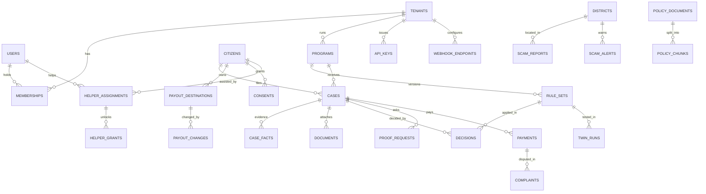

# AMANAT AI — Product Requirements Document

Nov 20, 2026 · @Coalition

*Trust-first public assistance platform · Coder's Cup '26: The Last Mile — AI on Public Rails · Prototype only, not an official service*

*Revision 2 (20 Nov 2026): corrected after a line-by-line check against the challenge brief. The change log is at the end.*

## 1. Executive Summary

**AMANAT AI helps a widow who cannot read get her relief payment safely and in full, even though she cannot fill the form, her records do not match, and scammers and middlemen are after the same money.** It is a multi-user SaaS platform, not a chatbot: citizens, community helpers, officers, admins and auditors work on the same cases, rules and audit trail.

We finish one public task end to end: **apply → verify → decide → pay → confirm she received the full amount**. The programme is fictional (the *Saaya Relief Programme*, modelled on a national cash-transfer scheme). Every government system behind it is a labelled mock.

**One design rule, repeated everywhere: AI reads the input, mock government systems confirm it, versioned rules decide, and people sign off on anything that cannot be undone.**

- **Read.** Urdu voice, document photos and forwarded messages become a fixed, validated form. The language model has no tool that can approve, reject or move money.
- **Confirm.** Every claim is checked against the mock identity registry, civil registry and payment ledger before any model guesses.
- **Decide.** Versioned JSON rules plus an evidence-based confidence pick one of three outcomes: act, ask for one specific proof, or hand the case to a person.
- **Sign off.** Only officers reject. Payout-destination changes, large payouts, mass alerts and risky rule changes always need a person.

**How it says "I am not sure".** Confidence comes from verified evidence and is calibrated on a labelled synthetic set (500 cases: 300 to train, 100 to calibrate, 100 held out for testing), never from a number a model writes about itself. A case is auto-approved only when the expected cost of a wrong approval is below the cost of a human review (about 98% certainty at default costs), and money then waits through a cooling-off hold. Twelve hard stops send the case to an officer with what is known, what conflicts and what would settle it. Any model can make a case more cautious; none can make it less.

**What sets it apart** (each is a live demo beat, not a slide):

1. **"Is this real?"** The shopkeeper forwards a suspicious SMS. We check its claims against the payment ledger, not just its wording, and plot confirmed scams on a Scam Map.
2. **Middleman protection.** Helpers unlock one family at a time with that family's PIN. A shared payout wallet, night-time bulk edits or a last-minute payout change freezes the case.
3. **Cost slider and Break It.** Judges set the price of a wrong approval and watch the thresholds move, then fire 18 scripted attacks at the live system and see what was caught, escalated, falsely flagged or missed.
4. **Digital Twin.** Before publishing a rule change, the admin sees exactly whose outcome would change.
5. **Evidence chain and consent.** Every action is hash-chained. Withdrawn consent turns the officer's next request into a logged 403.

**Build scope** (Fri 20 Nov 18:00 to Sun 22 Nov 18:00 PKT, 3–4 people): all 7 core platform features; 7 optional platform features committed (the brief asks for 3), 6 of them built deep, with 3 more as stretch goals; 10 AI features committed (the brief asks for 3), with the LLM verification agent as a stretch goal over a deterministic plan; Helper Mode, Offline-First Sync and the Digital Twin as committed bonus features, with the Scam Map as a stretch goal (a district table is the fallback); and an answer to each of the 8 technical challenges (Appendix A). We claim to judges only what is committed; a stretch item is mentioned only if it works live at feature freeze. Feature freeze is Sunday 10:00; the last eight hours go to breaking our own system.

**Stack in one line:** Next.js PWA and API on Vercel, Supabase Postgres with pgvector, Inngest for durable jobs, Gemini through Vercel AI Gateway for reading, voice and policy answers, and Jev from TypeSafe AI for typed routing decisions.

## 2. Product Vision

**AMANAT AI is the last-mile trust layer for Pakistan's digital public infrastructure: anyone entitled to a public benefit can claim it by voice, on any phone, and receive every rupee, with each decision explained and each scam caught before it costs her.** It does not replace identity, payment or data-exchange rails such as NADRA and Raast. It makes them usable by people who cannot read and safe for people who are targeted.

*Amanat* (امانت) means something held in trust. The tagline stays: **Every claim verified. Every citizen protected.**

### Product principles

These seven principles settle design arguments during the build. When two features compete, the one that serves more principles wins.

1. **Verify, don't guess.** Evidence from authoritative records outranks anything a model says about its own confidence.
2. **Price both errors.** A wrong approval loses public money; a wrong block hurts a real person. Both carry a cost in the decision rule.
3. **People sign off on the irreversible.** Rejections, payout-destination changes, mass alerts and harmful rule changes always need a human.
4. **Explain twice.** A simple reason for the citizen, in her language and by voice; a full, replayable trace for the auditor.
5. **Her data, her say.** Consent is a server-enforced record, not a screen toggle. Withdrawal stops access on the next request.
6. **Design for the weakest link.** Voice first, offline first, 2G first, one question per screen.
7. **Honest about limits.** Mocks are labelled, false alarms are published and misses are shown.

### Where the product goes

| Horizon | Scope | Proof of success |
| --- | --- | --- |
| Prototype (this weekend) | One fictional programme, Urdu voice, 2 department workspaces, all services mocked | Every judging claim works live on the deployed link |
| Pilot (next 6 months) | One real programme in one district, sandbox integrations with identity and payment partners | Applications completed by voice without help; zero confirmed wrong payouts above threshold |
| Platform (after the pilot) | Many programmes and departments, regional languages, phone-call channel, public scam intelligence | Departments configure new schemes through rules alone, without engineering work |

## 3. Problem Statement Analysis

**The brief is testing whether our AI knows when not to decide.** It scores behaviour, not claims; it says silent guessing earns zero; it asks for numbers behind the risk trade-off; and it counts blocking a real person as a cost. Teams that ship OCR, a scam classifier and an LLM that prints "confidence: 0.92" are the teams this brief is written to beat.

### 3.1 What the brief requires

- **One multi-user SaaS platform** for three people who depend on the same public service: a widow who cannot read and has a weak signal, a shopkeeper who keeps getting fake "relief payment" messages, and a helper who serves 40 families from one shared phone.
- **Not a chatbot:** users, roles, cases, rules and audit trails. It must decide, explain, protect, and say "I am not sure" and hand over to a human.
- **Minimums:** 3 roles, all 7 core platform features, 3 optional platform features, 3 AI features, Postgres with migrations, a deployed link, monitoring, logs and basic tests.
- **Eight technical challenges:** cost of being wrong, saying "I am not sure", bad data, rules that change, explain and audit, consent and take-back, works for everyone, scams and fake documents.
- **Judging (section 08 of the brief):** behaviour over claims; partial credit given separately for each criterion, so a feature that works but is not explained in the README loses its documentation points; roles and consent enforced on the server and tested with raw API calls (curl), where client-only checks earn zero; a live demo that screenshots and videos cannot replace; honest limits score higher than guessing; and anything not clearly labelled as mock or simulated can lose Safety and Privacy points. The organizers may change anything at any time, so expect a surprise rule or a mock outage on Monday.

### 3.2 The real problem: trust breaks in both directions at the last mile

**Citizens cannot check the government, so scammers impersonate it.** The national cash-transfer programme keeps reminding beneficiaries that only messages from 8171 are genuine and that any demand for fees is fraud; it has reported blocking more than 37,000 SIMs and 170 websites linked to fraud in its name ([Business Recorder, Sep 2025](https://www.brecorder.com/news/40384595)). A sender number is a weak defence for someone who cannot read it.

**The government cannot check citizens.** Names are spelled several ways, fields are missing, papers are forged and records are duplicated. A careless match pays the wrong person; a strict one blocks the right one.

**The middleman both helps and takes.** Beneficiaries report agents deducting Rs 1,500 to Rs 2,000 per payment, and the grievance system could not verify deduction claims for a recent cycle ([Dawn, Aug 2026](https://www.dawn.com/news/2021629/price-of-collecting-bisp-stipend)). In Sindh, 94% of beneficiaries had received SIMs for a new digital wallet, but only about 30% had activated them (same source): handing people a digital channel is not the same as making it usable.

**Our edge:** the brief treats the helper as a hero. We design for both the honest helper and the dishonest one, because the last mile is where the money goes missing.

### 3.3 The one-sentence problem

> We help **a widow who cannot read** do **one public task — receive her relief payment safely and in full** — even though **she cannot fill the form, her records do not match, and scammers and middlemen are after the same money.**

The other two people sit inside this task. The shopkeeper's fake messages are about the same payment, so the scam check verifies them against the same ledger. The helper is how 40 families reach the same application, so Helper Mode protects the same case.

### 3.4 Root causes and what the product must do

| Symptom | Root cause | Product response |
| --- | --- | --- |
| Fake relief messages work | No cheap way to check a message's claim against the truth | "Is this real?" checks claims against the payment ledger and programme rules; a personal trust picture; genuine messages never ask for action outside the app |
| Wrong approvals | Messy identity data; model confidence mistaken for evidence | Evidence-based confidence, record matching with a human-review zone, twelve hard stops |
| Real people blocked | Anomalies treated as fraud | Anomalies are warnings, never rejections; only officers reject |
| Deductions at payout | Beneficiary does not know her exact amount; complaining is hard; the agent controls the process | Exact-amount voice receipt, one-tap complaint, protected payout changes, helper anomaly freezes |
| Non-readers excluded | Text-heavy forms on data-hungry pages | Voice first, icons, one question per screen, offline queue |
| Policy drift breaks systems | Rules hard-coded in software | Versioned rules in the database, Digital Twin before publishing |
| Nobody can explain a decision | No record of inputs, versions and actors | Decision records with full versions, hash-chained audit log, two-view explanations |
| Data used without permission | Consent is a screen, not an enforced record | Consent checked by the server on every read; withdrawal returns 403 and is logged |

### 3.5 Implicit requirements the brief does not spell out

1. **Idempotency everywhere.** Weak networks retry, so every write carries a client-generated key.
2. **Deterministic, replayable decisions.** The same case snapshot and versions must give the same result, for auditors and for the Twin.
3. **Three-valued logic.** Missing data is "unknown", never silently false (rejection) or true (approval).
4. **Classification is not authorization.** No model output can approve, reject or move money on its own.
5. **Documents are untrusted input.** Text inside an image can be an attack.
6. **Calibrated probabilities.** A 0.9 must be right about 90% of the time on held-out data, or it is not used as a threshold.
7. **Shared-device safety.** One phone, 40 families: per-family unlock, auto-lock and no family's trust picture on the helper's screen. The citizen app itself opens only with her PIN, because her own phone is often shared too.
8. **Graceful degradation.** Every external call has a timeout, a retry policy and a safe fallback, which is usually a human.
9. **Abuse controls.** OTP, scam-check and public API endpoints are rate-limited.
10. **Change on demand.** Rules, thresholds, costs and mock failures are editable from the admin panel, because judges will change things live.
11. **Synthetic data only.** Mock CNICs use a locality prefix not issued to real people, and every mock document carries a SPECIMEN watermark.

## 4. Product Objectives

**The prototype succeeds when every objective below can be shown live or reproduced from the evaluation set on Monday; the pilot objectives say what the product must prove next.** Targets are set before the data exists, so each is checked on the 100-case held-out test set and adjusted only with a written reason.

| # | Objective | Metric | Target | How it is measured |
| --- | --- | --- | --- | --- |
| O1 | A non-reader finishes the task | Application completed with voice and icons only, on a throttled 2G profile | Under 6 minutes, no typing | Timed run with all screen text hidden |
| O2 | No silent guessing | Cases ending in act, ask-for-proof or human review, with a stored reason | 100% | Database check on every decision row |
| O3 | Wrong approvals stay rare | Bad cases auto-approved on the test set at the chosen threshold | 0, with the 95% upper bound reported | Evaluation run, published on the dashboard |
| O4 | Officers are not flooded | Legitimate cases auto-approved | At least 50% of clean legitimate cases | Same evaluation run |
| O5 | Scam check is trustworthy | Precision and recall of the "Fake" verdict | Precision 0.95 or higher, recall 0.90 or higher, "not sure" 15% or less | 300 labelled messages |
| O6 | No wrong identity merges | False auto-matches | 0; recall 0.90 or higher; review zone 10% or less | 500-record name-variant set |
| O7 | Rules change without code | Time from publish to first decision under the new version | Under 5 seconds, no redeploy | Timestamp diff in the audit log |
| O8 | Consent withdrawal is real | Reads allowed after withdrawal, across all data endpoints and pipeline steps | 0 | Automated test that calls every endpoint and withdraws during a pipeline run |
| O9 | Weak signal never duplicates | Duplicate cases after forced connection drops | 0 in 50 replays | Playwright offline-replay test |
| O10 | Tampering is visible | Single-row audit edits detected by the chain check | 100% | Break It and a manual SQL edit |
| O11 | Permissions hold on the server | Role-by-endpoint access tests passing, including cross-tenant | 100% | API test suite run in CI |
| O12 | Outages degrade safely | Cases approved while a verification service is down | 0 | Chaos toggle during Break It |

**Pilot objectives (after the hackathon):** at least 95% of payments confirmed by the beneficiary as received in full; complaints about agent deductions in the pilot district halved against a measured baseline; median time from a first scam report to a district alert under 2 hours; no more than 40% of cases needing human review, with a median review time under 4 minutes.

## 5. Target Audience and User Personas

**Three citizens set the requirements, three staff roles make the system accountable, and two adversaries set the security bar.** All personas are fictional; their names are reused as seed data in the demo.

### 5.1 Primary personas

| Persona | Context | Goal | What blocks her or him today | What the product must do |
| --- | --- | --- | --- | --- |
| **Zarina Bibi**, 54, widow, Badin district (Sindh) | Cannot read; speaks Urdu and Sindhi; shared low-end Android phone; weak 2G that drops; four children | Receive her quarterly support, in full, without paying anyone | Forms she cannot read; her name spelled three ways across records; a middleman who keeps a cut; calls from people claiming to be the programme | Voice-first steps with read-back; photos instead of typing; saved progress; exact-amount voice receipt; a trust picture and a one-tap "Is this real?" |
| **Akram**, 38, shopkeeper, Hyderabad | Reads Urdu, some English; WhatsApp all day; customers ask him whether messages are real | Know in seconds whether a "relief payment" message is fake, and warn others | No way to check a claim except asking around; fake messages copy official wording | Forward any SMS, screenshot or voice note; get a verdict with reasons; his reports feed the Scam Map |
| **Shabana**, 31, community helper, Badin | Serves 40 families from one shared phone; trusted locally; under pressure from agents and time | Get families registered and paid quickly, without mixing up their data | Switching between families on one phone; no proof that she acted honestly | Fast per-family unlock with that family's PIN; a banner showing whose case is open; a log that protects her if she is accused |

### 5.2 Staff personas

| Persona | Context | Goal | What the product must do |
| --- | --- | --- | --- |
| **Imran**, 45, department officer | Reviews 60 to 80 cases a day; accountable for every approval | Decide hard cases quickly and defensibly | Queue sorted by priority and confidence; a summary of known facts, conflicts and the one thing that would settle the case; one-click actions with reasons |
| **Sana**, 35, programme admin | Owns eligibility rules, thresholds and service settings | Change a rule safely the same day a policy notice arrives | Rule editor without code; Digital Twin showing who would be affected; second-approver rule for harmful changes; cost slider |
| **Raza**, 50, auditor | Ombudsman-style reviewer; read-only | Reconstruct exactly why any decision happened and who touched the data | Full decision trace with versions and hashes; replay; chain verification; consent and access logs |

### 5.3 Anti-personas (who we defend against)

- **The scammer** sends bulk "your Rs 25,000 relief is approved, pay Rs 500 fee" messages, spoofs official-sounding sender names and calls pretending to be an officer. Defence: claim verification against the ledger, a rule that genuine messages never ask for money, codes or action outside the app, and district alerts.
- **The dishonest middleman** collects CNICs, redirects payouts to wallets he controls, edits many cases at night and takes a cut at cash-out. Defence: per-family consent, payout-change protection, anomaly freezes, the exact-amount receipt and one-tap complaints counted against him.

### 5.4 Design implications

- The citizen interface assumes **no reading at all**; text is a secondary label for helpers and officers.
- The helper interface assumes **the helper may be honest or not**; it protects honest helpers with a clean record and blocks dishonest ones with limits.
- Staff interfaces assume **time pressure**; every screen leads with the decision to make and the one fact that would change it.

## 6. Stakeholder Analysis

**The people with the most at stake have the least power, so the product's defaults protect them; the people with the most power need proof, so the product records everything.**

&#91;embedded content: stakeholder map · power against interest · 10 groups\]

Admins, officers and helpers are managed closely because they can change outcomes; citizens are kept informed in their own language because they cannot.

| Stakeholder | What they need from AMANAT | What we show or give them |
| --- | --- | --- |
| Citizens (widows, shopkeepers) | Their full payment, no fees, no scams, control over their data | Voice journey, exact-amount receipt, "Is this real?", Consent Control Center |
| Community helpers and agents | Speed with 40 families; protection from false accusations | Per-family unlock, clear banner, a signed log of their own actions |
| Department officers | Fewer, better-prepared cases; defensible decisions | Confidence-sorted queue, case summaries, reason codes |
| Programme admins | Same-day policy changes without breaking cases | Rule editor, Digital Twin, second-approver rule |
| Auditors and ombudsman | A complete, tamper-evident record | Decision traces, replay, hash-chain verification |
| Identity authority (NADRA-like) | Minimal, lawful, logged use of its data | Adapter calls only with consent; every lookup in the audit log |
| Banks and wallet providers | Correct destinations; fewer disputes | Payout-change protection, confirmation of full receipt |
| Telecom regulator and operators | Fewer fraud messages on their networks | Scam reports aggregated by sender pattern and district (future data feed) |
| Civil society and media | Evidence that the system is fair | Published false-alarm rates and aggregate outcomes, never personal data |
| Hackathon judges | A system that behaves well under pressure | Live demo, Break It, honest limits |

**Who can block the project:** the identity authority and payment partners (data and money access), the telecom regulator (short codes and caller ID), and programme leadership (policy ownership). The pilot plan in section 28.5 makes each of them a partner before launch.

## 7. Proposed Solution

**AMANAT AI turns the widow's application into evidence, checks that evidence against authoritative records, and lets versioned rules and a cost-based threshold choose one of three outcomes: act, ask for one proof, or hand over to a person.** Nothing a model writes can approve, reject or move money.

&#91;embedded content: case decision flow · 3 checks, 3 outcomes, 1 loop\]

Hard stops are checked before the cost threshold, so a confident score can never override a conflict, an outage or an ambiguous identity.

### 7.1 The task, end to end

1. **Apply.** Zarina answers one question per screen by voice or icon and photographs her CNIC and her husband's death certificate. Everything is saved on the phone first (one tick).
2. **Sync.** When the signal returns, the outbox sends each item with an idempotency key; the server confirms receipt (two ticks). A dropped upload is retried, never duplicated.
3. **Read.** Speech becomes text and is read back to her. Gemini extracts document fields into a fixed schema. The signed QR on each mock document is decoded and its signature checked.
4. **Confirm.** The mock identity registry, civil registry and payment ledger are queried. Names are matched with an Urdu-aware matcher that has a human-review zone. Duplicate people, cases and images are searched.
5. **Decide.** Rules evaluate the facts with three-valued logic and cite their policy clauses. The evidence scorer gives a calibrated probability that the case is legitimate. The decision policy applies 12 hard stops, then the cost threshold.
6. **Sign off.** Uncertain cases reach an officer with a summary. Approved cases wait through a cooling-off hold during which an officer or a new risk flag can stop the payment.
7. **Pay and confirm.** The mock ledger records the payment; a voice note tells Zarina the exact amount; she taps to confirm she received all of it or to complain.

### 7.2 The three outcomes

| Outcome | When it happens | What Zarina hears (in Urdu) | What happens next |
| --- | --- | --- | --- |
| **Act: approve with hold** | No hard stop, nothing missing, risk below the cost threshold | "Your application is approved. You will receive Rs 12,000 in 2 days. Nobody will ask you for money." | Cooling-off hold, then mock payment and receipt check |
| **Ask for one proof** | A curable gap: unreadable date, missing certificate, blurry photo | "The date on your certificate was not clear. Please take one more photo in good light." | Up to 2 attempts, then an officer |
| **Hand to a person** | Any hard stop, risk above the threshold, or a proposed rejection | "A person will check your case. Nobody will ask you for money." | Officer queue with the case summary |

### 7.3 How the other two people fit

- **The shopkeeper** uses the same platform to check a message. The scam check compares the message's claims with the same payment ledger and programme rules that run Zarina's case, so "you have Rs 25,000 waiting, pay a fee" is answered with facts, not a guess.
- **The helper** opens Zarina's case on the shared phone only after Zarina enters her PIN. Everything the helper does is logged under the helper's name, Zarina's case and that unlock.

### 7.4 Why not let a language model decide?

- A probability printed in model output is more generated text; it is not calibrated against outcomes.
- A forged document that says "approve this claim" must not be able to approve itself. Our models have no approval tool, and every extracted value must match an authoritative record.
- Decisions must replay exactly for auditors and the Digital Twin. Pure code with versioned inputs does; sampled model output does not.
- Models still do what they are good at: reading voice and images, filling a schema, classifying messages, retrieving policy and writing summaries for officers.

## 8. Core Value Proposition

**For relief programmes that must reach people who cannot read, AMANAT AI is the trust layer that verifies every claim and protects every citizen.** Unlike a chatbot or an OCR pipeline, it decides only when the evidence and the cost of being wrong allow it, and hands everything else to a person with the case already explained.

### 8.1 One promise per user, and where it is proven

| User | Promise | Where the product proves it |
| --- | --- | --- |
| Widow (Zarina) | Apply by voice, receive every rupee, never pay a fee | Voice journey with read-back; exact-amount receipt; one-tap complaint |
| Shopkeeper (Akram) | Know within seconds whether a message is fake, and protect the district | "Is this real?" verdict with reasons; Scam Map and district alerts |
| Helper (Shabana) | Serve 40 families quickly, with a record that shows she acted honestly | Per-family unlock, banner, a log of her own actions |
| Officer (Imran) | See only the cases that need a person, with the facts lined up | Confidence-sorted queue; case summary with conflicts and next step |
| Admin (Sana) | Change policy today, knowing exactly who it affects | Rule editor, Digital Twin, second-approver rule |
| Auditor (Raza) | Rebuild any decision and see whether anyone touched the record | Decision trace, replay, hash-chain verification |
| Department (the buyer) | Less leakage and less officer time, with a defensible trail | Wrong-approval and escalation rates on the evaluation dashboard |

### 8.2 Value to the judges, note by note

The rows follow the judging notes in section 08 of the brief.

| Judging note in the brief | What they will see |
| --- | --- |
| Behavior over claims | Every claim in this PRD maps to a live demo beat or a button (Appendix A); stretch items are not claimed unless they work live |
| Partial credit for each criterion | The README has one section per feature (what it does, how to try it live, what is simulated), so no working feature loses documentation points |
| Server-side checks, tested with curl | Ready-made curl commands and a demo token per role (API-6): 403 for a helper without an unlock, 404 across tenants, 403 `CONSENT_WITHDRAWN` after withdrawal |
| Live demo required | A 10-minute story on the deployed link, then Break It in the judges' hands |
| Honest limits earn trust | Twelve hard stops, no automatic rejection, published false alarms, visible misses and stated limits (section 29.3) |
| Mock labels (Safety and Privacy) | SIMULATED badges on every mock, a prototype banner on every screen, the real-versus-simulated table (section 33.4), and no message ever sent to a real number or inbox |

## 9. Feature Selection and Prioritization

**Everything the brief marks as required is P0 and is not up for debate; every optional idea was scored on seven criteria, and the order of cuts is fixed now so a late cut never removes a judging claim.** P0 must work in the live demo. P1 is planned for the build and cut only in the order given in section 33. P2 is a stretch goal. Future is roadmap only.

### 9.1 Mandatory (P0, not scored)

- **All 5 roles:** citizen, community helper, department officer, admin, auditor (the brief asks for 3). Officers review both claims and complaints, as the brief's role table says.
- **All 7 core platform features:** secure login with role-based access; dashboard with progress, status and history; case management (create, assign, escalate, close); public REST API with API keys and OpenAPI docs; audit log of every user, AI and agent action; consent management (see, share, withdraw, correct); mock identity, payment and data services behind clean APIs.
- **All 8 constraints and technical challenges** (mapped in Appendix A).
- **Engineering basics:** Postgres with migrations, a deployed link, monitoring, logs and tests.

### 9.2 Scoring of optional features

Scores run 1 (poor) to 5 (strong). Complexity is inverted, so 5 means simple. R = relevance to the one task, V = user value, F = feasibility in 48 hours, A = accuracy and reliability, C = simplicity, D = differentiation, L = long-term potential.

| Feature | Type | R | V | F | A | C | D | L | Total /35 | Class | Priority |
| --- | --- | --- | --- | --- | --- | --- | --- | --- | --- | --- | --- |
| Exact-amount voice receipt and one-tap complaint | Differentiator | 5 | 5 | 5 | 4 | 5 | 5 | 5 | 34 | Must | P0 |
| Payout-change protection (officer approval, cooling-off, call to old number) | Differentiator | 5 | 5 | 4 | 5 | 4 | 5 | 5 | 33 | Must | P0 |
| Officer review queue with priority and confidence sorting | Platform | 5 | 5 | 5 | 5 | 4 | 3 | 5 | 32 | Must | P0 |
| Structured outputs and validation | AI | 5 | 5 | 5 | 5 | 5 | 2 | 5 | 32 | Must | P0 |
| Guardrails and human approval | AI | 5 | 5 | 4 | 5 | 4 | 4 | 5 | 32 | Must | P0 |
| Explainability (citizen and auditor views) | AI | 5 | 5 | 4 | 5 | 4 | 4 | 5 | 32 | Must | P0 |
| Anomaly and duplicate detection | AI | 5 | 5 | 4 | 4 | 4 | 5 | 5 | 32 | Must | P0 |
| "Is this real?" claim verification | Differentiator | 5 | 5 | 4 | 4 | 4 | 5 | 5 | 32 | Must | P0 |
| Hash-chained evidence chain | Differentiator | 5 | 4 | 5 | 5 | 4 | 4 | 5 | 32 | Must | P0 |
| Classification and routing with Jev | AI | 5 | 5 | 4 | 4 | 4 | 4 | 5 | 31 | Must | P0 |
| Evaluation dashboard with cost curve | AI | 5 | 4 | 4 | 5 | 3 | 5 | 5 | 31 | Must | P0 |
| Helper Mode | Bonus | 5 | 5 | 4 | 4 | 3 | 5 | 5 | 31 | Must | P0 |
| Digital Twin | Bonus | 5 | 4 | 4 | 5 | 3 | 5 | 5 | 31 | Must | P0 |
| Cost slider | Differentiator | 5 | 4 | 4 | 5 | 4 | 5 | 4 | 31 | Must | P0 |
| Admin rule editor | Platform | 5 | 5 | 4 | 4 | 3 | 4 | 5 | 30 | Must | P0 |
| Rate limiting and error handling | Platform | 4 | 4 | 5 | 5 | 5 | 2 | 5 | 30 | Must | P0 |
| Computer vision: OCR, signed QR, blur, image reuse | AI | 5 | 5 | 4 | 4 | 3 | 4 | 5 | 30 | Must | P0 |
| Break It attack suite | Differentiator | 5 | 4 | 4 | 5 | 3 | 5 | 4 | 30 | Must | P0 |
| Low-bandwidth and offline-first sync | Platform and bonus | 5 | 5 | 3 | 4 | 2 | 5 | 5 | 29 | Must | P0 |
| Notifications: in-app, mock SMS, voice note | Platform | 5 | 5 | 4 | 4 | 3 | 3 | 5 | 29 | Must | P0 (no WhatsApp or email: they would reach real numbers and inboxes) |
| Memory and context (saved progress, resumable pipeline) | AI | 4 | 4 | 5 | 5 | 5 | 2 | 4 | 29 | Must | P0 |
| Background jobs and queues | Platform | 4 | 4 | 4 | 5 | 4 | 2 | 5 | 28 | Must | P0 |
| Voice: Urdu speech-to-text and text-to-speech | AI | 5 | 5 | 3 | 3 | 3 | 4 | 5 | 28 | Must | P0 |
| Scam Map with district alerts | Bonus | 4 | 4 | 4 | 4 | 4 | 4 | 4 | 28 | Should | P1 |
| RAG over policy with clause citations | AI | 4 | 4 | 4 | 4 | 3 | 3 | 5 | 27 | Must | P0 |
| Personal trust picture | Differentiator | 4 | 3 | 5 | 3 | 5 | 4 | 3 | 27 | Must (cheap) | P0 |
| Multi-tenant workspaces | Platform | 3 | 4 | 4 | 4 | 3 | 3 | 5 | 26 | Should | P1 |
| Analytics dashboard per tenant | Platform | 3 | 4 | 4 | 4 | 4 | 3 | 4 | 26 | Should | P1 |
| Phone-call (IVR) channel | Differentiator | 4 | 5 | 2 | 3 | 2 | 4 | 5 | 25 | Advanced | P2, simulated in browser |
| Bounded verification agent with tool calling | AI | 4 | 3 | 4 | 3 | 3 | 3 | 4 | 24 | Should | P1 (deterministic plan is P0) |
| Webhooks for outside systems | Platform | 3 | 3 | 4 | 4 | 4 | 2 | 4 | 24 | Should | P1 |
| Policy-to-rule drafting by LLM | Differentiator | 3 | 3 | 3 | 3 | 3 | 4 | 4 | 23 | Advanced | P2 |
| Officer copilot questions over case evidence | AI | 3 | 3 | 4 | 3 | 4 | 2 | 4 | 23 | Advanced | P2 |
| Subscription plans and usage limits | Platform | 2 | 2 | 4 | 4 | 4 | 2 | 4 | 22 | Advanced | P2, light |
| Regional languages (Sindhi, Punjabi, Pashto) | AI | 4 | 5 | 1 | 2 | 2 | 3 | 5 | 22 | Future | Roadmap |

### 9.3 Depth of the optional platform features

The brief asks for 3 and rewards depth over count, so we commit to seven and treat three as stretch goals.

- **Committed, deep (6):** officer review queue, admin rule editor, low-bandwidth and offline mode, notifications (in-app, mock SMS, voice notes), background jobs and queues, rate limiting and error handling.
- **Committed, medium (1):** multi-tenant workspaces (2 seeded departments, isolation proven by API tests).
- **Stretch (3):** analytics per tenant (fallback: the evaluation dashboard filtered by tenant), webhooks (fallback: `case.decided` only), subscription plans and usage limits (fallback: per-key rate-limit tiers).

**Rule for the pitch and the README:** claim only committed items. A stretch item is mentioned only if it passes its demo check at feature freeze on Sunday 10:00.

### 9.4 What we deliberately do not build

- **Automatic rejection.** The AI may propose a rejection with reasons; only an officer can reject.
- **A chatbot as the main interface.** The brief rules it out; the policy assistant is one screen inside a workflow.
- **Real government or bank integrations.** Prohibited for the prototype; every adapter is a labelled mock with the same interface a real one would use.
- **Face or fingerprint matching.** High privacy risk and no safe way to test it with synthetic people.
- **Blockchain.** A hash-chained table plus an exported head hash gives tamper evidence without the operational cost.
- **Fine-tuned models.** No real data, no time; calibration on a labelled synthetic set is the honest substitute.
- **A native mobile app.** An installable PWA covers offline use, voice and camera on low-end Android phones.

## 10. Complete Functional Requirements

**These 142 requirements are the testable contract: each has an ID that tests, pull requests and the compliance matrix refer to.** "Must" is implied in every line. Priorities follow section 9.

### 10.1 Access, roles and tenancy

| ID | Requirement | Priority |
| --- | --- | --- |
| AUTH-1 | Staff sign in with email and password, using fictional addresses on the reserved `.test` domain; admins and auditors also use TOTP MFA | P0 (MFA P1) |
| AUTH-2 | Citizens register with a phone number and a one-time code delivered to the mock SMS inbox, which reads the code aloud digit by digit; she taps it on the large keypad and hears each digit back. The device stays registered for 30 days, but the app locks after 5 minutes in the background and reopens only with her PIN, so nothing personal shows on a shared phone before the PIN | P0 |
| AUTH-3 | Citizens set a 4-digit PIN that opens the app and confirms consent changes, helper unlocks and payout changes; 5 wrong tries lock it for 15 minutes | P0 |
| AUTH-4 | Every API request is authenticated and authorized on the server; hiding a button is never the only control | P0 |
| AUTH-5 | Five roles: citizen, helper, officer, admin, auditor; a staff user may hold roles in several tenants | P0 |
| AUTH-6 | Access tokens live 15 minutes; an admin can revoke a user's sessions | P1 |
| AUTH-7 | OTP requests limited to 3 per phone per 10 minutes and 10 per IP per hour | P0 |
| TEN-1 | Every tenant-scoped row carries `tenant_id`, and every query is scoped by the actor's tenant | P0 |
| TEN-2 | A staff member of tenant A gets 404 for any resource of tenant B | P0 |
| TEN-3 | Citizens are global identities; consent is granted per tenant | P1 |
| TEN-4 | The console's tenant switcher lists only tenants where the user holds a membership | P1 |

### 10.2 Citizen experience, voice and offline

| ID | Requirement | Priority |
| --- | --- | --- |
| CIT-1 | First-run setup by voice: language, trust picture (1 of 30), PIN, consent | P0 |
| CIT-2 | One question per screen; each screen plays its Urdu prompt once and has a replay button | P0 |
| CIT-3 | Every answer can be given by voice, icon or large keypad; no free typing is ever required | P0 |
| CIT-4 | Spoken names and numbers are read back for a yes or no confirmation | P0 |
| CIT-5 | The camera screen runs an on-device blur check and asks for a retake before upload | P0 |
| CIT-6 | Photos are compressed on the device to at most 1280 px on the long side and about 200 KB | P0 |
| CIT-7 | The status screen shows each check as an icon, plays a voice explanation and says what would change the result | P0 |
| CIT-8 | The trust picture is in the header of every signed-in screen and named at the start of every voice message | P0 |
| CIT-9 | "Is this real?" accepts pasted text, a screenshot or a voice note | P0 |
| CIT-10 | After payment, a voice receipt states the exact amount, with "received all" and "received less" buttons | P0 |
| CIT-11 | One tap files a complaint linked to the payment and to any helper on the case | P0 |
| CIT-12 | Spoken policy questions are answered with clause citations, or with "I am not sure; a person will call you" | P0 |
| VOICE-1 | Urdu speech-to-text for answers, with a 15-second clip limit; in the demo tenant the audio is deleted right after transcription and only the transcript is kept | P0 |
| VOICE-2 | Pre-generated prompt library; dynamic phrases synthesized at runtime and cached by text hash | P0 |
| VOICE-3 | Amounts and numbers can be composed from cached digit clips when text-to-speech is down | P1 |
| VOICE-4 | "Haan" and "nahin" are recognised for yes and no, with icons as fallback | P0 |
| VOICE-5 | A failed or empty transcript leads to a retry prompt, then icon input; never a silent guess | P0 |
| OFF-1 | The shell, prompts and icons are precached; the app opens and records answers with no network | P0 |
| OFF-2 | Every answer and photo is written to an IndexedDB outbox with a client UUID before any upload | P0 |
| OFF-3 | Sync retries with exponential backoff and jitter on reconnect, on app open and every 30 seconds while online | P0 |
| OFF-4 | The server treats repeats with the same key as one submission and returns the original result | P0 |
| OFF-5 | Ticks: one grey (saved on phone), two grey (reached office), two blue (an officer opened it) | P0 |
| OFF-6 | Citizen API responses stay under 10 KB; no web fonts when a system Urdu font exists; images lazy-load | P0 |
| OFF-7 | Low-bandwidth mode switches on automatically on 2G or when the user saves data: no previews, polling instead of websockets | P1 |
| OFF-8 | Texting "STATUS" to the mock short code returns the case state | P2 |

### 10.3 Documents and identity

| ID | Requirement | Priority |
| --- | --- | --- |
| DOC-1 | Accept CNIC front and back and a death certificate as JPEG, PNG or WebP, up to 5 MB before compression | P0 |
| DOC-2 | Decode the QR, verify its Ed25519 signature against the mock issuer key, and compare QR fields with the visible text and the registry | P0 |
| DOC-3 | Extract name, father or husband name, CNIC, date of birth, issue and expiry, certificate number and date of death into a Zod schema | P0 |
| DOC-4 | A sharpness score below the threshold triggers a "retake photo" proof request | P0 |
| DOC-5 | A 64-bit difference hash within 5 bits of an image on another citizen's case raises an anomaly | P0 |
| DOC-6 | Instruction-like text in a document ("approve", "ignore previous") flags the case for an officer | P0 |
| DOC-7 | Editing-software metadata and error-level analysis are shown as weak signals only | P2 |
| ID-1 | Names are normalised: Urdu and Roman script, honorifics (Mst., Bibi, Begum, Syed), Muhammad variants, spacing and punctuation | P0 |
| ID-2 | Candidates are scored with Fellegi–Sunter weights on name, father or husband name, date of birth, CNIC, district and gender | P0 |
| ID-3 | Two thresholds: above the upper is a match, below the lower is a non-match, between is the human-review zone | P0 |
| ID-4 | When the top two candidates are within 2 bits of each other, the ambiguity stop fires | P0 |
| ID-5 | Records are never merged automatically; a link is a proposal until an exact CNIC plus a valid signed QR, or an officer, confirms it | P0 |
| ID-6 | A CNIC gender-digit mismatch is a warning for review, never a rejection | P0 |

### 10.4 Rules, decisions and cases

| ID | Requirement | Priority |
| --- | --- | --- |
| RULE-1 | Rules are JSON documents validated by JSON Schema and stored as immutable versions | P0 |
| RULE-2 | Each rule cites a policy clause and carries Urdu and English explanation text and an icon | P0 |
| RULE-3 | Evaluation is three-valued; an unknown fact never counts as pass or fail | P0 |
| RULE-4 | A published version is used by the next decision, with no redeploy | P0 |
| RULE-5 | Every decision stores the rule set and version it used | P0 |
| RULE-6 | Publishing re-decides all open cases in a background job; an in-flight case that would get a worse outcome goes to an officer | P0 |
| RULE-7 | A version that would harm in-flight cases needs a second admin's approval to publish | P0 |
| RULE-8 | The editor builds conditions from dropdowns (fact, operator, value) and previews them against a sample case | P0 |
| RULE-9 | An LLM drafts a rule change from an uploaded policy notice, for human review only | P2 |
| DEC-1 | `decide(snapshot, versions)` is a pure function returning outcome, stops, probability, threshold and trace | P0 |
| DEC-2 | The evidence scorer returns a calibrated probability that the case is legitimate, from verified evidence features only | P0 |
| DEC-3 | The auto-approval threshold is computed from configured costs | P0 |
| DEC-4 | The 12 hard stops are evaluated before the threshold | P0 |
| DEC-5 | Nothing is rejected automatically; an ineligible result becomes a proposed rejection for an officer | P0 |
| DEC-6 | Any model output may escalate a case; none may de-escalate it | P0 |
| DEC-7 | Auto-approval starts a cooling-off hold (2 minutes in the demo, 48 hours in the product) that a new flag or an officer can stop | P0 |
| DEC-8 | Decision rows are immutable; a re-decision is a new row linked to the previous one | P0 |
| DEC-9 | Replaying a stored decision reproduces it exactly; CI checks this on golden cases | P0 |
| CASE-1 | Cases can be created (citizen, helper, API), assigned (by district and load, or by hand), escalated and closed with a reason | P0 |
| CASE-2 | A case timeline is built from audit events: simplified for the citizen, full for staff | P0 |
| CASE-3 | A proof request names one item, has a voice prompt and allows 2 attempts | P0 |
| CASE-4 | Officers can freeze and unfreeze a case with a reason | P0 |
| CASE-5 | States: draft, submitted, processing, needs proof, in review, approved on hold, approved, rejected, paid, confirmed, disputed, paused for consent, frozen, closed | P0 |
| CASE-6 | Officers assign or reassign a case within their tenant, escalate it to a senior officer (a flag on the officer's membership) with a note, and close it with a reason code (paid and confirmed, withdrawn, duplicate, ineligible confirmed); each action has its own endpoint and audit event | P0 |
| OQ-1 | The queue sorts by priority (stop severity, waiting time, vulnerability), then by lowest confidence | P0 |
| OQ-2 | Filters: route reason, district, stop type, age, assigned to me | P0 |
| OQ-3 | The case view shows the summary, evidence with sources, conflicts, stops, rule trace with clauses, documents, match candidates and anomaly flags | P0 |
| OQ-4 | Actions: approve, reject (reason code and note required), request proof, assign, escalate to a senior officer, freeze, close with a reason code | P0 |
| OQ-5 | Opening a case turns the citizen's ticks blue and writes an access event | P0 |
| OQ-6 | Proposed rejections can be confirmed in bulk only after each trace has been opened | P1 |
| EXP-1 | The citizen explanation lists each check as pass, fail or unclear, in icons and Urdu voice, with one "what would change this" line | P0 |
| EXP-2 | The officer explanation shows the largest evidence contributions with their signs, the stops and the rule trace | P0 |
| EXP-3 | The auditor trace shows the input hash, all versions, thresholds, confidence, outcome, actor, timestamps and a replay button | P0 |
| EXP-4 | Explanations come from structured traces through templates; an LLM may only rephrase within a template, and the result is validated | P0 |
| EXP-5 | AI decisions outside the case decision (scam verdicts, intent routing, complaint triage, policy answers) are stored as `ai_decisions` rows with input hash, model and prompt versions, probabilities, result and a simple reason for the user; auditors search them alongside case decisions | P0 |

### 10.5 Consent, audit, helpers and money

| ID | Requirement | Priority |
| --- | --- | --- |
| CONS-1 | The citizen sees who holds or processes her data (tenants, helpers, AI providers and mock registries, named in plain words), for what purpose and until when | P0 |
| CONS-2 | The citizen can hear her access log, for example "Officer Imran, Badin office, opened your documents yesterday" | P0 |
| CONS-3 | Consent can be granted, narrowed by data category and withdrawn by voice plus PIN | P0 |
| CONS-4 | Before a withdrawal, a voice warning explains that her case will pause | P0 |
| CONS-5 | After withdrawal, every staff read of her personal data returns 403 `CONSENT_WITHDRAWN` and the denial is logged | P0 |
| CONS-6 | Helper consent covers one family, a scope and an expiry: 2 hours per unlock, 90 days per assignment | P0 |
| CONS-7 | Correction requests for any field go to the officer's complaint and correction queue (CMP-3); the old value stays in history | P0 |
| CONS-8 | A citizen can export her own data as JSON | P2 |
| CONS-9 | Consent is re-checked before every pipeline step that reads or sends her personal data, for system and agent actors as well as staff; a withdrawal during a run stops it at the next step | P0 |
| AUD-1 | Every user, AI, agent and API-key action is an audit event, including denied attempts and data reads | P0 |
| AUD-2 | The hash chain is computed in the database; a verify endpoint returns the first broken row | P0 |
| AUD-3 | The head hash is exported every hour to an anchor record | P1 |
| AUD-4 | Auditors search by case, citizen, actor, action and time | P0 |
| HELP-1 | Helpers see their assigned families (40 at most) as avatar cards, never trust pictures | P0 |
| HELP-2 | A family is unlocked with its own PIN (or a code sent to its phone); the unlock ends after 30 idle minutes or 2 hours | P0 |
| HELP-3 | While unlocked, a banner shows the family's name and avatar on every screen; switching families locks the screen | P0 |
| HELP-4 | Helpers can answer, add photos and submit; they cannot change payout or consent or see a full CNIC | P0 |
| HELP-5 | Anomaly rules freeze cases and alert an officer: one wallet on 2 or more families; over 10 edits in 10 minutes between 00:00 and 05:00; a payout change within 7 days of a payment; a reused image | P0 |
| HELP-6 | Complaints against a helper are counted and shown to officers | P1 |
| PAY-1 | A payment instruction goes to the mock ledger when the hold expires with no new flags | P0 |
| PAY-2 | A payout-destination change needs the citizen's PIN, an officer's approval, a cooling-off period (2 minutes in demo, 72 hours in product) and a notice to the old number with a press-9 objection | P0 |
| PAY-3 | An objection freezes the change and opens a complaint | P0 |
| PAY-4 | Payments above the auto cap (Rs 50,000) always need an officer | P0 |
| PAY-5 | "Received less" records the missing amount against the payment and any helper | P0 |
| CMP-1 | Officers have a complaint queue sorted by severity, then age, with filters by type, district and helper | P0 |
| CMP-2 | The complaint view shows the linked payment, ledger entry, case timeline and the helper's actions under that unlock; the officer resolves it as upheld, not upheld or referred, with a reason code and note, and the citizen hears the outcome by voice | P0 |
| CMP-3 | Correction requests are reviewed in the same queue; an approved correction is stored as a new fact with `source = officer`, the old value is kept, and the case is re-decided | P0 |

### 10.6 Scams and notifications

| ID | Requirement | Priority |
| --- | --- | --- |
| SCAM-1 | Extract the message's claims: sender, programme, amount, requested action, links, phone numbers, urgency | P0 |
| SCAM-2 | Check the claims against the official sender list and programme rules (no fees, no codes); check the user's own ledger only when the signed-in user confirms the message was sent to her or him and consents. A message checked on someone else's behalf never gets a ledger check | P0 |
| SCAM-3 | Classify with Jev using neutral option keys; store the probabilities | P0 |
| SCAM-4 | Return fake, genuine or not sure, with reasons and one action; "not sure" goes to the scam desk | P0 |
| SCAM-5 | Aggregate confirmed scams by district, type and day; never show personal data on the map | P1 |
| SCAM-6 | A spike drafts a district alert that an officer approves before broadcast | P1 |
| NOT-1 | Templates in Urdu and English with variables; citizen messages never contain links | P0 |
| NOT-2 | Channels: in-app, mock SMS and voice note. WhatsApp and email are not used in the prototype because they would send to real phone numbers and inboxes; they move to the pilot | P0 |
| NOT-3 | Delivery runs through the outbox and jobs with retries and tracked status | P0 |
| NOT-4 | Citizen messages never ask for money, PINs or codes, and voice messages open by naming her trust picture | P0 |

### 10.7 Platform, API and operations

| ID | Requirement | Priority |
| --- | --- | --- |
| API-1 | REST endpoints under `/api/v1`, documented in OpenAPI 3.1 at `/api/docs` | P0 |
| API-2 | Per-tenant API keys with scopes, hashed storage, rotation and revocation | P0 |
| API-3 | `Idempotency-Key` required on every POST that creates a record or moves money (cases, submissions, uploads, payments, payout changes, complaints) and accepted on all other writes; a missing key returns 400 `IDEMPOTENCY_KEY_REQUIRED` with the fix in the message | P0 |
| API-4 | Errors in RFC 9457 format with stable codes | P0 |
| API-5 | Webhooks for `case.decided`, `case.escalated`, `payment.sent`, `consent.withdrawn`: HMAC-SHA256 with timestamp, retries with backoff, delivery log, replay | P1 |
| API-6 | `/api/docs` and the README give ready-to-run curl commands and a short-lived token for each seeded demo role (demo tenant only), so judges can test permissions from the command line | P0 |
| TWIN-1 | Run a draft rule set or threshold change over stored snapshots: cases decided in the last 90 days plus all open cases | P0 |
| TWIN-2 | Show changed outcomes by direction, payout change, district breakdown, affected people (masked) and in-flight harm | P0 |
| TWIN-3 | A Twin run is tied to the draft's hash; a changed draft needs a new run before publishing | P0 |
| TWIN-4 | Twin runs send no notifications, make no payments and change no cases | P0 |
| EVAL-1 | The evaluation dashboard shows routing confusion, wrong approvals, escalations, false alarms, scam and matcher precision and recall, calibration, latency and cost per case | P0 |
| EVAL-2 | The cost slider recomputes the threshold and route split on the test set in under 2 seconds | P0 |
| EVAL-3 | Break It runs 18 attacks plus legitimate controls through the live pipeline in a sandbox tenant and reports each result | P0 |
| EVAL-4 | A label-swap test checks that Jev follows option descriptions, not option names | P1 |
| ADM-1 | Admins manage users, roles and basic tenant settings | P0 |
| ADM-2 | The chaos panel sets latency, timeout rate and error rate per mock service | P0 |
| ADM-3 | System config holds model IDs, cooling-off periods, costs and the auto cap | P0 |
| ADM-4 | Plans set per-tenant limits on cases, API calls and AI calls | P2 |
| OBS-1 | Structured JSON logs carry the request ID; errors go to Sentry | P0 |
| OBS-2 | A `/status` page shows each dependency's health and the audit chain status | P0 |
| OBS-3 | Every AI call is logged with model, prompt version, tokens, latency and cost | P0 |

## 11. Detailed Feature Specifications

**Seventeen features carry the product; each is specified by its inputs, processing, outputs, failure handling and acceptance criteria, and F6 holds the decision math that answers the brief's first two challenges.** Requirement IDs from section 10 appear in brackets.

### F1. Voice-first application (P0) \[CIT-1 to CIT-8, VOICE-1 to VOICE-5\]

Lets a person who cannot read apply without help, which is the task the whole product exists for.

- **Inputs:** voice clips (15 seconds at most, Opus about 16 kbps), icon taps, keypad digits, two to three photos.
- **Processing:** each screen plays its prompt; speech goes to the selected STT provider; the transcript is normalised and read back ("I heard Muhammad Aslam, is that right?"); answers are stored as facts with `source = voice`. Names are confirmed later against the CNIC, so a poor transcript costs one extra question, never a wrong match.
- **Outputs:** a draft application in the outbox, one fact per answer, a review screen narrated by voice.
- **Errors and edge cases:** empty or noisy audio leads to a retry prompt and then icon input; a refused microphone leads to icons only; an STT timeout queues the clip and moves on, and the read-back happens when the server has a result.
- **Acceptance criteria:** a tester with all screen text hidden completes the flow in under 6 minutes on a throttled 2G profile; no screen needs typing; every voice answer is either confirmed or replaced by an icon answer.

### F2. Offline-first sync and ticks (P0) \[OFF-1 to OFF-6\]

Makes a weak or dropping signal survivable and shows the citizen exactly where her application is.

- **Inputs:** outbox entries with client UUIDs; photos keyed by SHA-256.
- **Processing:** Serwist precaches the shell and about 120 voice clips; Dexie stores every entry first; the sync engine sends entries in order with `Idempotency-Key` and retries with backoff and jitter. The server stores the key with the response, so a replay returns the first result.
- **Outputs:** one grey tick when saved, two grey ticks when the server acknowledges, two blue ticks when an officer opens the case (via realtime or polling).
- **Errors and edge cases:** a dropped upload is resent whole (photos are about 200 KB); a conflicting edit made on two devices keeps the newest per field and logs both; a full device storage shows a voice warning.
- **Acceptance criteria:** 50 forced-drop replays create 0 duplicate cases; sync finishes within 30 seconds of reconnection on 2G; ticks match server state after every replay.

### F3. Document verification (P0) \[DOC-1 to DOC-6\]

Reads documents and catches edited or reused ones without trusting the picture alone.

- **Inputs:** CNIC front and back; death certificate.
- **Processing:** sharp computes a sharpness score and a 64-bit difference hash; jsQR decodes the QR; Node crypto verifies the Ed25519 signature against `mock.issuer_keys`; Gemini 3.8 Flash extracts fields into a Zod schema; a comparator checks QR fields, extracted fields and registry fields against each other.
- **Outputs:** per-document facts (`source = qr_signed` or `ocr`), `qr_sig_valid`, mismatches, sharpness, hash, injection flag.
- **AI:** extraction only. The extraction prompt treats the image as data, returns schema-valid JSON or a refusal, and is followed by a separate check for instruction-like text.
- **Errors and edge cases:** no QR (older document) lowers evidence weight instead of failing; a valid QR with edited visible text raises the integrity stop; a blurry photo raises a proof request; a schema failure retries once, then goes to an officer.
- **Acceptance criteria:** every planted forgery in the test set is caught by signature or mismatch; no clean document is flagged by the integrity stop; the injection attack never changes an outcome.

### F4. Identity resolution (P0) \[ID-1 to ID-6\]

Matches messy names without ever merging two different people.

- **Inputs:** applicant facts (name, father or husband name, date of birth, CNIC, district, gender digit).
- **Processing:** normalise (Urdu and Roman script, honorifics, Muhammad variants); block candidates by CNIC, then by phonetic key and district; score fields with Fellegi–Sunter log-likelihood weights estimated offline with Splink; compare the best score with the upper and lower thresholds and the runner-up margin.
- **Outputs:** ranked candidates with weights per field and a zone: match, review or non-match.
- **Errors and edge cases:** CNIC missing or unreadable falls back to name blocking; two candidates within 2 bits fire the ambiguity stop; a gender-digit mismatch is a warning; the registry being down fires the service stop.
- **Acceptance criteria:** "Mohd. Aslam" matches "Muhammad Aslam"; a second Fatima Bibi in the same district goes to review; zero false auto-matches on the 500-record variant set.

### F5. Rule engine and rule editor (P0) \[RULE-1 to RULE-8\]

Lets admins change eligibility the same day, without code, while every old decision keeps its version.

- **Rule format:** `{ id, clause, severity: hard | soft, when: { all | any | not: [ { fact, op, value } ] }, on_fail: INELIGIBLE | NEEDS_PROOF:<item> | ESCALATE, text_ur, text_en, icon }`. Operators: `eq`, `ne`, `lt`, `lte`, `gt`, `gte`, `in`, `exists`, `age_between`, `days_since_lte`.
- **Processing:** each condition returns true, false or unknown with the fact value it used; `all` is false if any is false, unknown if any is unknown, otherwise true. Unknown on a hard rule becomes a proof request when a document can supply the fact, otherwise the unknown-rule stop.
- **Editor:** dropdowns for fact, operator and value; JSON view for power users; live validation; preview against any case; Twin run before publish (F13).
- **Speed of change:** a change that harms no in-flight case publishes at once with one admin. Only a change that would worsen an in-flight case waits for a second admin (RULE-7); in the demo the second admin is already signed in, so even that takes under a minute.
- **Errors and edge cases:** an invalid draft cannot be saved; publishing is atomic and switches the active pointer in one transaction.
- **Acceptance criteria:** a published change applies to the next decision within 5 seconds without redeploy; old decisions still show their version; open cases are re-decided and any that get worse go to an officer.

### F6. Trust and Decision Engine (P0) \[DEC-1 to DEC-9\]

Decides when the system may act alone, using evidence and the price of each mistake.

**Inputs:** the case snapshot (facts with their sources), the active rule set, the scorer version, cost settings and anomaly flags.

**Step 1 — facts.** Each field takes the strongest source available: registry, then signed QR, then officer, then OCR, then voice, then self-declared. Two strong sources that disagree on a material field are a conflict.

**Step 2 — rules.** Three-valued evaluation gives eligible, ineligible (with rule IDs) or unknown (with missing facts).

**Step 3 — evidence score.** A logistic model over evidence features gives a probability that the case is legitimate, then an isotonic calibration maps it to an observed frequency. Features describe this case's evidence only: match weight, QR validity, QR-to-text agreement, death record found, marital link, duplicate score, image reuse, sharpness, proof attempts, helper anomaly score, days since a payout change, wallet sharing. District-level scam rates are never used against a citizen. Weights are trained offline on the synthetic set and stored as a versioned JSON artifact.

**Step 4 — hard stops.** Twelve stops run before any threshold. Any one sends the case to an officer (S3 first asks for proof).

| Code | Stop | Example |
| --- | --- | --- |
| S1 | Identity ambiguous | Two Fatima Bibis in Badin within 2 bits of each other |
| S2 | Evidence conflict | Registry says the husband is alive; the certificate says he died |
| S3 | Document unreadable | Date of death still unclear after 2 retakes |
| S4 | No rule can decide | A hard rule stays unknown, or no rule covers the category |
| S5 | Duplicate | Same CNIC already has an active case, or a near-duplicate person |
| S6 | Document integrity | QR signature invalid, QR differs from printed text, or reused image |
| S7 | Anomaly | Shared wallet, night-time bulk edits, payout change before payment |
| S8 | Service unavailable | Identity registry timed out after retries |
| S9 | Injection suspected | "Approve this claim" printed on a document |
| S10 | Second opinion escalates | Jev puts 0.5 or more on "needs a person" |
| S11 | Rule change would harm | A new rule makes an in-flight case worse |
| S12 | High-stakes action | Proposed rejection, payout change, or amount above Rs 50,000 |

Inactive consent is not a stop: it pauses the case without deciding anything.

**Step 5 — the cost threshold.** With no stop and nothing missing, the case is auto-approved only if the expected cost of approving is lower than the expected cost of a review:

```latex
\Pr(\text{bad}\mid E)\, C_{\text{wrong}} \;<\; C_{\text{review}} + \bigl(1-\Pr(\text{bad}\mid E)\bigr)\, C_{\text{delay}}
\quad\Longleftrightarrow\quad
\Pr(\text{bad}\mid E) \;<\; \frac{C_{\text{review}} + C_{\text{delay}}}{C_{\text{wrong}} + C_{\text{delay}}}
```

Default costs, all labelled assumptions: a wrong approval costs Rs 25,000 (two quarterly payments of Rs 12,000 before recertification catches it, plus Rs 1,000 to recover); a review costs Rs 300 (about 15 minutes of officer time); a legitimate applicant's delay costs Rs 200. The bound is 500 ÷ 25,200 = 1.98%, so auto-approval needs at least 98.0% confidence that the case is legitimate. A 90% floor applies however cheap a mistake looks, and amounts above Rs 50,000 always go to a person.

&#91;embedded content: computed from the decision rule in F6 · default costs are assumptions, editable with the cost slider\]

The same rule that needs 98.0% at the Saaya default would accept 90.4% if a mistake cost Rs 5,000; the cost slider (F14) lets judges move these costs and watch the route split change.

**Outputs:** an immutable decision row (outcome, proposed action, probability, threshold, stops, rule trace, versions, input hash), citizen and officer explanations, and events for notifications and the hold timer.

**Asymmetry rule:** Jev, the extractor and every other model can only add stops; none can remove a stop or lower a threshold.

**Acceptance criteria:** each stop has a golden case that fires exactly that stop; at default costs a case at 0.979 is not auto-approved and one at 0.981 is; changing the wrong-approval cost to Rs 5,000 moves the bar to 90.4% on the next decision; replay reproduces every golden decision exactly.

### F7. Officer review queue and case summary (P0) \[OQ-1 to OQ-6, EXP-2\]

Gives officers only the cases that need them, already explained.

- **Processing:** priority = stop severity (S2, S6, S7 highest) + waiting time + vulnerability flags; ties sorted by lowest confidence. The case summary is generated by Gemini from the structured evidence into four fixed headings: what is known (with sources), what conflicts, why the system stopped, what would settle it. Each sentence must cite an evidence ID; uncited sentences are dropped. If generation fails, a template renders the same headings from the evidence JSON.
- **Outputs:** officer actions as decision rows with `actor_type = officer` and a reason code.
- **Acceptance criteria:** the summary for the two-Fatima case names both candidates and the field that would separate them; rejecting without a reason code is impossible; opening a case turns the citizen's ticks blue.

### F8. Consent Control Center (P0) \[CONS-1 to CONS-7\]

Makes "her data, her say" true on the server.

- **Model:** a consent row per grantee, purpose and data category, with method (voice plus PIN), notice version and expiry.
- **Enforcement:** every read of personal data calls `has_active_consent` before the query runs; a failure returns 403 `CONSENT_WITHDRAWN` and writes a denied audit event. The case pipeline makes the same check before every step that reads or sends her data (CONS-9), so a withdrawal during processing stops the run at the next step and nothing more goes to a model provider or a mock registry.
- **Withdrawal:** a voice warning that the case will pause, PIN confirmation, then the case moves to "paused for consent", helper grants are revoked and pending payments are held.
- **Auditors after withdrawal:** decision traces stay visible with personal fields removed (IDs, hashes, versions and outcomes only), because oversight must continue; break-glass access to personal fields is allowed only for an open complaint or a legal request and appears in her access log.
- **Acceptance criteria:** after withdrawal, the automated suite calls every data endpoint as an officer and gets 403 from all of them; a withdrawal during a pipeline run stops it at the next step, with no later model or registry call in the logs; the citizen hears the denied attempt in her access log.

### F9. Evidence chain (P0) \[AUD-1 to AUD-4\]

Makes tampering visible.

- **Processing:** the trigger in section 20.3 chains every event; the auditor console runs `audit_verify` and shows the first broken row; the head hash is anchored hourly.
- **Acceptance criteria:** editing any single row through SQL (with the guard disabled) is detected at that row; every decision row has a matching audit event with its input hash.

### F10. Helper Mode and anomaly freeze (P0) \[HELP-1 to HELP-6\]

Lets one phone serve 40 families safely, for honest and dishonest helpers alike.

- **Flow:** family grid with avatars → the family enters its PIN → a scoped grant (answer, photograph, submit) for 30 idle minutes or 2 hours → a banner with the family's name on every screen → switching families locks the screen.
- **Anomaly rules:** one wallet on 2 or more families; more than 10 edits in 10 minutes between 00:00 and 05:00; a payout change within 7 days of a payment; an image within 5 bits of another family's. A rule hit freezes the affected cases and alerts an officer with the evidence.
- **Acceptance criteria:** moving five families' payouts to one wallet freezes all five within one pipeline run; a helper cannot read a family's data without a live grant (403).

### F11. Payout protection and exact-amount receipt (P0) \[PAY-1 to PAY-5\]

Closes the last metre, where deductions happen.

- **Payout change:** citizen PIN → officer approval → cooling-off (2 minutes in demo) → an SMS and voice notice to the old number: "Your money will go to a new number ending 4417. Press 9 if this isn't you." A 9 freezes the change and opens a complaint.
- **Receipt:** after payment, a voice note says the exact amount; "received less" records the missing amount and links the payment and helper.
- **Acceptance criteria:** no payout change completes without an officer; an objection during cooling-off stops it; a short-payment complaint appears in the helper's record.

### F12. "Is this real?" and Scam Map (P0, map P1) \[SCAM-1 to SCAM-6\]

Answers a suspicious message with facts, then protects the district.

- **Processing:** extract claims into a schema; check the sender against the official list (the programme sends only from a mock sender ID and never from mobile numbers); check rules (never fees, never codes, never links); if the signed-in user confirms the message was sent to them and consents, check their ledger for the claimed payment (a shopkeeper checking a customer's message gets no ledger check); ask Jev to classify the message with neutral option keys; combine into a verdict.
- **Verdict logic:** any hard contradiction (fee requested, code requested, non-official sender, or no such payment in the recipient's own ledger) gives "fake"; a missing payment counts only when the ledger checked belongs to the message's recipient; Jev alone can only move a message to "not sure", never to "genuine"; "genuine" requires an official sender and a matching ledger entry.
- **Map:** confirmed scams per district per day; a spike (today's count at least 3 times the 7-day average and at least 5 reports) drafts a voice alert that an officer approves.
- **Acceptance criteria:** the fake Rs 25,000 message is called fake with "no such payment" and "fees are never charged"; the genuine control message is not called fake; a genuine message checked by a shopkeeper for a customer is not called fake; districts with fewer than 3 reports show no exact count.

### F13. Digital Twin (P0) \[TWIN-1 to TWIN-4\]

Shows exactly who a rule change would affect before it goes live.

- **Processing:** load stored snapshots; run `decide()` with the draft versions; diff against current outcomes; group by direction (newly approved, newly escalated, newly ineligible), district and amount; flag in-flight harm.
- **Outputs:** an impact report tied to the draft's hash, with masked names and a link to each case.
- **Acceptance criteria:** the report for raising the age limit lists the exact cases that change; publishing a different draft without a new run is blocked; a harmful change cannot publish without a second admin.

### F14. Cost slider, evaluation dashboard and Break It (P0) \[EVAL-1 to EVAL-4\]

Turns "show the numbers" into something judges can operate.

- **Cost slider:** three sliders (wrong approval, review, delay) recompute the threshold, the split between auto-approve, proof and person, the expected wrong approvals and officer hours on the 100-case test set, in under 2 seconds.
- **Dashboard:** metrics in section 25, each with its denominator.
- **Break It:** 18 attacks plus legitimate controls through the live pipeline in a sandbox tenant (section 25.4).
- **Acceptance criteria:** slider and dashboard numbers agree with the offline notebook on the same data; every Break It result links to its case and decision trace.

### F15. Public API, keys, webhooks and notifications (P0, webhooks P1) \[API-1 to API-5, NOT-1 to NOT-4\]

Lets other systems and channels use the platform without bypassing its guards. Endpoints are listed in section 21. Webhooks are signed with HMAC-SHA256 over the timestamp and body; receivers reject anything older than 5 minutes. Notification templates never contain links and never ask for money or codes.

### F16. Policy assistant with citations (P0) \[CIT-12\]

Answers "Am I eligible if my husband died abroad?" from the policy, not from memory.

- **Processing:** hybrid search over clause chunks; Gemini answers only from the retrieved clauses, in simple Urdu, citing clause IDs; a validator checks that every cited clause was retrieved and every quote is a substring of its clause.
- **Uncertainty:** low retrieval scores or a failed validation return "I am not sure; a person will call you" and open a query for an officer.
- **Acceptance criteria:** answers about eligibility cite the same clause that the matching rule cites; 0 uncited answers in the evaluation set.

### F17. Complaints and corrections queue (P0) \[CMP-1 to CMP-3, CONS-7\]

Gives officers the brief's second job: reviewing complaints, not only claims.

- **Inputs:** complaints ("received less" deductions, helper misconduct, payout objections, data issues) and citizen correction requests.
- **Processing:** Jev triages severity with neutral option keys and can only raise it above the rule-based minimum (a "received less" complaint with a missing amount is always high). The queue sorts by severity, then age. The complaint view shows the linked payment, the ledger entry, the case timeline, the helper's actions under that unlock and earlier complaints against the same helper.
- **Outputs:** a resolution (upheld, not upheld, referred) with a reason code and note; an upheld deduction is recorded against the helper (HELP-6); an approved correction becomes a fact with `source = officer` and triggers a re-decision.
- **Acceptance criteria:** a "received less" complaint from journey J1 appears in the queue within one pipeline run with the payment and helper attached; resolving without a reason code is impossible; the citizen hears the outcome; every action is in the audit log.

## 12. AI and Intelligent Capabilities

**Eleven AI capabilities, each with a narrow job, a schema-checked output and a defined fallback; none of them can approve, reject or move money.** Models read, classify, retrieve and summarise. Pure code with versioned rules and calibrated weights decides.

### 12.1 Model and service map

| Job | Model or service | Why this one | Fallback when it fails or is unsure |
| --- | --- | --- | --- |
| Document field extraction | Gemini 3.8 Flash (vision, structured output) through AI Gateway | Reads printed Urdu and English; returns schema-valid JSON | Retry once; then an officer types the fields from the image |
| Urdu speech-to-text | ElevenLabs Scribe (subject to the hour-one bake-off) | Urdu supported through the AI SDK transcription API | Uplift AI Scribe, then Gemini 3.8 Flash audio, then icon input |
| Urdu text-to-speech | Pre-generated prompt library; runtime Uplift AI Orator or Gemini TTS (ur-PK), picked by ear | Clips work offline and cost nothing at runtime | Amounts and numbers built from cached digit clips |
| Typed decisions: scam category, intake intent, complaint triage, second opinion, injection check | Jev (`typesafe-ai/jev`) | Probability per option instead of prose; input-token pricing only | Logistic classifier exported from scikit-learn; Gemini 3.5 Flash-Lite with an enum schema |
| Policy answers | Gemini 3.8 Flash over hybrid search (Gemini embeddings in pgvector plus full-text) | Small corpus; answers must cite clauses | "I am not sure; a person will call you" |
| Officer case summaries | Gemini 3.8 Flash | Turns evidence JSON into four fixed headings | Template rendering of the same headings |
| Verification agent | Gemini 3.8 Flash tool calling through the AI SDK, 8 steps at most | Chooses which mock services to query when data is missing or odd | Deterministic plan that runs every check |
| Evidence scorer | Logistic regression with isotonic calibration, trained offline in scikit-learn, run in TypeScript | Calibrated, explainable, replayable | Hand-set weights (version 0) |
| Record matching | Fellegi–Sunter weights estimated offline with Splink | Standard method with an explicit review zone | Stricter thresholds, more cases to review |
| Anomaly detection | Rules plus robust z-scores against peer helpers | Explainable patterns that officers can act on | Rules only |
| Image checks | sharp, jsQR, Ed25519 verification, difference hash | Deterministic, no model needed | Not applicable |

Model IDs live in `system_config`, so a model can be swapped from the admin panel without a redeploy. Every call is logged with model, version, prompt version, tokens, latency and cost.

### 12.2 Capability cards

**1. RAG with official policy citations.** Answers policy questions from the fictional Saaya policy, split by clause (for example `SRP-POL-3.2`) in Urdu and English. Input: a transcribed question. Output: `{ answer_ur, answer_en, citations[{ clause_id, quote }], refused }`. Evaluated on 40 labelled questions for citation accuracy and refusal correctness. When unsure (top retrieval score below the tuned cutoff, or a citation fails validation) it refuses and opens an officer query. Rules cite the same clause IDs, so an explanation and an answer about the same rule always quote the same text.

**2. Agents and tool calling.** A bounded verification agent receives the case facts and a toolset: `identity.lookup`, `identity.search`, `civil.getDeathRecord`, `civil.getMarriageLink`, `ledger.getPayments`, `complaints.list`, `documents.verifyQr`. It has no tool that approves, rejects, pays or edits payouts. Output: an `EvidenceBundle` validated by Zod. Every tool call is an audit event with `actor_type = agent`. Evaluated by bundle completeness against the deterministic plan on the test set. If it exceeds 8 steps, errors or returns an invalid bundle, the deterministic plan runs instead. A complaint agent (P1) gathers ledger and helper history for a "received less" complaint.

**3. Classification and confidence-based routing (Jev).** Classifies scam messages, citizen intents (new application, status, complaint, scam report, data request), complaint severity and, as a second opinion, whether a case needs a person. Output: choices and probabilities, stored with the model version. Thresholds are set on labelled data, and Jev can only escalate. Evaluated by precision, recall, calibration by probability band, and a label-swap test (12.3).

**4. Computer vision.** Signed-QR verification, field extraction, blur scoring and image-reuse detection (F3). Evaluated by field exact-match rate per field, character error rate on names, forgery catch rate and false-flag rate. Unsure means a proof request (blur) or the integrity stop (mismatch); it never means a rejection.

**5. Voice.** Urdu speech in, Urdu speech out (F1). Evaluated by word error rate on 30 synthetic clips (several text-to-speech voices, with background noise and phone-quality compression added) and digit accuracy on CNIC-style numbers. Unsure means read-back and then icons.

**6. Structured outputs and validation.** Every model output has a Zod schema: format checks (CNIC `^\d{5}-\d{7}-\d$`, dates, enums) and cross-field checks (date of death after date of birth and not in the future). A failure retries once with the validation error, then falls back. Evaluated by schema-pass rate per prompt version.

**7. Guardrails and human approval.** Input guardrails: documents and messages are treated as data; instruction-like text is flagged by a pattern list plus a Jev check. Output guardrails: schema validation, citation validation, a banned-content check (never tell a citizen to pay anyone or share a code), language check for Urdu output. Action guardrails: tool allowlists per agent, no money-moving tools for any model, human approval for rejections, payout changes, mass alerts and harmful rule changes, and a two-person rule for the last. Evaluated by Break It attacks 8, 12, 13 and 17.

**8. Explainable decisions.** Citizen view: icons and Urdu voice built from rule-trace templates, plus one counterfactual ("if you send a clear photo, your case can move forward"). Officer view: the largest evidence contributions with signs. Auditor view: the full trace and replay. An LLM may only rephrase a template, and the result is checked against the template's facts. Evaluated by a 10-case review: does each explanation name the actual blocking reason? Scam verdicts, intent routing, complaint triage and policy answers get the same two views through `ai_decisions` (EXP-5).

**9. Anomaly and duplicate detection.** Helper rules (F10), duplicate CNIC and near-duplicate person checks, reused images, payout-wallet graph (one wallet linked to several families), and robust z-scores of each helper's activity against peers. Flags are warnings that freeze for review, never rejections. Evaluated on planted patterns in the synthetic set by recall and false-flag rate.

**10. Memory and context.** The case is the memory: facts, answers, documents and pipeline position live in Postgres, so the citizen can stop and resume days later, and Inngest resumes a pipeline from its last completed step. Preferences (language, voice speed, trust picture) persist per citizen. No personal data goes into vector stores; embeddings hold policy text only.

**11. AI evaluation dashboard.** Section 25 lists the metrics, datasets and the Break It suite. Every figure shows its denominator and the dataset version.

### 12.3 Using Jev well

Jev returns typed answers with probabilities through the AI SDK's experimental `evaluate` API (AI SDK 7.0.105 or later) ([Vercel guide](https://vercel.com/kb/guide/typesafe-jev-and-ai-sdk)). We follow four rules:

1. **Neutral option keys, meaning in the descriptions.** Keys are `opt_a` to `opt_e`, so the model must match descriptions, not names.
2. **Probability, not confidence, drives routing.** Jev's confidence measures how concentrated the distribution is, not whether it is right; thresholds are tested on labelled data ([Vercel guidance](https://vercel.com/i/jev-probabilities-and-thresholds)).
3. **Classification is not authorization.** Jev's answer is one input to code that already checked the claims.
4. **Record and test.** We store the resolved model version, enable zero data retention, and run a label-swap test that permutes which key carries which description; the share of decisions that change is published on the dashboard.

```ts
import { experimental_evaluate as evaluate } from 'ai';

const result = await evaluate({
  model: 'typesafe-ai/jev',
  state: { message: redactedText, claims, ledgerCheck },
  questions: {
    requestType: {
      type: 'choice',
      instructions: 'Which description best matches what this message asks the reader to do?',
      criteria: {
        opt_a: 'Asks the reader to pay money, a fee or a charge before receiving a benefit.',
        opt_b: 'Asks for a PIN, one-time code, password or a photo of an identity card.',
        opt_c: 'Asks the reader to open a link, call a mobile number or visit an agent.',
        opt_d: 'Informs about a payment or status without asking the reader to do anything.',
        opt_e: 'None of the above.',
      },
    },
    needsPerson: {
      type: 'boolean',
      instructions: 'Would a careful reviewer need more information before deciding whether this message is genuine?',
    },
  },
  providerOptions: { gateway: { zeroDataRetention: true } },
});
// result.answers.requestType.probabilities is stored; routing code applies the thresholds
```

### 12.4 When a model is wrong

| If this model is wrong | What catches it |
| --- | --- |
| Extraction misreads a field | Signed QR and registry comparison raise a conflict; officer review |
| Speech-to-text mishears a name | Read-back, then the CNIC and registry name are used for matching |
| Jev picks the wrong scam category | Claim checks decide "fake"; Jev alone can only move a message to "not sure" |
| The summary states something false | Every sentence must cite an evidence ID; officers see the raw evidence beside it |
| RAG cites the wrong clause | Citation and quote validation; otherwise a refusal |
| The matcher links the wrong person | Review zone, ambiguity stop, no automatic merge |
| The scorer is overconfident | Calibration checked by band on held-out data; hard stops run first |

### 12.5 Prompts and versions

Prompts live in `src/ai/prompts` as typed modules with an ID and version, use temperature 0 for extraction and summaries, and contain only synthetic examples. A prompt change is a new version, recorded on every call, and re-evaluated on the test set before the demo.

## 13. User Roles and Permissions

**Permissions are decided on the server by one policy function that checks role, tenant, helper grant and consent, in that order; the UI only mirrors it.** Judges will call the API directly, so every cell below is covered by an automated test.

### 13.1 Permission matrix

Key: **own** = only her own records; **grant** = only while that family's unlock is live; **tenant** = only inside the actor's tenant; **consent** = only while an active consent row covers the purpose and data; **masked** = personal fields hidden unless a logged reason is given.

| Action | Citizen | Helper | Officer | Admin | Auditor | API key |
| --- | --- | --- | --- | --- | --- | --- |
| Create or edit an application | own | grant | assisted intake, with citizen PIN | no | no | scope `cases:write`, tenant |
| Read a case and its documents | own | grant (CNIC masked) | tenant + consent | no | tenant, masked | scope `cases:read`, tenant + consent |
| Approve, reject, request proof, freeze | no | no | tenant | no | no | no |
| Assign, escalate or close a case | no | no | tenant | assign only, tenant | no | no |
| Review and resolve complaints and corrections | no | no | tenant | no | read, tenant | no |
| Request a payout-destination change | own, with PIN | no | no | no | no | no |
| Approve a payout-destination change | no | no | tenant | no | no | no |
| Grant, narrow or withdraw consent | own, with PIN | no | no | no | no | no |
| Hear her own access log | own | no | no | no | no | no |
| Draft rules, run the Twin | no | no | no | tenant | read reports | no |
| Publish a rule version | no | no | no | tenant; a second admin if in-flight harm | no | no |
| Change costs, thresholds, chaos settings | no | no | no | tenant | read | no |
| Run Break It | no | no | no | sandbox tenant | read results | no |
| Manage users, roles, API keys, webhooks | no | no | no | tenant | read | no |
| Read audit events | own access log | own actions | case timeline, tenant | config events, tenant | all, tenant | no |
| Verify the audit chain | no | no | no | yes | yes | no |
| Check a message ("Is this real?") | yes | yes | yes | yes | no | scope `scam:check` |
| Approve a district scam alert | no | no | tenant (scam desk) | no | no | no |

### 13.2 How it is enforced

```ts
type Actor = {
  kind: 'user' | 'api_key' | 'system' | 'agent';
  id: string;
  role: 'citizen' | 'helper' | 'officer' | 'admin' | 'auditor';
  tenantId?: string;           // staff and API keys
  citizenId?: string;          // citizens
  scopes?: string[];           // API keys
};

type Verdict =
  | { allow: true; mask?: string[] }
  | { allow: false; status: 403 | 404; code: 'FORBIDDEN_ROLE' | 'NOT_FOUND' | 'GRANT_REQUIRED' | 'CONSENT_WITHDRAWN' | 'SCOPE_MISSING' };
// another tenant's resource returns 404 NOT_FOUND, identical to an unknown ID; the audit event records TENANT_MISMATCH

// called by every route handler and server action before any data is loaded
async function authorize(actor: Actor, action: Action, resource: ResourceRef): Promise<Verdict>;
```

- **Order of checks:** role allows the action → tenant matches (else 404 `NOT_FOUND`, the same response as for an ID that does not exist, so other tenants' records do not leak; the audit event records the real reason, `TENANT_MISMATCH`) → helper grant is live → consent covers the purpose and data category (else 403 `CONSENT_WITHDRAWN`).
- **Scoped repositories:** data-access functions take the actor and add tenant and ownership filters themselves, so a handler that forgot `authorize()` still cannot read across tenants.
- **Every denial is logged** as an audit event with `outcome = denied` and the code.
- **Row-level security** blocks direct table access from browsers (section 20.4).
- **Least privilege for models and agents:** they run as `kind = agent` with a fixed tool allowlist and no write access to decisions, payments or payouts.

### 13.3 Break-glass access

An auditor or officer who must see masked fields gives a reason from a list (complaint investigation, legal request, data correction). Access lasts 15 minutes, is logged with the reason, and appears in the citizen's access log.

### 13.4 Tests

A generated suite calls every endpoint as each role, in the right tenant and the wrong tenant, with and without consent, and asserts the status code and error code. It runs in CI and in the final hardening phase, and its pass count is shown on the `/status` page.

## 14. User Stories

**Twenty-four stories cover every role; each acceptance criterion is something a judge can watch happen.**

| ID | As a | I want to | So that | Accepted when |
| --- | --- | --- | --- | --- |
| US-1 | Citizen | apply by speaking and taking photos | I do not need to read or write | A tester with all text hidden finishes in under 6 minutes without typing |
| US-2 | Citizen | know my application reached the office even if my signal drops | I do not worry or apply twice | Ticks match the server after every drop; no duplicate case exists |
| US-3 | Citizen | hear why my case is stuck and the one thing to do | I can fix it myself | The explanation names the blocking check and the fix |
| US-4 | Citizen | check whether a message really comes from the programme | I do not lose money | A verdict with reasons arrives in under 10 seconds; "not sure" goes to a person |
| US-5 | Citizen | hear exactly how much I should receive | nobody can take a cut unnoticed | The receipt states the amount; "received less" files a complaint |
| US-6 | Citizen | hear who opened my data and stop sharing it | I stay in control | The access log names each reader; after withdrawal an officer gets 403 |
| US-7 | Citizen | be warned before my payout number changes | nobody redirects my money | The old number gets a notice; pressing 9 freezes the change |
| US-8 | Helper | open one family's case with their permission | their data stays separate from the others | PIN unlock, banner, auto-lock; 403 without a live grant |
| US-9 | Helper | have a record of what I did for each family | I am protected from false accusations | Every action is logged under my name, the family and the unlock |
| US-10 | Shopkeeper | forward a screenshot of a suspicious SMS | I can warn my customers | The text is read from the image; the verdict and report reach the map |
| US-11 | Officer | see the most serious uncertain cases first, with a summary | I decide quickly and defensibly | Queue sorted by priority then confidence; summary under four fixed headings with evidence links |
| US-12 | Officer | be required to give a reason when I reject | decisions stay accountable | Reject is disabled until a reason code is chosen; an audit event is written |
| US-13 | Officer | approve or block payout-number changes | money reaches the right person | A change cannot complete without my approval |
| US-14 | Admin | change an eligibility rule without a developer | policy updates apply the same day | The next decision uses the new version within 5 seconds |
| US-15 | Admin | see whose outcome changes before I publish | nobody is harmed silently | Twin diff shown; a harmful change needs a second admin |
| US-16 | Admin | set the cost of each kind of mistake | thresholds reflect policy, not guesswork | The slider updates the threshold and route split in under 2 seconds |
| US-17 | Admin | simulate a service outage | I know the system fails safely | With the identity mock down, affected cases escalate and none is approved |
| US-18 | Auditor | replay any decision | I can confirm it was computed as recorded | Replay reproduces the output and shows every version |
| US-19 | Auditor | check that the audit log was not edited | the evidence can be trusted | Verify points to the first broken row after tampering |
| US-20 | Partner system | create cases through the API with a key | we can integrate without the UI | Scoped key, OpenAPI docs, idempotent create |
| US-21 | Partner system | receive signed webhooks | we can react to decisions | Signature verifies; failed deliveries retry with backoff |
| US-22 | Judge | attack the live system myself | I can see how it behaves under pressure | Break It reports every attack, misses included |
| US-23 | Officer | review a "received less" complaint with the payment and helper history | deductions are acted on, not just recorded | The complaint queue shows it; resolving needs a reason code; the citizen hears the outcome |
| US-24 | Judge | call the API with curl as each role | I can check that permissions live on the server | Ready-made commands and demo tokens; the expected 403 and 404 responses come back |

## 15. Complete User Journeys

**Nine journeys, each written as the steps a person takes and what happens when something goes wrong.** The decision branches inside journey J1 are drawn in section 7.

### J1. Zarina applies on a weak signal (citizen)

1. A helper or a district poster gives her the link; the PWA installs from the browser. A voice greets her in Urdu.
2. **Setup:** she says "haan" to Urdu, picks her trust picture (a mango) from 30 large icons, sets a 4-digit PIN on a big keypad, and hears the consent notice for the identity and civil-registry checks. She confirms with "haan" and her PIN.
3. **Phone check:** a one-time code arrives in the mock SMS inbox and is read aloud digit by digit; she taps the digits on the large keypad and hears each one back. (In a pilot, a missed-call check or a helper-assisted check replaces reading a code.)
4. **Questions:** one per screen. Spoken answers are read back: "I heard Zarina Bibi. Is that right?"
   - If speech fails twice, icons and the keypad replace the microphone.
5. **Photos:** CNIC front and back, then the death certificate. A blurry photo is caught on the phone: "The photo is not clear. Hold the phone still and try again."
6. **Submit:** everything is saved on the phone with one grey tick. The signal drops mid-upload.
   - When the signal returns, the outbox resends; the server recognises the key; two grey ticks appear. No second case exists.
7. **Decision:** the pipeline runs. The date on the certificate is unreadable, so she hears: "Please take one more photo of the certificate in good light." The second photo passes.
8. **Approval:** no stops, confidence above the bar. She hears: "Mango. Your application is approved. You will receive Rs 12,000. Nobody will ask you for money." A cooling-off hold starts.
9. **Payment and receipt:** the mock ledger pays. She hears the exact amount and taps "received all". If she taps "received less", a complaint is filed with the payment and the helper attached, and it appears in the officer's complaint queue (F17).

### J2. Akram checks a fake message (shopkeeper)

1. An SMS says: "Congratulations, Rs 25,000 relief approved. Send Rs 500 fee to 03XX to release."
2. He opens "Is this real?" and pastes it (or shares a screenshot, or records it aloud).
3. Claims are extracted: amount Rs 25,000, fee Rs 500, a mobile number, urgency.
4. Checks: the sender is not the official sender ID; the programme never charges fees (clause cited); he confirms the message was sent to him, and with consent his ledger shows no such payment. Jev classifies the request as "pay a fee".
5. **Verdict: fake**, read aloud: "This message is fake. There is no Rs 25,000 payment for you, and this programme never charges fees. Do not send money."
6. The report is added to the Scam Map for Hyderabad. If reports spike, an officer reviews a drafted voice alert and approves it for the district.
   - If the checks are inconclusive, the verdict is "not sure" and the message goes to the scam desk; Akram is told a person will check it.

### J3. Shabana helps a family (helper)

1. She signs in on the shared phone and sees her 40 families as avatar cards.
2. She taps a family; the screen asks the family to enter their own PIN. A banner with the family's name and avatar appears, with a countdown (the unlock ends after 30 idle minutes or 2 hours, whichever comes first).
3. She records answers and photos, then submits. Every action is logged under her name, the family and this unlock.
4. She taps another family: the screen locks and the new family must unlock.
   - She cannot change a payout number or consent, and full CNIC numbers are masked.
5. **If she tries to point five families' payouts to one wallet**, the anomaly rule freezes all five cases and alerts an officer with the evidence.

### J4. Imran reviews an uncertain case (officer)

1. His queue shows cases sorted by priority, then lowest confidence. The top case has stop S1, identity ambiguous.
2. The summary reads: known (CNIC photo, district Badin), conflicting (two Fatima Bibi records within 2 bits), why stopped (S1), what would settle it (the husband's name on the death certificate).
3. He opens the documents and match candidates; the husband's name matches candidate B.
4. He approves with reason code "identity confirmed by document". The citizen's ticks turn blue when he opened the case, and she hears the outcome.
   - If he rejects, he must pick a reason code and add a note; the citizen hears the reason and how to appeal.

### J5. Sana changes a rule (admin)

1. A policy notice raises the minimum age from 18 to 21 for a new category. She opens rule R2 and edits the condition from a dropdown.
2. She runs the Twin. It shows 7 open and 3 decided cases whose outcome would change, 2 of them in flight.
3. Because in-flight cases would be harmed, publishing needs a second admin. The second admin reviews the diff and approves.
4. Version 4 is published. The next decision uses it; the re-check job sends the 2 in-flight cases to officers instead of silently rejecting them. Old decisions still show version 3.

### J6. Raza audits a complaint (auditor)

1. He searches by case ID from a complaint. The trace shows the input hash, rule version 3, scorer version 2, model and prompt versions, the probability, the threshold and the actor.
2. He clicks replay; the decision is recomputed and matches.
3. He runs the chain check; it is intact. In the demo, a teammate then edits one row in SQL, and the check names that row.
4. He opens the citizen's access log to see who read her documents and when.

### J7. Zarina withdraws consent (citizen)

1. In the Consent Control Center she hears who holds her data: the Saaya office in Badin and her helper Shabana.
2. She taps "stop sharing" for the Saaya office. A voice warns: "Your application will pause until you share again." She confirms with her PIN.
3. The consent row is withdrawn; her case moves to "paused for consent"; helper grants are revoked; pending payments are held.
4. Imran opens her case and sees "Access withdrawn by the citizen" with no personal data; the API returns 403 `CONSENT_WITHDRAWN`, and the denial appears in her access log.

### J8. A payout number change (citizen and officer)

1. Zarina gets a new phone wallet and asks to change her payout number, confirming with her PIN.
2. An officer approves; a cooling-off period starts (2 minutes in the demo).
3. The old number receives: "Your money will go to a new number ending 4417. Press 9 if this isn't you."
4. No objection: the change completes. An objection freezes the change and opens a complaint.

### J9. Error and recovery paths

| What fails | What the user experiences | What the system does |
| --- | --- | --- |
| Identity registry times out | "We are checking your details. You will hear from us." | Retries 3 times with backoff, then stop S8 sends the case to an officer; nothing is approved |
| Speech-to-text returns nothing | "I did not hear that. Please tap the picture instead." | Switches that question to icons |
| Upload fails repeatedly | One grey tick stays; a voice note says it will keep trying | Outbox retries with backoff; nothing is lost |
| Session expires | Asked for her PIN, not a password | Refreshes the session; the outbox keeps its items |
| Model provider is down | No visible change for the citizen; slower decisions | Gateway fallback model, then officer review |
| Inngest is unreachable | No visible change | Inline processing flag runs the pipeline in the request |

## 16. UI/UX Requirements

**The citizen app is designed to be heard and tapped, not read; the staff consoles are designed to be scanned under time pressure; both look like one calm, trustworthy product.**

### 16.1 Citizen and helper interface

- **Voice first:** every screen plays a short Urdu prompt once, with a large replay button; every outcome is also a voice note.
- **One decision per screen:** one question, at most four choices, each a large icon with a short Urdu label.
- **Touch targets:** 64 px minimum for citizens, 48 px for staff; nothing important near the screen edge.
- **Status by shape and colour:** pass = green circle with a tick; fail = red square with a cross; unclear = amber triangle with a question mark. Shape carries the meaning, so colour-blind users are covered.
- **Trust picture header** on every signed-in screen; never shown in Helper Mode.
- **Prototype banner** on every screen: "Prototype — not an official service", plus a SIMULATED badge wherever a mock service is involved, as the brief requires.
- **Numbers:** amounts shown in large Western digits with "Rs", and always spoken in Urdu words.
- **Never alarming, never asking for money:** copy is plain, calm and always ends with what to do next.

### 16.2 Staff interface

- **Lead with the decision:** each case view opens on the stop or proposed action and the one fact that would settle it.
- **Dense and scannable:** tables with sticky headers, stop badges, source chips on every fact (Registry, Signed QR, OCR, Voice, Self-declared), confidence as a number with its band.
- **Keyboard shortcuts** in the queue: J and K move between cases, A approves, R opens reject with a reason, P requests proof.
- **Charts** in admin and evaluation pages follow one palette: grey for context, one accent for the point being made.

### 16.3 Design system

| Token | Value |
| --- | --- |
| Typography | Device Urdu font first (Noto Nastaliq Urdu on most Android phones) with a small subset as fallback; Inter for staff screens; body 16 px citizen, 14 px staff |
| Colour | Deep teal primary for trust; green, amber and red reserved for status; neutral greys for everything else; contrast at least 4.5:1 |
| Spacing | 8-point grid; 16 px screen padding on phones |
| Shape | 12 px radius on cards and buttons; flat surfaces, no gradients |
| Icons | lucide for staff; a custom set of about 60 pictograms for citizens, including the 30 trust pictures (mango, kettle, kite, goat, star, boat, rose, lantern and others), all original drawings |
| Motion | Only for state changes (tick appears, card slides); disabled when the device asks for reduced motion |
| Themes | Light for citizens (readability outdoors); light and dark for staff (dark is P2) |

### 16.4 States every screen must handle

| State | Citizen treatment | Staff treatment |
| --- | --- | --- |
| Loading | Voice "please wait", three pulsing dots, never a blank screen | Skeleton rows |
| Empty | A picture and one sentence of what will appear here | One line and the action that fills it |
| Offline | A banner with the tick legend; everything still records | A banner; actions queue and retry |
| Error | Calm voice message, a retry icon and the next step | Problem-details code, request ID and a retry |
| Success | A soft sound, a large tick and the voice outcome | Toast with an undo where it is safe |

### 16.5 Accessibility and performance budgets

- **Staff consoles:** WCAG 2.2 AA (contrast, focus order, labels, keyboard use).
- **Citizen app:** every audio prompt has a caption for deaf users; no time limits except the helper unlock, which warns 2 minutes before it ends; screen-reader labels in Urdu.
- **Budgets on a throttled 2G profile:** first load of the citizen app under 150 KB of compressed JavaScript; each later screen under 10 KB of data plus its voice clip (about 5 KB); photos about 200 KB after compression; the app usable within 5 seconds of opening from the home screen once installed.

### 16.6 Language and tone

Urdu first, English second, Roman Urdu understood in input. Sentences are short, use everyday words and avoid official jargon. Every message from the programme says what happened, what happens next and that nobody will ask for money.

## 17. Screen-by-Screen Specifications

**Thirty-seven screens across five areas; the citizen screens share one question template, so the build effort sits in the staff consoles and the decision views.** Routes are given in brackets.

### 17.1 Citizen PWA (`/c`)

| Screen | Purpose | Main components | Actions and navigation |
| --- | --- | --- | --- |
| C1 Welcome and language | Start without reading | Voice greeting, two language icons, prototype banner | Tap or say a language → C2 |
| C2 Trust picture | Choose a personal sign | Grid of 30 pictograms, voice naming each on tap | Confirm with "haan" → C3 |
| C3 PIN | Protect consent and payout actions | Large keypad, dots, voice feedback | Enter twice → C4 |
| C4 Consent notice | Agree to each check | One card per purpose with an icon and voice; who will see what | "Haan" plus PIN → C5 |
| C5 Home | Pick a task | Trust picture header, five large tiles: Apply, My status, Is this real?, My data, Help | Tap a tile |
| C6 Question (template) | Answer one question | Prompt audio, microphone button, icon choices or keypad, read-back card | Confirm → next question; back always allowed |
| C7 Camera | Capture a document | Live guide frame, on-device blur meter, retake prompt | Capture → compress → outbox |
| C8 Review | Check before sending | Icon list of answers and photos, voice summary | Submit → C9 |
| C9 Status | Understand the case | Tick indicator, timeline, checks as icons, voice explanation, "what to do next" | Replay, open proof request |
| C10 Proof request | Fix one gap | The one item needed, example picture, camera | Capture → resubmit |
| C11 Is this real? | Check a message | Paste box, screenshot picker, record button, a "was this sent to you?" icon question, verdict card with reasons | Report, share verdict |
| C12 Payment receipt | Confirm the full amount | Large amount, voice note, two buttons | "Received all" or "Received less" → complaint |
| C13 My data | Control sharing | Who holds data, purposes, expiry, access log with play buttons, stop-sharing toggle | Withdraw with voice warning and PIN |
| C14 Mock phone (SIMULATED) | Show SMS, calls and voice notes in the demo | Phone frame with inbox, incoming-call card, keypad for "press 9" | Read OTP, object to a payout change |

### 17.2 Helper Mode (`/h`)

| Screen | Purpose | Main components | Actions and navigation |
| --- | --- | --- | --- |
| H1 Families | Choose a family | 40 avatar cards with status ticks and flags; search by name | Tap → H2 |
| H2 Unlock | Get the family's permission | Family avatar, PIN keypad for the family, "send code to their phone" option | Valid PIN → H3 |
| H3 Family workspace | Work on one case | Persistent banner with name, avatar and countdown; the citizen question template | Submit; switching locks the screen |
| H4 My activity | Review own actions | Log of actions with family, time and unlock ID | Read only |

### 17.3 Officer console (`/o`)

| Screen | Purpose | Main components | Actions and navigation |
| --- | --- | --- | --- |
| O1 Queue | Work the most important cases first | Table: priority, stop badges, confidence, age, district, assignee; filters; counts by stop | Open a case; keyboard J and K |
| O2 Case view | Decide | Summary (four headings), evidence table with source chips, documents with zoom, match candidates with per-field weights, rule trace with clause links, anomaly flags, timeline | Approve, reject with reason, request proof, assign, escalate to a senior officer, freeze, close with a reason |
| O3 Payout changes | Protect destinations | Pending changes with old and new numbers (last 4 digits), requester, cooling-off timer, objections | Approve or block |
| O4 Scam desk | Settle "not sure" messages; approve alerts | Message, extracted claims, checks, Jev probabilities, drafted district alert | Label fake or genuine; approve or dismiss alert |
| O5 Scam Map | See patterns | District map with circles sized by count, spike markers, filters by type and days | Open district detail |
| O6 Complaints and corrections | Act on complaints and data corrections | Queue sorted by severity then age; complaint view with linked payment, ledger entry, case timeline and the helper's actions; correction requests with old and claimed values | Resolve (upheld, not upheld, referred) with a reason code; approve or reject a correction |

### 17.4 Admin console (`/a`)

| Screen | Purpose | Main components | Actions and navigation |
| --- | --- | --- | --- |
| A1 Rules | Edit eligibility | Version list, rule cards with condition builder, clause picker, Urdu and English text, JSON view, validation | Save draft → A2 |
| A2 Twin report | See impact before publishing | Summary counts by direction, affected-case table (masked), district breakdown, in-flight harm warning | Publish, or request a second approver |
| A3 Cost and evaluation | Set costs, read metrics | Three cost sliders, threshold readout, route split bars, cost curve, confusion matrix, calibration chart, scam and matcher metrics | Save costs (new config version) |
| A4 Break It | Attack the system | Attack list with checkboxes, run button, results table (caught, asked, escalated, false alarm, missed) with links to traces | Run, export report |
| A5 Chaos and config | Simulate failures, set models | Per-service latency, timeout and error sliders; model IDs; cooling-off durations; auto cap | Apply (audited) |
| A6 Organisation | Manage access | Users and roles, tenants, API keys (create, revoke, last used), webhooks with delivery log | Create, revoke, replay delivery |
| A7 Tenant analytics | Run the programme | Funnel from application to confirmed receipt, time to decision, officer workload, complaints by helper, consent withdrawals | Filter by date and district |

### 17.5 Auditor console (`/au`) and public pages

| Screen | Purpose | Main components | Actions and navigation |
| --- | --- | --- | --- |
| AU1 Decision search | Find and inspect a decision | Search by case, citizen, actor, date across case decisions and other AI decisions (scam verdicts, routing, complaint triage, policy answers); trace view with all versions and hashes | Replay; open audit events |
| AU2 Chain integrity | Prove nothing was edited | Chain status per tenant, last anchor, verify button, first broken row | Verify now |
| AU3 Consent and access | Check lawful use | Consent records and every data read, allowed and denied | Export |
| P1 Login | Enter by role | Phone and code for citizens; email, password and MFA for staff | Sign in |
| P2 API reference (`/api/docs`) | Integrate | OpenAPI reference with try-it using an API key | Read, try |
| P3 Status (`/status`) | Show health | Dependency checks, chain status, last test-suite pass count | Read only |

## 18. Technical Architecture

**AMANAT AI is one Next.js deployment with a single guard chain, a pure decision core, durable background jobs, one Postgres database and six labelled mock services.** Models and mocks sit behind adapters with timeouts, so an outage turns into a human review, never into an approval.

&#91;embedded content: system architecture · 4 client types, 1 deployment, 2 data stores, 5 mock services\]

Every client enters through the same guards; outcomes are decided only in the highlighted pure-code layer; models only read and classify.

### 18.1 Request lifecycle

1. A request reaches a route handler on the Node runtime and gets a request ID that follows it through logs, jobs and the audit trail.
2. **Authenticate:** a Supabase JWT (cookie for browsers, bearer token for apps) or an API key looked up by hash. The result is an actor: type, ID, role, tenant.
3. **Rate limit** per IP, per actor and per API-key plan. Over the limit returns 429 with `Retry-After`.
4. **Validate** the body and query with Zod. Bad input returns 400 or 422 as RFC 9457 problem details.
5. **Authorize:** role policy, tenant match and, for any personal data, an active consent record. A denial returns 403 with a code (`FORBIDDEN_ROLE`, `GRANT_REQUIRED`, `CONSENT_WITHDRAWN`, `SCOPE_MISSING`), or 404 `NOT_FOUND` for another tenant's resource, and is written to the audit log with the real reason.
6. **Idempotency:** every write that creates a record or moves money needs an `Idempotency-Key` (API-3). A repeat within 24 hours returns the stored response instead of acting twice.
7. **Execute** the use case inside one database transaction that also writes the audit event, so no action exists without its record.
8. **Hand off slow work** by writing an outbox row in the same transaction; a dispatcher sends it to Inngest, which runs each step with retries.
9. **Respond** with the request ID. Clients show friendly Urdu messages keyed by the error code.

### 18.2 Trust boundaries

- **Untrusted:** all client input, uploaded photos and audio, forwarded messages, text read from documents, every model output, and every mock-service response. Each is schema-validated before use.
- **Advisory only:** model providers. Their outputs become evidence with a source label; they never authorize anything.
- **Trusted:** database constraints and triggers, the pure domain functions, signatures checked against the mock issuer's public key, and authenticated staff actions, which are themselves logged.

### 18.3 Environments and resilience

- **Local:** Supabase CLI and the Inngest dev server. **Preview:** a deploy per pull request with a seeded demo tenant. **Production:** the judged link.
- **Config lives in the database:** model IDs, thresholds, costs, cooling-off periods (minutes in demo, hours in production) and chaos settings. Changing them needs no redeploy.
- **Demo reset:** `pnpm demo:reset` reseeds tenants, rule version 3, sample cases and clears the chaos panel. Run it before every rehearsal and before judging.
- **Inline fallback:** if Inngest is unreachable, a config flag runs the case pipeline synchronously inside the request. Slower, but the demo still works.

### 18.4 Architecture decisions

| Decision | Choice | Reason | Trade-off we accept |
| --- | --- | --- | --- |
| Number of deployables | One Next.js app plus hosted jobs; Python offline only | Fewer things to fail live; one language for the team | Runtime ML limited to models we can export (logistic weights, rule lists) |
| Who decides outcomes | Pure TypeScript domain functions with versioned inputs | Exact replay for auditors and the Twin | Less "magic"; every behaviour must be written as a rule or a weight |
| Slow and retryable work | Inngest durable steps | Per-step retries, resumable after crashes, visible run history | A vendor dependency, covered by the inline fallback |
| External systems | Adapters behind interfaces, mock implementations today | A real registry or bank can replace a mock without touching the core | Some adapter boilerplate |
| Configuration | Versioned rows in Postgres, validated by JSON Schema | Rules and thresholds change live, as judges will demand | Config must be validated as strictly as code |
| Audit integrity | Hash chain computed by a database trigger | Application bugs cannot skip or forge the chain | Inserts serialize on the chain head; fine at prototype scale, partition per tenant later |
| Consent enforcement | Service-layer check on every read, row-level security as backstop | Defence in depth; the API returns a clear 403 code | Two places to keep in sync, covered by the permission test suite |

## 19. Technology Stack

**One TypeScript codebase on Vercel, one Postgres on Supabase, durable jobs on Inngest, and every model behind Vercel AI Gateway; Python is used offline to train and calibrate, never on the request path.** One deployable means fewer moving parts to fail during a live demo, and pure TypeScript decision functions can be replayed exactly by auditors and the Digital Twin.

| Layer | Choice | Why it fits AMANAT | Alternatives and why not |
| --- | --- | --- | --- |
| Web framework | Next.js (App Router), React, TypeScript | One codebase for the citizen PWA, staff dashboards and the REST API; server rendering gives fast first paint on 2G; the team already knows it | SvelteKit (smaller bundles, unfamiliar); a separate Expo app (twice the work) |
| UI | Tailwind CSS, shadcn/ui (Radix primitives), lucide icons, Recharts, react-leaflet with OpenStreetMap tiles | Accessible primitives, fast to style, no heavy runtime | MUI (heavier); Mapbox (keys, cost) |
| Offline and PWA | Serwist service worker, Dexie (IndexedDB outbox), canvas image compression | Precaches the shell and voice clips; queues answers and photos with idempotency keys | next-pwa (unmaintained); PowerSync or ElectricSQL (full sync engines are overkill for an append-only outbox) |
| Urdu and RTL | next-intl, `dir="rtl"` layouts, device Urdu font first with a small subset as fallback | Nastaliq web fonts are heavy; most Android phones already ship an Urdu font | i18next (fine, more setup) |
| API layer | Next.js route handlers under `/api/v1`, a service layer with guards, Zod schemas, OpenAPI 3.1 generated from Zod, Scalar reference UI | One schema validates input, types the code and documents the API | FastAPI in Python (second deployable); NestJS (heavier) |
| Database | Supabase Postgres with pgvector and pgcrypto; Drizzle ORM and drizzle-kit migrations; hand-written SQL migrations for triggers and row-level security | Transactions for idempotency and the audit chain; vectors next to case data; migrations are a brief requirement | Neon plus separate auth and storage; Prisma (heavier client) |
| Auth | Supabase Auth: email and password for staff (TOTP MFA for admins), phone OTP for citizens routed through a Send-SMS hook to the mock SMS gateway; custom claims hook adds role and tenant | Proven token handling; server verifies the JWT on every request | Better Auth (strong org and API-key plugins, new to the team); Clerk (less control over citizen PIN flows) |
| File storage | Supabase Storage, private buckets, 60-second signed URLs, object key = SHA-256 of the file | Content-hash keys make re-uploads after a dropped connection idempotent | S3 or R2 (another account) |
| Realtime | Supabase Realtime on case and notification rows; 15-second polling fallback | Delivers "reached office" and "officer opened" ticks and live queue updates | Pusher, server-sent events |
| Jobs and queues | Inngest durable functions (steps, retries, timeouts, cron, concurrency keys) | Each pipeline step retries on its own and resumes after a crash; run history is visible to judges | Trigger.dev; Upstash QStash; Supabase Queues; Vercel Cron (too coarse on the free plan) |
| Cache and rate limits | Upstash Redis with @upstash/ratelimit (sliding window) | Works from serverless functions; per-IP, per-user and per-API-key limits | Postgres counters (slower); platform firewall rules (paid) |
| AI access | Vercel AI SDK 7 (7.0.105 or later, needed for Jev) through Vercel AI Gateway | One key, model fallbacks, spend logs and zero-data-retention per request | Provider SDKs directly; LangChain.js (more abstraction than we need) |
| Reading model | Gemini 3.8 Flash for document extraction, structured outputs, RAG answers, summaries and the verification agent; Gemini 3.5 Flash-Lite for cheap classification fallbacks | Multimodal (images and audio), strong multilingual output, structured JSON | A second provider through the gateway is configured as fallback only |
| Decision model | Jev from TypeSafe AI (`typesafe-ai/jev`) | Returns typed choices with a probability per option instead of prose; billed on input tokens only | Our own scikit-learn classifier exported to JSON (kept as fallback); Gemini enum output |
| Speech-to-text | ElevenLabs Scribe through the AI SDK, chosen after a one-hour bake-off against Uplift AI Scribe and Gemini 3.8 Flash audio | Urdu is supported; Gemini 3.5 Transcribe does not list Urdu, so it is excluded | Uplift AI (Urdu-specialised, Pakistani); Gemini audio prompt as emergency fallback |
| Text-to-speech | Pre-generated library of about 120 Urdu prompt clips, plus runtime TTS for names and amounts, cached by text hash; provider picked by ear from Uplift AI Orator and Gemini TTS (ur-PK) | Clips work offline and cost nothing at runtime | Azure ur-PK neural voices; ElevenLabs |
| Embeddings and search | Gemini embeddings into pgvector (HNSW) plus Postgres full-text, fused by reciprocal rank | Small corpus, no extra database; hybrid search handles Urdu, Roman Urdu and exact clause numbers | Pinecone or Chroma (extra infrastructure for 200 chunks) |
| Documents and images | sharp (resize, sharpness score), jsQR (decode), qrcode (generate), Ed25519 signatures with Node crypto, a 64-bit difference hash for image reuse, Gemini vision for field extraction | All in Node, so no image service to deploy | Python OpenCV and pyzbar service; Google Cloud Vision OCR |
| Record matching | Urdu-aware name normaliser, Jaro–Winkler and phonetic keys, Fellegi–Sunter weights estimated offline with Splink | Matches "Mohd. Aslam" to "Muhammad Aslam" without merging two different Fatima Bibis | Python dedupe; plain edit distance (too many false matches) |
| Rule engine | Our own JSON rule schema with a three-valued evaluator (about 200 lines), versions stored in Postgres | Every condition produces a trace line with its clause; unknown stays unknown | json-rules-engine or JsonLogic (no per-condition trace or unknown state); GoRules ZEN (heavier) |
| Offline ML | Python 3.12, pandas, scikit-learn (logistic regression with isotonic calibration), Splink, matplotlib | Trains the evidence scorer and the scam fallback, estimates match weights, produces the cost curve; exports JSON | A live Python inference service (another cold start and failure point) |
| Notifications | In-app (database plus realtime) and our mock SMS gateway with an on-screen phone | No message ever reaches a real phone number or inbox, as the brief's no-real-data rule requires | Twilio WhatsApp Sandbox and Resend email (they would deliver to real team numbers and inboxes; pilot only) |
| Observability | Sentry for errors and traces, JSON logs with a request ID, AI Gateway logs plus our own `ai_calls` table, Inngest run history, a `/status` page | The brief asks for monitoring and logs; judges can watch failures recover | Axiom, Datadog; Langfuse for prompt tracing if time allows |
| Testing and CI | Vitest, Playwright (offline and throttled network), a role-by-endpoint permission suite, the evaluation harness, GitHub Actions | Tests the server's behaviour, which is what judges probe | Jest, Cypress |
| Hosting | Vercel for web and functions, Supabase cloud; database and functions co-located in the nearest region (Mumbai) | Preview deploys per pull request; low latency to Pakistan | Railway or Fly.io (more ops) |

### Repository layout

The pure `domain` folder is the heart of the system: it has no I/O, so the same function decides live cases, replays old ones for auditors and runs the Digital Twin.

```text
amanat/
  app/
    (citizen)/c/...        voice-first PWA, RTL, minimal JavaScript
    (helper)/h/...         Helper Mode
    (staff)/o/...          officer queue and case view
    (staff)/a/...          admin: rules, Twin, cost slider, Break It, chaos panel
    (staff)/au/...         auditor
    api/v1/...             public REST API (route handlers)
    api/mock/...           mock identity, civil registry, ledger, SMS, complaints
    api/inngest/route.ts   job endpoint
    api/docs/              OpenAPI reference
  src/
    domain/                rules, decision policy, evidence scorer, matcher (pure)
    services/              use cases behind guards: cases, consent, documents, scam, twin
    ai/                    model clients, versioned prompts, Zod schemas, guardrails, Jev
    jobs/                  Inngest functions
    db/                    Drizzle schema, queries, migrations
    auth/                  sessions, RBAC policies, API keys
    lib/                   errors (RFC 9457), rate limits, idempotency, logging
    offline/               Dexie outbox, sync engine, tick states
  ml/                      Python: data generator, training, calibration, evaluation
  data/                    synthetic seeds, fictional policy text, voice clip manifest
  public/voice/ur/         pre-generated Urdu prompt clips
  tests/                   unit, E2E, permission matrix, evaluation harness
```

### Secrets and configuration

All keys live in Vercel and Supabase environment settings, never in the repository: AI Gateway key, Supabase URL and keys, pooled database URL, Inngest event and signing keys, Upstash Redis URL and token, ElevenLabs or Uplift AI key, Sentry DSN, the mock issuer's Ed25519 private key, and an API-key pepper. Tenant webhook secrets are stored encrypted in the database. Model IDs, thresholds and costs live in database config rows so they change without a redeploy.

## 20. Database Design

**Fifty-two tables in one Postgres database (forty-five platform tables and seven mock tables), organised so that every decision can be replayed from stored facts and versions, every action is hash-chained, and every read of personal data can be checked against a consent row.** The mock tables live in a separate `mock` schema, so simulated government data can never be confused with platform data. Tables that serve only P1 and P2 features (plans, webhooks, anchors) can be added later without touching the core.

### 20.1 Entity relationships



### 20.2 Tables

| Area | Table | Purpose | Key columns and constraints |
| --- | --- | --- | --- |
| Tenancy | `tenants`, `plans` | Departments and their plan limits | `tenants.plan_id`; `plans.limits` jsonb (cases per month, API requests per minute, AI calls per day) |
| People | `users` | Every login (staff, helper, citizen with a phone) | id = Supabase auth user id; `locale` |
| People | `memberships` | Staff and helper roles per tenant | unique (user, tenant); role enum officer, admin, auditor, helper; `is_senior` for escalation |
| People | `citizens` | The person the case is about, with or without her own login | `cnic_enc` (pgcrypto), `cnic_hash` (HMAC, unique), `cnic_last4`, `name_norm`, `dob`, `gender`, `district_id`, `trust_picture_id`, `avatar_id`, `pin_hash` (argon2id) |
| Access | `api_keys` | Keys for outside systems | `prefix`, `key_hash` (SHA-256 with pepper), `scopes[]`, `revoked_at`, `last_used_at` |
| Helper | `helper_assignments` | Which helper may assist which family | status, `approved_by`; trigger caps active assignments at 40 per helper |
| Helper | `helper_grants` | One family's time-limited unlock on the helper's phone | `scope[]`, `method` (pin or otp), `expires_at`, `revoked_at`, `device_id` |
| Policy | `programs` | The fictional programme and its benefit | `benefit_amount`, `frequency`, `active` |
| Policy | `rule_sets` | Versioned eligibility rules, thresholds and costs | unique (program, version); status draft, published, retired; `rules` jsonb validated by JSON Schema; `json_hash`; `approved_by`, `second_approver`; `twin_run_id` |
| Policy | `policy_documents`, `policy_chunks` | Fictional policy text for RAG | `clause_id` (for example `SRP-POL-3.2`), `embedding vector(768)` with HNSW, `tsv` with GIN |
| Cases | `cases` | One application to one programme | status enum; `route`; `priority`; `assigned_officer_id`; `current_decision_id`; unique (tenant, `client_submission_id`); `first_opened_at` for blue ticks |
| Cases | `case_facts` | Every fact with where it came from | `key` (for example `applicant.dob`), `value` jsonb, `source` (self-declared, voice, OCR, signed QR, registry, officer), `source_ref`, `superseded_by` |
| Cases | `documents` | Uploaded photos and what was read from them | unique (case, `storage_key` = SHA-256); `sharpness`; `dhash` (64-bit); `qr_payload`; `qr_sig_valid`; `extraction` jsonb; `injection_flag` |
| Cases | `voice_inputs` | Spoken answers and their transcripts | `question_key`, `transcript`, `stt_model`, `confirmed` |
| Cases | `identity_matches` | Candidate registry records with match weights | `score_bits`, `probability`, `field_agreements` jsonb, `zone` (match, review, non-match), `rank` |
| Cases | `decisions` | Immutable decision records, system or officer | `outcome`, `proposed_action`, `p_legit`, `threshold`, `gates[]`, `rule_set_id`, `scorer_version`, `model_versions`, `prompt_versions`, `input_hash`, `snapshot`, `rule_trace`, `explanation_citizen`, `explanation_auditor`, `actor_type`, `actor_id` |
| Cases | `proof_requests` | The one specific item asked for | `item`, `reason_code`, `attempts` (max 2), `status` |
| Money | `payout_destinations`, `payout_changes` | Where money goes and every attempt to change it | `wallet_enc`, `wallet_last4`; change status pending officer, cooling off, objected, approved, rejected; `cooling_off_until` |
| Money | `payments` | Mock disbursements | status scheduled, hold, sent, confirmed full, disputed; `hold_until`; `confirmed_amount` |
| Money | `complaints` | Deductions, misconduct, scams, data issues | `type`, `amount_missing`, `helper_user_id`, `channel`, `status`, `severity`, `resolution` (upheld, not upheld, referred), `reason_code`, `resolved_by` |
| Consent | `consents` | Server-enforced consent records | grantee (tenant or helper), `purpose`, `data_categories[]`, status, `method`, `notice_version`, `expires_at`, `withdrawn_at`; partial unique index on active rows |
| Consent | `correction_requests` | Citizen flags a wrong field | `field_key`, `claimed_value`, `status`, `reviewed_by` |
| Scams | `scam_reports`, `scam_alerts`, `districts` | Checked messages, district spikes, map centroids | `verdict`, `scam_type`, `extracted_claims`, `ledger_check`; alert status draft, approved, sent, dismissed |
| Messaging | `notifications`, `outbox` | Every message sent; transactional outbox for jobs | channel, template key, status, attempts |
| Messaging | `webhook_endpoints`, `webhook_deliveries` | Outside-system subscriptions and delivery attempts | `secret_enc`, `events[]`; delivery status, attempts, `next_attempt_at` |
| Integrity | `audit_events`, `audit_chain_heads`, `audit_anchors` | Append-only, hash-chained log of every action and every data read | `seq` (position in the chain, unique per chain), `prev_hash`, `hash`; `subject_citizen_id` for "who opened my data"; anchors store exported head hashes |
| Integrity | `idempotency_keys` | Exactly-once writes | primary key (actor, key); `request_hash`; stored response; 24-hour expiry |
| AI | `ai_calls`, `ai_decisions`, `model_versions` | Every model call; every AI decision outside a case (EXP-5); every trained artifact | model, prompt version, tokens, latency, cost, status; `ai_decisions`: kind, input hash, probabilities, result, user reason; scorer weights and metrics as jsonb |
| Evaluation | `twin_runs`, `twin_case_results`, `eval_runs`, `eval_case_results` | Twin impact reports; offline and Break It results | old and new outcome per case; expected versus actual per attack |
| Config | `system_config`, `chaos_settings` | Live settings and simulated failures | model IDs, cooling-off times; per mock service latency, timeout rate, error rate |
| Mocks | `mock.identity_records`, `mock.civil_events`, `mock.wallets`, `mock.ledger_transactions`, `mock.sms_messages`, `mock.complaints`, `mock.issuer_keys` | Simulated government, payment and telecom systems | planted near-duplicates and conflicts; issuer public keys for QR signatures |

### 20.3 Critical database code

The audit chain is computed by a trigger, so no application path can skip it. Even a database admin who disables the update guard and edits a row is caught by `audit_verify`.

```sql
create extension if not exists pgcrypto;

create table audit_chain_heads (chain_id text primary key, last_seq bigint not null default 0,
  last_hash bytea not null default decode(repeat('00', 32), 'hex'));

create table audit_events (
  id bigserial primary key,
  chain_id text not null references audit_chain_heads(chain_id),
  seq bigint,                               -- position in the chain, set by the trigger under the head lock
  ts timestamptz not null default now(),
  request_id text,
  actor_type text not null check (actor_type in ('user','system','ai','agent','api_key')),
  actor_id text not null,
  tenant_id uuid,
  subject_citizen_id uuid,
  action text not null,
  resource_type text not null,
  resource_id text,
  outcome text not null check (outcome in ('allowed','denied','error')),
  details jsonb not null default '{}',   -- ids and hashes only, never raw personal data
  prev_hash bytea,
  hash bytea,
  unique (chain_id, seq)
);

-- covers every column except the hash itself, so editing any field of a row is detected;
-- a jsonb array keeps nulls and separators unambiguous
create or replace function audit_payload(e audit_events, prev bytea) returns bytea
language sql stable as $$
  select digest(jsonb_build_array(
    encode(prev, 'hex'), e.chain_id, e.seq, e.id,
    (extract(epoch from e.ts) * 1000000)::bigint,
    e.request_id, e.actor_type, e.actor_id, e.tenant_id, e.subject_citizen_id,
    e.action, e.resource_type, e.resource_id, e.outcome, e.details)::text, 'sha256')
$$;

create or replace function audit_chain() returns trigger language plpgsql as $$
declare head audit_chain_heads;
begin
  select * into head from audit_chain_heads where chain_id = new.chain_id for update;  -- serialise writers
  new.seq := head.last_seq + 1;            -- assigned under the lock, so chain order never depends on id order
  new.prev_hash := head.last_hash;
  new.hash := audit_payload(new, head.last_hash);
  update audit_chain_heads set last_seq = new.seq, last_hash = new.hash where chain_id = new.chain_id;
  return new;
end $$;
create trigger trg_audit_chain before insert on audit_events for each row execute function audit_chain();

create or replace function audit_append_only() returns trigger language plpgsql as $$
begin raise exception 'audit_events is append-only'; end $$;
create trigger trg_audit_append_only before update or delete on audit_events
  for each row execute function audit_append_only();

-- returns the id of the first broken row, -1 if rows are missing from the end, or null if the chain is intact
create or replace function audit_verify(p_chain text) returns bigint language plpgsql as $$
declare r audit_events; prev bytea := decode(repeat('00', 32), 'hex'); expected bigint := 1;
begin
  for r in select * from audit_events where chain_id = p_chain order by seq loop
    if r.seq is distinct from expected                -- a gap means a deleted row
       or r.prev_hash is distinct from prev
       or r.hash is distinct from audit_payload(r, prev) then
      return r.id;
    end if;
    prev := r.hash;
    expected := expected + 1;
  end loop;
  if expected - 1 is distinct from (select last_seq from audit_chain_heads where chain_id = p_chain) then
    return -1;                                        -- rows deleted from the end of the chain
  end if;
  return null;
end $$;

-- consent check used by the service layer and by row-level security policies
create or replace function has_active_consent(p_citizen uuid, p_grantee_type text, p_grantee uuid,
  p_purpose text, p_category text) returns boolean language sql stable as $$
  select exists (select 1 from consents
    where citizen_id = p_citizen and grantee_type = p_grantee_type and grantee_id = p_grantee
      and purpose = p_purpose and status = 'active'
      and (expires_at is null or expires_at > now())
      and p_category = any (data_categories))
$$;
```

Chain heads are seeded in the migration (one global chain plus one per tenant), so the trigger never races to create one. The chain position `seq` is assigned inside the trigger while the head row is locked, and verification walks rows by `seq`, so concurrent writers (parallel pipeline steps, Break It runs) can never cause a false tamper alarm. The hash covers every column, so an edit to any field, including `tenant_id` or `subject_citizen_id` (which feeds the citizen's access log), is detected; a gap in `seq` exposes a deleted row, and a mismatch with the head exposes a deleted tail. The head lock is held until the writing transaction commits, so audit writes serialise per chain, which is acceptable at prototype scale (section 18.4). `jsonb::text` is canonical, and the timestamp is hashed as epoch microseconds, so the hash does not depend on the session time zone.

### 20.4 Indexes, caching, retention and backup

- **Indexes:** `cases (tenant_id, status, priority desc, created_at)` for the queue; `citizens.name_norm` with pg\_trgm for candidate blocking; `documents.dhash` searched by Hamming distance of 5 bits or less; `audit_events (subject_citizen_id, ts)` and `(resource_type, resource_id)`; `scam_reports (district_id, created_at)`; `payments (status, hold_until)`; HNSW on `policy_chunks.embedding`.
- **Row-level security:** enabled on every table. The browser never queries tables directly, except realtime subscriptions on `notifications` and the citizen's own `cases` rows, which have narrow `auth.uid()` policies. Everything else is reached through the API with the service role.
- **Caching:** rule sets are immutable per version, so they are cached in memory by ID and never go stale; only the active-version pointer is read per decision. Redis holds rate-limit and usage counters only.
- **Retention (product defaults, shortened in the demo):** documents and voice deleted 90 days after a case closes, keeping hashes; on consent withdrawal, access stops at once and deletion runs after a 30-day grace period unless a payment dispute is open; audit events kept 7 years and contain no raw personal data; raw scam-message text kept 90 days, aggregates kept.
- **Validation:** enums, foreign keys and `check (amount > 0)` in the database; JSON Schema for `rules`, `thresholds` and `costs`; Zod at every API boundary.
- **Backup and recovery:** Supabase managed backups in production; for the hackathon, `pg_dump` before judging plus `pnpm demo:reset`, which rebuilds all demo data from seed files in under two minutes.

## 21. API and External Integrations

**One versioned REST API serves the web app, partner systems and judges alike, with the same guards for all of them; every outside service sits behind an adapter with a timeout and a fallback.**

### 21.1 Conventions

- **Base path** `/api/v1`; JSON in and out; OpenAPI 3.1 generated from Zod and served at `/api/docs`.
- **Authentication:** session cookie (web), `Authorization: Bearer <JWT>` (apps), or `X-API-Key` (partner systems, scoped and tenant-bound).
- **Writes** that create a record or move money need `Idempotency-Key` (a missing key returns 400 `IDEMPOTENCY_KEY_REQUIRED`); a repeat returns the stored response with `Idempotent-Replayed: true`.
- **Testing with curl:** Bearer tokens and API keys need no cookie and no `Origin` header; `/api/docs` and the README list a ready-made curl command for each role and permission case (API-6).
- **Errors** use RFC 9457 problem details: `type`, `title`, `status`, `detail`, `code`, `requestId`.
- **Rate-limit headers** on every response: `RateLimit-Limit`, `RateLimit-Remaining`, `RateLimit-Reset`; 429 carries `Retry-After`.
- **Pagination** by opaque cursor; **request ID** in `X-Request-Id` on every response.

### 21.2 Endpoint catalogue

| Group | Method and path | Who may call | Purpose |
| --- | --- | --- | --- |
| Auth | `POST /auth/otp/request`, `POST /auth/otp/verify` | Public, rate-limited | Citizen sign-in by phone code (delivered to the mock SMS inbox) |
| Auth | `POST /auth/pin/verify` | Citizen | Step-up confirmation for consent, payout and helper unlocks |
| Auth | `POST /demo/tokens` | Public, demo tenant only, rate-limited | A 15-minute token for a seeded demo role, for curl testing; disabled outside the demo tenant |
| Cases | `POST /cases` | Citizen, helper with grant, API key | Create a draft case (idempotent) |
| Cases | `PATCH /cases/{id}/answers` | Citizen, helper with grant | Save answers as facts with sources |
| Cases | `POST /cases/{id}/documents` | Citizen, helper with grant | Upload a photo; key = SHA-256 of the file |
| Cases | `POST /cases/{id}/voice` | Citizen, helper with grant | Upload a clip; returns a transcript for read-back |
| Cases | `POST /cases/{id}/submit` | Citizen, helper with grant, API key | Start the pipeline |
| Cases | `GET /cases/{id}/status` | Citizen, helper with grant | Light status (under 10 KB) with ticks and explanation codes |
| Cases | `GET /cases/{id}`, `GET /cases/{id}/timeline` | Officer, auditor (masked), API key with consent | Full case and history |
| Cases | `GET /cases/{id}/explanation?view=citizen\|officer\|auditor` | By view and role | Explanation for that audience |
| Cases | `POST /cases/{id}/proof` | Citizen, helper with grant | Fulfil a proof request |
| Officer | `GET /queue` | Officer | Sorted, filtered queue |
| Officer | `POST /cases/{id}/decisions` | Officer | Approve, reject (reason required), request proof, escalate |
| Officer | `POST /cases/{id}/freeze`, `POST /cases/{id}/unfreeze` | Officer | Hold or release a case |
| Officer | `POST /cases/{id}/assign`, `POST /cases/{id}/close` | Officer (assign also admin) | Assign or reassign; close with a reason code |
| Officer | `GET /complaints`, `GET /complaints/{id}`, `POST /complaints/{id}/resolve` | Officer; auditor reads | Complaint queue and resolution with a reason code |
| Officer | `GET /corrections`, `POST /corrections/{id}/approve`, `.../reject` | Officer | Review citizen correction requests |
| Money | `POST /payout-changes` | Citizen with PIN | Request a destination change |
| Money | `POST /payout-changes/{id}/approve`, `.../block` | Officer | Decide a change |
| Money | `POST /payout-changes/{id}/object` | Old-number holder (mock phone) | "Press 9" objection |
| Money | `POST /payments/{id}/receipt` | Citizen | Confirm all received, or report the missing amount |
| Money | `POST /complaints` | Citizen, helper, officer | File a complaint |
| Consent | `GET /me/consents`, `POST /me/consents`, `POST /me/consents/{id}/withdraw` | Citizen with PIN | See, grant, narrow, withdraw |
| Consent | `GET /me/access-log`, `POST /me/corrections` | Citizen | Hear who read her data; request a correction |
| Helper | `GET /helper/families`, `POST /helper/grants`, `DELETE /helper/grants/{id}` | Helper | List families; unlock with the family's PIN; lock |
| Scams | `POST /scam/check` | Anyone, rate-limited; ledger check only when signed in with consent | Verdict with reasons |
| Scams | `GET /scam/map`, `GET /scam/alerts`, `POST /scam/alerts/{id}/approve` | Officer; map aggregates also public | Aggregates and district alerts |
| Rules | `GET /rules`, `POST /rules/drafts`, `PUT /rules/drafts/{id}` | Admin | Read and edit rules |
| Rules | `POST /rules/drafts/{id}/twin`, `GET /twin-runs/{id}` | Admin; auditor reads | Run and read the Digital Twin |
| Rules | `POST /rules/drafts/{id}/publish`, `POST /rules/drafts/{id}/approve` | Admin; second admin | Publish, with a second approval when needed |
| Evaluation | `POST /eval/cost-preview`, `GET /eval/metrics` | Admin; auditor reads | Cost slider and dashboard |
| Evaluation | `POST /eval/break-it`, `GET /eval/runs/{id}` | Admin | Run and read the attack suite |
| Assistant | `POST /assist/policy` | Citizen, helper, officer | Policy answer with citations or a refusal |
| Audit | `GET /audit/events`, `POST /audit/verify` | Auditor; admin for config events | Search and verify the chain |
| Audit | `GET /decisions/{id}`, `POST /decisions/{id}/replay` | Officer (own tenant), auditor | Trace and deterministic replay |
| Audit | `GET /ai-decisions`, `GET /ai-decisions/{id}` | Auditor; officer (own tenant) | Scam verdicts, routing, complaint triage and policy answers with their traces |
| Admin | `/admin/users`, `/admin/api-keys`, `/admin/webhooks`, `/admin/chaos`, `/admin/config` | Admin | Organisation and settings |
| Ops | `GET /health`, `GET /status` | Public | Liveness and dependency status |

### 21.3 Mock services (all SIMULATED, under `/api/mock`)

| Service | Endpoints | Behaviour |
| --- | --- | --- |
| Identity registry (NADRA-like) | `GET /identity/{cnic}`, `POST /identity/search` | Returns records with planted variants and near-duplicates |
| Civil registry | `GET /civil/death`, `GET /civil/marriage` | Death and marriage events by certificate number or CNIC |
| Payment ledger and wallets (Raast-like) | `GET /ledger/payments`, `POST /ledger/payments` | Records payments; never moves money |
| SMS and IVR gateway | `POST /sms/send`, `GET /sms/inbox`, `POST /ivr/call` | Writes to the on-screen mock phone |
| Complaint system | `POST /complaints`, `GET /complaints/{ref}` | Returns a reference number |
| Document issuer | `GET /issuer/keys` | Public keys for signed QR verification |

Every mock reads its latency, timeout rate and error rate from `chaos_settings`, so judges can break it live.

### 21.4 Example: create and submit a case

```http
POST /api/v1/cases
Authorization: Bearer <citizen JWT>
Idempotency-Key: 6f1c2a7e-3b4d-4c55-9a10-2f8e7d1b0c99

{ "programCode": "SAAYA-WS", "channel": "citizen", "clientSubmissionId": "6f1c2a7e-3b4d-4c55-9a10-2f8e7d1b0c99" }

201 Created
{ "id": "case_01JD...", "status": "draft", "ticks": 2 }
```

```json
{
  "type": "https://amanat.example/problems/consent-withdrawn",
  "title": "Access withdrawn by the citizen",
  "status": 403,
  "code": "CONSENT_WITHDRAWN",
  "detail": "The citizen withdrew consent for eligibility verification on 2026-11-22.",
  "requestId": "req_7Q2..."
}
```

### 21.5 Webhooks

Events: `case.decided`, `case.escalated`, `payment.sent`, `consent.withdrawn`. Each delivery carries `webhook-id`, `webhook-timestamp` and `webhook-signature` (HMAC-SHA256 over id, timestamp and body, following the Standard Webhooks convention). Receivers reject timestamps older than 5 minutes. Failed deliveries retry 6 times over about 2 hours with exponential backoff; every attempt is logged and can be replayed from the admin console. Payloads carry IDs and outcomes only, never personal data.

### 21.6 External services

| Service | Purpose | Data exchanged | Auth | Failure handling | Alternatives | Status |
| --- | --- | --- | --- | --- | --- | --- |
| Vercel AI Gateway | One entry point to Gemini and Jev | Prompts, images, audio; zero data retention requested | Gateway key or Vercel OIDC | Timeouts, provider fallback, then human review | Direct provider SDKs | Verified in Vercel and Google docs |
| Gemini 3.8 Flash, embeddings | Extraction, RAG, summaries, agent | Synthetic data only | Through the gateway | Retry once, then fallback path | Another gateway model | Verified on the Gemini model list |
| Jev (TypeSafe AI) | Typed decisions | Redacted text and claims | Through the gateway | Fallback classifier | Gemini enum output | Verified in the Vercel guide |
| ElevenLabs Scribe | Urdu speech-to-text | Short audio clips | API key | Fallback provider, then icons | Uplift AI, Gemini audio | Urdu support stated by vendor; validate in the bake-off |
| Uplift AI | Urdu speech-to-text and text-to-speech | Clips and prompt text | API key | Fallback provider | ElevenLabs, Gemini TTS, Azure | Needs validation of access and latency in hour one |
| Gemini TTS (ur-PK) | Urdu prompts | Prompt text | Through Google | Cached clips | Uplift AI | Urdu listed as preview in Google Cloud docs; validate quality |
| Supabase | Database, auth, storage, realtime | All platform data | Service and anon keys | Managed; demo reset script | Neon plus separate services | Standard |
| Inngest | Durable jobs | Event payloads with IDs | Event and signing keys | Inline fallback flag | Trigger.dev, QStash | Check free-plan limits at setup |
| Upstash Redis | Rate limits, counters | Keys and counts | REST token | Fail open for staff, closed for OTP | Postgres counters | Standard |
| Sentry | Errors and traces | Stack traces, no personal data | DSN | Not on the critical path | Axiom | Standard |
| OpenStreetMap tiles | Scam Map background | Tile requests | None; attribution shown | Map falls back to the district table | MapLibre with hosted tiles | Fine for demo traffic |

**After the pilot, the mocks are replaced by:** an identity-verification partner under a data agreement, a bank or Raast participant for payments, a licensed SMS aggregator with a registered short code, and a telecom IVR provider. Each replaces one adapter; the core does not change.

## 22. Data Flow and Processing Pipelines

**Ten pipelines run the product; the case pipeline is a chain of durable steps, and every step that fails ends in a safe state, usually a person.** No failure path ends in an approval.

### 22.1 Case pipeline (`case.process`, Inngest)

| # | Step | Reads | Writes | Timeout | Retries | If it still fails |
| --- | --- | --- | --- | --- | --- | --- |
| 1 | Load and lock the case | case, facts | status "processing" | 2 s | 3 | Case stays "submitted"; the job is retried later |
| 2 | Consent check | consents | — | 1 s | 3 | Case paused for consent; no decision |
| 3 | Transcribe pending voice | voice clips | transcripts, voice facts | 15 s | 2 | That question is re-asked with icons |
| 4 | Verify documents | images, issuer keys | QR validity, sharpness, hash | 5 s per image | 2 | Proof request (blur) or stop S6 (integrity) |
| 5 | Extract fields | images | extraction, OCR facts | 20 s | 2 | Officer types the fields; stop S3 if critical |
| 6 | Injection scan | extracted text | flag | 3 s | 1 | Treated as flagged (fail safe) |
| 7 | Identity resolution | mock identity registry | match candidates | 3 s | 3 with backoff | Stop S8 |
| 8 | Civil registry | mock civil registry | registry facts | 3 s | 3 with backoff | Stop S8 |
| 9 | Duplicate and anomaly checks | cases, images, wallets, helper actions | flags | 5 s | 2 | Stop S8 (a check that cannot run is not a pass) |
| 10 | Evaluate rules | active rule version | rule trace | 1 s | 1 | Stop S4 |
| 11 | Score evidence | scorer weights | probability | 1 s | 1 | Officer review |
| 12 | Second opinion | case summary features | Jev probabilities | 5 s | 1 | Skipped and logged; it can only escalate, so its absence cannot cause an approval |
| 13 | Decide (pure) | snapshot, versions | decision row | 1 s | 1 | Officer review |
| 14 | Explain | decision trace | explanations | 10 s | 1 | Template explanations |
| 15 | Notify | outbox | notifications | per channel | per channel | In-app always succeeds |
| 16 | Cooling-off hold (approvals only) | config | scheduled payment | demo 2 min, product 48 h | — | An officer or a new flag cancels the payment |
| 17 | Pay | payout destination | payment row | 3 s | 3 | Payment stays on hold; officer alerted |

Steps 7 and 8 run in parallel. Each step is memoised by Inngest, so a crash resumes at the failed step without repeating calls that succeeded. Before every step from 3 onward, the step re-checks consent (CONS-9); if it was withdrawn, the run stops, the case moves to "paused for consent" and nothing more is sent to a model or a mock service.

### 22.2 Other pipelines

| Pipeline | Trigger | What it does | Output |
| --- | --- | --- | --- |
| Re-decide on publish | `rules.published` event | Re-decides open cases in batches of 50 with the new version; a worse outcome goes to an officer | New decision rows citing the new version |
| Digital Twin | Admin runs a draft | Replays stored snapshots under the draft; diffs outcomes; counts in-flight harm | Twin report tied to the draft's hash |
| Scam check | `POST /scam/check` (synchronous, under 10 s) | Extract claims, run checks, ask Jev, combine into a verdict | Verdict, report row |
| Scam spikes | Every 5 minutes | Counts confirmed scams by district and day; compares with the 7-day average | Draft district alert for an officer |
| Notifications | Every outbox row | Picks the channel adapter, sends, records the status, retries | Notification rows |
| Webhooks | Subscribed events | Signs and posts; retries on a schedule | Delivery log |
| Break It | Admin presses run | Creates attack and control cases in the sandbox tenant, runs `case.process`, collects outcomes | Evaluation run with per-attack results |
| Audit anchor | Hourly | Verifies each chain and stores the head hash | Anchor rows |
| Retention sweep | Daily | Deletes expired documents and voice, expires helper grants and consents | Audit events for each deletion |

### 22.3 Lineage: every number can be traced

Every fact carries its source and a reference (document hash, registry response ID, voice clip ID or officer ID). Every decision stores the SHA-256 of its canonical snapshot and the IDs of every version it used. Every audit event points at those hashes. So any line in a citizen's explanation can be traced to a document, a registry response or a person.

### 22.4 Offline sync on the phone

1. An answer or photo is written to the IndexedDB outbox as `{ id, type, payload, attempts, status }`; one grey tick shows.
2. The sync worker runs on reconnect, on app open and every 30 seconds while online, and sends entries in order with `Idempotency-Key = id`.
3. A 2xx marks the entry sent and shows two grey ticks. A 4xx marks it failed and plays a prompt to redo that item. A network error or 5xx backs off: 1, 2, 4, 8 seconds and so on up to 5 minutes, with jitter.
4. When an officer first opens the case, a realtime event (or the next poll) turns the ticks blue.
5. Photos are sent last and whole; their keys are content hashes, so a repeat upload overwrites itself.

## 23. Security and Privacy

**Security is enforced on the server, privacy is designed into the data model, and every AI component is treated as an untrusted input with no authority.** The prototype follows OWASP ASVS level 2 practices for the web app and the OWASP Top 10 for LLM applications for the AI layer.

### 23.1 Threat model

| Threat | Example | Controls |
| --- | --- | --- |
| Spoofing | Stolen staff password; OTP brute force | MFA for admins and auditors; 15-minute access tokens; OTP limited to 3 per phone per 10 minutes; PIN lockout after 5 tries |
| Tampering | Editing a decision or the audit log; a forged certificate | Immutable decision rows; append-only, hash-chained audit with hourly anchors; Ed25519-signed QR on mock documents |
| Repudiation | An officer denies making a decision | Every action logged with actor, reason code and request ID inside the chain |
| Information disclosure | Cross-tenant reads; personal data sent to model providers | Tenant scoping, 404 across tenants, row-level security, permission tests; synthetic data only; minimal fields to models; zero data retention requested |
| Denial of service | Flooding the scam check or OTP endpoints | Per-IP and per-key rate limits; a bot challenge on the public scam check (P1) |
| Elevation of privilege | A helper acting without a grant; an API key beyond its scope | Grant checks on every helper call; scoped keys; agents with fixed tool allowlists and no write access to money or decisions |
| Insider fraud | A helper redirecting payouts; collusion at payout | Payout changes need the citizen's PIN, an officer, a cooling-off period and a notice to the old number; helper anomaly freezes |
| Prompt injection | "Approve this claim" printed on a document | Models have no approval tool; extracted values must match registries; injection scan raises stop S9 |

### 23.2 Authentication and sessions

- Supabase Auth issues JWTs; the server verifies every request. Access tokens last 15 minutes; refresh tokens rotate.
- Browser sessions use HttpOnly, Secure, SameSite=Lax cookies; mutating requests made with the session cookie also check the `Origin` header (Bearer-token and API-key requests use no cookies, so curl calls need no `Origin`).
- API keys are shown once, stored as SHA-256 with a server-side pepper, scoped, tenant-bound, revocable and logged on every use.
- Citizen PINs are hashed with argon2id; the PIN is a step-up factor, not a login.

### 23.3 Data protection

- **In transit:** HTTPS everywhere with HSTS.
- **At rest:** Supabase disk encryption, plus AES-256-GCM application-level encryption for CNIC and wallet numbers; lookups use an HMAC of the value with a pepper.
- **Documents:** private buckets; 60-second signed URLs; images re-encoded by sharp on upload, which strips metadata and neutralises malformed files.
- **Logs and audit details** hold IDs and hashes, never raw personal data.

### 23.4 Privacy by design

- **Purpose limitation:** consent rows name the purpose and data categories; reads outside them are refused.
- **Minimisation:** models receive only the fields a task needs; helpers see masked CNICs; auditors see masked data unless they give a logged reason.
- **Transparency:** the citizen hears who read her data and when.
- **Control:** grant, narrow, withdraw and correct, by voice and PIN.
- **Retention:** limits in section 20.4, enforced by a daily sweep.
- **No real data:** every person, document and number is synthetic; using real personal data disqualifies a team under the brief.

### 23.5 Input validation and secure communication

- Zod validates every body, query and model output; file types are checked by magic bytes, not extensions; sizes are capped.
- React escapes all rendered text; no user content is rendered as HTML.
- CORS allows only the app's own origin for cookie routes; API keys are accepted only in headers.
- Security headers: Content-Security-Policy, X-Content-Type-Options, Referrer-Policy and a restrictive Permissions-Policy (camera and microphone only on capture screens).

### 23.6 AI-specific controls

- Documents, messages and transcripts are data, never instructions; prompts say so, and outputs are schema-validated.
- Agents have no network or code-execution tools and cannot write to decisions, payments or payouts.
- The policy assistant refuses questions its corpus cannot answer.
- Model IDs are pinned in config; a model change is a recorded version.

### 23.7 Monitoring and incident response

- Sentry alerts on new errors; dashboards track 401, 403, 429 and 5xx rates; a spike in consent denials or cross-tenant 404s alerts the admin.
- The audit chain is verified hourly; a break pages the team and freezes rule publishing until reviewed.
- Runbook for the demo: rotate exposed keys, revoke sessions, switch to inline processing, run `demo:reset`.

### 23.8 Regulations to respect in a pilot

Pakistan's Prevention of Electronic Crimes Act 2016 applies to unauthorised access and data misuse. Personal-data protection legislation has been in draft for several years, so its current status must be confirmed before a pilot; until then the product follows widely used principles: lawful basis, purpose limitation, minimisation, storage limitation, integrity and accountability. Real payments would also fall under central-bank rules through the partner bank, and SMS short codes under the telecom regulator.

## 24. Non-Functional Requirements

**Targets are set for a prototype that must survive a live demo on venue Wi-Fi and a throttled phone; each has a measurement method so the team can prove it on Sunday.**

| Category | Requirement | Target | How it is measured |
| --- | --- | --- | --- |
| Responsiveness | Citizen API calls (excluding uploads) | p95 under 800 ms server time | Request logs |
| Responsiveness | Officer queue with 500 open cases | Loads in under 1 s | Playwright timing |
| Pipeline speed | Submit to decision, excluding holds and humans | p95 under 60 s | Timestamps on case events |
| AI latency | Extraction per document; speech-to-text per 10-second clip | p95 under 12 s; under 5 s | `ai_calls` table |
| Scam check | Verdict returned | p95 under 10 s | Request logs |
| Admin tools | Twin over 500 snapshots; cost-slider update | Under 20 s; under 2 s | Timers in the UI and logs |
| Bandwidth | Citizen first load; each later screen | Under 150 KB compressed JavaScript; under 10 KB data plus a voice clip | Lighthouse and DevTools on a 2G profile |
| Availability | During the judging window | No dependency failure stops a citizen from saving progress | Chaos panel drills |
| Capacity (prototype) | Concurrent users; submissions | 50 users; 20 submissions per minute | k6 smoke test (P2) |
| Capacity (product, phase 4) | Decisions | 50 cases per second, p95 under 60 s | Load test report |
| Durability | Answers and photos across drops | 0 lost, 0 duplicated | Offline replay suite |
| Correctness | Replay of stored decisions | 100% identical | CI golden tests |
| Security | Role, tenant and consent tests | 100% pass; no secrets in the repo; no critical dependency advisories | CI, secret scanner, `npm audit` |
| Privacy | Personal data in logs or audit details | None | Log scanner test on seeded data |
| Accessibility | Staff consoles; citizen voice coverage | WCAG 2.2 AA; 100% of citizen screens voiced | axe checks; screen inventory |
| Maintainability | Type safety, linting, tests in `domain` | TypeScript strict; ESLint clean; 70% or more line coverage in `src/domain` | CI |
| Observability | Request IDs; error reporting | 100% of log lines; errors visible in Sentry within 1 minute | Spot checks |
| Cost | AI spend per case | Under USD 0.02 per case (target, to be measured) | `ai_calls` cost totals divided by cases |
| Portability | Replacing a mock with a real service | One adapter changed, no core changes | Code review |

## 25. AI Evaluation and Validation

**Every AI claim is measured on frozen synthetic datasets with published denominators, the threshold is chosen from a cost curve rather than intuition, and Break It shows judges the misses as well as the catches.**

### 25.1 Datasets (all synthetic, seeds fixed)

| ID | Dataset | Size | Contents | Split |
| --- | --- | --- | --- | --- |
| D1 | Cases | 500 | Clean, curable gaps, name variants, duplicates, forgeries, helper fraud, ambiguous identities, rule-boundary cases (Appendix B) | 300 train, 100 calibration, 100 test, stratified |
| D2 | Messages | 300 | 150 scams in 6 types, 100 genuine programme messages, 50 ambiguous or unrelated; Urdu script, Roman Urdu, English, mixed | 200 tune, 100 test |
| D3 | Name pairs | 500 | Pairs with true match labels, including Muhammad and Bibi variants and Urdu to Roman script | 300 estimate, 200 test |
| D4 | Voice clips | 30 | Synthetic names, numbers and districts spoken by several text-to-speech voices, with noise and phone compression added; no recordings of real people | Test only |
| D5 | Policy questions | 40 | 30 answerable with expected clause IDs, 10 unanswerable | Test only |
| D6 | Document images | 60 | Clean, blurry, edited text, forged QR, reused image, hidden instructions | Test only |

Test sets are frozen before any prompt or threshold tuning and are never used to train the scorer.

### 25.2 Metrics and targets

| Capability | Metric | Target | Dataset |
| --- | --- | --- | --- |
| Decision routing | Wrong approvals: bad cases auto-approved ÷ bad cases | 0 at the chosen threshold, with its 95% upper bound reported | D1 test |
| Decision routing | Unnecessary escalations: clean legitimate cases sent to a person ÷ clean legitimate cases | 50% or less | D1 test |
| Calibration | Expected calibration error; reliability by probability band | 0.05 or less | D1 calibration |
| Scam check | Precision and recall of "fake"; false alarms on genuine messages; "not sure" rate | 0.95 or more; 0.90 or more; 2% or less; 15% or less | D2 test |
| Record matching | Precision of automatic matches; recall; review-zone rate | 1.00; 0.90 or more; 10% or less | D3 test |
| Extraction | Exact match per field on clean documents; character error rate on names | 95% or more; 5% or less | D6 |
| Document integrity | Edited and forged documents caught; clean documents flagged | 100%; 1% or less | D6 |
| Voice | Word error rate on names; digit accuracy | Report; 95% or more | D4 |
| RAG | Citation accuracy; correct refusals; uncited answers | 95% or more; 90% or more; 0 | D5 |
| Jev | Share of decisions that change under the label-swap test | 5% or less | D2 test |
| Operations | p50 and p95 latency per stage; cost per case | Section 24 targets | Live logs |

With zero wrong approvals out of *n* bad test cases, the dashboard shows the rule-of-three upper bound, 3 ÷ *n*, so a perfect score on a small set is never presented as certainty.

### 25.3 Choosing the threshold: the cost curve

For each candidate threshold *t* from 0.80 to 0.999, the evaluation notebook routes the 100 test cases and adds up the cost of the result:

```latex
\text{Cost}(t) = N_{\text{wrong approvals}}(t)\, C_{\text{wrong}} + N_{\text{reviews}}(t)\, C_{\text{review}} + N_{\text{legitimate delayed}}(t)\, C_{\text{delay}}
```

The dashboard plots this curve, marks the threshold given by the decision rule in F6 and marks the empirical minimum. If the two disagree by more than one band, calibration is off, and the team says so instead of hiding it. The cost slider redraws the curve live.

### 25.4 Break It: the attack suite

Each attack runs through the live pipeline in a sandbox tenant, alongside 20 clean legitimate control cases and 5 genuine messages checked on someone else's behalf, which measure false alarms. Results are grouped as caught, asked for proof, escalated, false alarm or missed, and misses stay on the page.

| # | Attack | How it is injected | Expected behaviour |
| --- | --- | --- | --- |
| 1 | Blurry CNIC photo | Sharpness below the threshold | Proof request: retake |
| 2 | Edited certificate | Visible date changed, QR left intact | Stop S6 |
| 3 | Forged QR | Payload signed with an unknown key | Stop S6 |
| 4 | Reused document image | Same image on two applicants | Stop S6 and anomaly flag |
| 5 | "Mohd. Aslam" for "Muhammad Aslam" | Name variant on a legitimate case | Matched; no false stop |
| 6 | Two Fatima Bibis in one district | Near-duplicate registry records | Stop S1 |
| 7 | Duplicate submission | Same idempotency key sent 5 times | One case only |
| 8 | Hidden instruction | "Approve this claim" printed on a document | Stop S9; outcome unaffected |
| 9 | Identity service timeout | Chaos timeout at 100% | Stop S8; nothing approved |
| 10 | Upload dropped halfway | Connection cut mid-upload, then restored | Completes once; no duplicate |
| 11 | Rule changed mid-case | Version 4 published while a case is in flight | Stop S11 |
| 12 | Helper redirects five payouts | Five families pointed to one wallet | All five frozen (S7) |
| 13 | Payout change before payment | Change requested 2 days before payment | Stop S12 and hold |
| 14 | Scam messages | 6 variants in Urdu, Roman Urdu and English | All "fake" |
| 15 | Genuine programme message | Official sender, matching ledger entry | "Genuine", not a false alarm |
| 16 | Consent withdrawn during review | Withdraw, then the officer opens the case | 403, logged |
| 17 | Odd gender digit on a widow's CNIC | Corrected-card scenario | Review, not rejection |
| 18 | Missing date of birth | Blank field | Proof request; no crash |

### 25.5 Human oversight and improvement

- **Officer decisions are labels.** Every override of a system proposal is stored and counted; a rising override rate is a drift alarm.
- **Shadow mode:** a new scorer or prompt version runs alongside the active one on live cases and on D1 before it is switched on.
- **Recalibration** (product): monthly on governed real outcomes, with fairness checks by district and gender, and a model card per version.

### 25.6 Preventing hallucination

- Model text never becomes a case fact unless it was extracted from a document and matched against a registry or a signed QR.
- Summaries must cite evidence IDs; uncited sentences are removed.
- RAG answers must cite retrieved clauses with verifiable quotes, or refuse.
- Uncertain outputs are labelled as such in the UI; nothing generated is shown as a verified fact.

## 26. Testing Strategy

**Tests target what judges will probe: server-side permissions, failure behaviour and determinism, not just happy-path screens.** Every pull request runs the fast suites; the slow suites run at each gate and before submission.

### 26.1 Test levels

| Level | Tool | What it covers | When | Pass criteria |
| --- | --- | --- | --- | --- |
| Unit | Vitest | Rule evaluator, matcher, scorer, decision policy, cost maths, audit payload, name normaliser | Every commit | All green; 70% or more line coverage in `src/domain` |
| Golden decisions | Vitest | One fixed snapshot per hard stop, threshold boundaries (0.979 and 0.981), replay equality | Every commit | Outputs identical to the stored expectations |
| Integration | Vitest against local Supabase | Services with real triggers: audit chain, idempotency, consent function, row-level security | Every pull request | All green |
| Permission matrix | Generated API tests | Every endpoint × every role × own and other tenant × with and without consent or grant | Every pull request, and Sunday | Exact status and error code for every cell |
| Adapter contracts | Vitest | Mock responses match their schemas; chaos settings behave as configured | Every pull request | All green |
| End to end | Playwright | Citizen flow with throttling and `setOffline`, helper unlock, officer decision, rule publish with Twin, consent withdrawal | Each gate | Demo paths pass twice in a row |
| AI evaluation | TypeScript harness plus the Python notebook | Datasets D1 to D6 and the metrics in section 25 | Any prompt, model or weight change; final run Sunday | Targets met or deviations written down |
| Security | Secret scanner, `npm audit`, header checks, IDOR probes, JWT tampering, rate-limit tests | Each gate | No secrets, no critical advisories, every probe refused |  |
| Performance | Lighthouse on a 2G profile; k6 smoke test (P2) | Citizen bundle and screen weights; 50 concurrent users | Sunday | Section 24 budgets |
| Usability | Three walkthroughs with all text hidden, one by someone outside the team | Can a non-reader finish? | Saturday evening and Sunday | Each finishes in under 6 minutes |
| Chaos drills | Admin chaos panel | Identity down, registry slow, AI errors, Inngest unreachable | Sunday | No approvals during outages; inline fallback works |
| Acceptance | The demo script in section 34 | Every beat on the deployed link | Sunday | Two clean runs in a row |

### 26.2 The ten tests that matter most

1. **No duplicates:** 50 replays with forced drops create exactly one case each.
2. **Consent is real:** after withdrawal, every personal-data endpoint returns 403 `CONSENT_WITHDRAWN` to an officer, and each denial is in the audit log. A withdrawal during a pipeline run stops it at the next step.
3. **Tenants are sealed:** an officer of tenant A gets 404 for every tenant B resource ID, with a body identical to an unknown ID.
4. **Tampering is visible:** editing any column of any single audit row is detected at that row, even after concurrent writes; deleting a row is detected too.
5. **Rules change live:** after publishing, the next decision cites the new version within 5 seconds; old decisions still cite theirs.
6. **Threshold boundary:** at default costs, 0.979 is not auto-approved and 0.981 is.
7. **Every stop fires:** each of S1 to S12 fires on its golden case and on no clean control.
8. **Injection is inert:** a document saying "approve this claim" never changes an outcome.
9. **Helpers need a grant:** without a live unlock, every helper call on that family returns 403.
10. **Outages fail safe:** with the identity mock down, zero cases are approved.

### 26.3 Continuous integration

Lint → type check → unit and golden tests → integration tests on a disposable Supabase → build → preview deploy → Playwright smoke test on the preview → permission matrix against the preview. The evaluation run is triggered by hand and stored as an `eval_runs` row, so the dashboard always shows the latest numbers with their date.

## 27. Error Handling and Edge Cases

**Every error has a stable code, a calm message for the person in front of it and a safe system state; bad data becomes "unknown" or a question, never a crash or a silent guess.**

### 27.1 Error codes

| Code | HTTP | Meaning | What the user hears or sees |
| --- | --- | --- | --- |
| `VALIDATION_FAILED` | 422 | Input broke a schema rule | The field to fix, by voice for citizens |
| `UNAUTHENTICATED` | 401 | No valid session or key | Citizens are asked for their PIN or a new code |
| `FORBIDDEN_ROLE` | 403 | The role cannot do this | "You do not have permission for this action" |
| `NOT_FOUND` | 404 | No such resource, or it belongs to another tenant; both get the identical response, and only the audit log records `TENANT_MISMATCH` | "Not found" (no existence leak) |
| `GRANT_REQUIRED` | 403 | Helper has no live unlock for this family | "Ask the family to unlock their case" |
| `CONSENT_WITHDRAWN` | 403 | No active consent for this purpose | "Access withdrawn by the citizen" |
| `SCOPE_MISSING` | 403 | API key lacks the scope | Scope named in the detail |
| `RATE_LIMITED` | 429 | Too many requests | Wait time from `Retry-After` |
| `IDEMPOTENCY_KEY_REUSED` | 422 | Same key, different body | Developer-facing detail |
| `IDEMPOTENCY_KEY_REQUIRED` | 400 | A create or money write came without a key | Developer-facing detail with an example header |
| `STALE_VERSION` | 409 | Someone else changed this first | Reload and retry |
| `DEPENDENCY_UNAVAILABLE` | 503 | A required service is down | "We are checking; you will hear from us" |
| `PAYLOAD_TOO_LARGE`, `UNSUPPORTED_MEDIA` | 413, 415 | File too big or wrong type | "Please take the photo again" |
| `INTERNAL` | 500 | Unexpected error | A calm retry message and the request ID for staff |

### 27.2 Resilience patterns

- **Timeouts** on every outside call (section 22.1).
- **Retries** with exponential backoff and jitter, only for idempotent calls.
- **Circuit breaker** per mock service: open after 5 failures in 30 seconds, half-open after 30 seconds; while open, cases go straight to stop S8.
- **Bulkheads:** Inngest concurrency keys cap AI calls per tenant, so one tenant's burst cannot starve another.
- **Dead letters:** failed jobs stay visible in Inngest and can be retried by an admin.

### 27.3 Edge cases

| Area | Situation | Handling |
| --- | --- | --- |
| Bad data | Date of birth missing | Unknown fact → proof request; no crash |
| Bad data | Name only in Urdu script; registry in Roman script | Transliteration and phonetic keys before matching |
| Bad data | Day and month swapped in a date | Partial agreement with a lower weight, not a mismatch |
| Bad data | CNIC off by one digit | "Near" agreement; if it creates ambiguity, stop S1 |
| Bad data | Same person under two CNICs | Near-duplicate person → stop S5 |
| Bad data | Husband's death date before the marriage date, or in the future | Evidence conflict → stop S2, or validation → proof request |
| Bad data | Expired CNIC | Soft warning for the officer, not a block |
| Bad data | Odd gender digit on a woman's CNIC | Warning → review, never rejection |
| Connectivity | No signal for the whole application | Everything saved on the phone; sync later |
| Connectivity | Battery dies mid-upload | Outbox survives; upload resumes on next open |
| Connectivity | Citizen and helper edit the same case | Newest value per field wins; both edits logged; a material conflict is shown to the officer |
| Connectivity | Phone clock is wrong | Server timestamps are authoritative |
| Identity | Lost phone | New device by phone code plus PIN; an officer can revoke old sessions |
| Identity | Forgotten PIN | Officer-assisted reset after an identity check, logged |
| Identity | Helper removed | All assignments and grants revoked; families notified |
| Consent | Withdrawn during payment | Payment held; officer notified |
| Consent | Expired | Treated as withdrawn; a voice reminder offers renewal |
| Rules | Runtime error in a rule | Stop S4 for affected cases; admin alerted |
| Rules | Two admins publish at once | Optimistic version check; the second gets 409 |
| AI | Invalid JSON from a model | One retry with the error, then the fallback path |
| AI | Jev unavailable | Second opinion skipped and logged; scam verdicts rely on claim checks, so more "not sure" |
| AI | Transcript in the wrong language | Language check fails → question re-asked |
| Scams | Official sender ID but asks for a fee | "Fake": rules override the sender, because sender IDs can be spoofed |
| Scams | User not signed in | No ledger check; verdict from programme rules, often "not sure" |
| Scams | Shopkeeper checks a customer's message | No ledger check; a missing payment is not used as evidence; verdict from sender and rules, often "not sure" |
| Payments | Mock ledger down | Payment stays on hold; retried; officer alerted |
| Payments | "Received less" after confirming "all" | Allowed within 7 days as a complaint |
| Demo day | Venue Wi-Fi fails | Phone hotspot; second laptop; local build against the hosted database |
| Demo day | Organisers change a rule or kill a service | Edit the rule with the Twin; show the outage escalating cases |

## 28. Development Roadmap

**The 48 hours run in five phases with five gates; feature freeze is Sunday 10:00, and anything not working by then is cut in the order given in section 33.** A gate is a 10-minute stand-up where the team checks the criterion on the deployed link, not on a laptop.

&#91;embedded content: 48-hour build plan · 5 phases, 5 gates, PKT\]

Each gate is checked on the live deployment; a missed gate triggers the next cut in section 33 rather than a later bedtime.

### 28.1 Team roles (4 people)

| Person | Role | Owns in code | Demo beats they present |
| --- | --- | --- | --- |
| A | Platform and security lead | Repo, CI, schema and migrations, auth and RBAC, tenants, consent enforcement, audit chain, API keys, OpenAPI, rate limits, webhooks, deployment, monitoring, README | Consent withdrawal (403), audit tamper check, API and permissions |
| B | Decision engine and data lead (Python) | Synthetic data generator, matcher, rule engine, evidence scorer and calibration, decision policy, Twin, cost slider, evaluation runs, Break It runner | "I am not sure" handoff, rule change with Twin, cost slider |
| C | AI and integrations lead | Mock documents with signed QR, Gemini extraction, voice (STT, TTS, clip library), Jev, case pipeline jobs, scam check and map, helper anomaly rules, notifications, payout protection | Scam check and map, helper payout attack, Break It |
| D | Frontend and UX lead | Design system, citizen PWA, offline sync and ticks, Helper Mode UI, officer queue and case view, admin and auditor screens, charts | Widow applies on 2G with a dropped connection |

### 28.2 Phase checklists

Tick items as they land. Letters are owners from 28.1.

**Phase 1 — Foundations (Fri 18:00 to Sat 06:00).** Everyone spends the first hour reading sections 1, 9, 18–20, 28 and 33 and creating accounts.

- [ ] &#91;A\] Repo (Next.js, TypeScript, Tailwind, shadcn/ui) with CI for lint, type check and tests; Vercel, Supabase (Mumbai), Inngest, Upstash and AI Gateway connected; hello-world deployed by 20:00
- [ ] &#91;A\] Drizzle schema for tenancy, users, citizens, cases, facts, documents, decisions, consents; SQL migration for the audit chain, append-only guard and chain heads
- [ ] &#91;A\] Supabase Auth: staff email and password, citizen phone OTP through the Send-SMS hook into the mock SMS inbox; role and tenant claims; `requireActor()`, `can()` and tenant scoping helpers
- [ ] &#91;A\] Mock services (identity registry, civil registry, ledger and wallets, SMS inbox, complaints) reading the `mock` schema, each honouring chaos settings
- [ ] &#91;B\] Python generator v0: 500 citizens with name variants, planted duplicates and conflicts, document metadata for forgeries and edits, wallets, and a labels file
- [ ] &#91;B\] Rule JSON Schema, rule set v3 for the Saaya programme, three-valued evaluator with a trace line per condition, unit tests
- [ ] &#91;B\] Name normaliser, Jaro–Winkler, phonetic key and Fellegi–Sunter scorer with two thresholds; tests for Muhammad, Mohammad and Mohd., Bibi and Begum, Urdu and Roman script
- [ ] &#91;C\] Mock document generator: CNIC and death certificate images with a SPECIMEN watermark and an Ed25519-signed QR; issuer public key in `mock.issuer_keys`; print 10 copies for the live demo
- [ ] &#91;C\] Gemini 3.8 Flash extraction with AI SDK structured output and Zod for both documents; sharpness score and difference hash with sharp
- [ ] &#91;C\] Voice bake-off on 10 synthetic Urdu clips from D4 (ElevenLabs Scribe, Uplift AI, Gemini audio); pick STT by name and digit accuracy; generate about 120 prompt clips into `public/voice/ur`
- [ ] &#91;D\] Design tokens, RTL layout, role-based shells; citizen one-question-per-screen framework with an auto-playing prompt, large buttons and the trust-picture header
- [ ] &#91;D\] Serwist precache of the shell and voice clips; Dexie outbox; sync engine with idempotency keys and tick states

G1 (Sat 06:00, with a deploy check at Fri 23:59): every role logs in on the deployed link, migrations and seeds run clean, mocks respond, and a prompt plays with the network off.

**Phase 2 — End to end (Sat 06:00 to 14:00).**

- [ ] &#91;A\] Case API: idempotent create, submit, get, timeline; uploads keyed by content hash with signed URLs; consent captured at submission; audit written in the same transaction
- [ ] &#91;B\] Evidence scorer: hand weights first, then logistic regression with isotonic calibration trained on the synthetic set and exported as JSON; decision policy with the 12 stops and the cost threshold; pure `decide(snapshot, versions)` with golden tests
- [ ] &#91;C\] Inngest `case.process`: QR check, extraction, identity lookup, civil registry, duplicates, rules, score, route, decision record, notification; per-step timeouts and retries; inline fallback flag
- [ ] &#91;C\] Jev for intake intent and an escalate-only second opinion, with neutral option keys; fallback classifier
- [ ] &#91;D\] Citizen apply flow: photos with blur pre-check and compression, voice answers with read-back, review, submit, ticks; status screen with icons and voice
- [ ] &#91;D\] Officer queue sorted by priority then confidence; case view with evidence, stops, rule trace, summary, and approve, reject or request proof

G2 (Sat 14:00): one case from the citizen's phone reaches an officer with a full trace; the officer approves; the audit chain verifies; replaying the case gives the same decision.

**Phase 3 — Differentiators (Sat 14:00 to Sun 00:00).**

- [ ] &#91;A\] Consent Control Center API (who has my data, access log, withdraw with case pause, corrections); `CONSENT_WITHDRAWN` 403 on every data endpoint; consent re-check before every pipeline step; complaint, correction, assign and close endpoints; `ai_decisions` traces; demo tokens and curl examples for judges; permission test suite
- [ ] &#91;A\] API keys (hashed, scoped), OpenAPI generated from Zod with a reference page, per-key rate limits; webhooks (P1)
- [ ] &#91;B\] Rule editor backend: draft, validate, Twin run, diff, publish with a second approver when open cases would be harmed, then re-check open cases; rule version on every decision
- [ ] &#91;B\] Cost slider API: recompute threshold and route split on the test set; store evaluation runs
- [ ] &#91;C\] Scam check: claim extraction, ledger and programme checks, Jev classification, verdict with reasons; Scam Map aggregates and spike job with an officer-approved alert
- [ ] &#91;C\] Helper anomaly rules (shared wallet, night-time bulk edits, payout change before payment, reused images) that freeze cases and alert an officer
- [ ] &#91;D\] Helper Mode UI: family grid with avatars, PIN unlock, banner, countdown, auto-lock
- [ ] &#91;D\] Admin rule editor, Twin diff table, cost slider with charts; auditor view with trace, chain status and replay

G3 (Sun 00:00): every P0 demo beat runs on the deployed link, even if rough.

**Phase 4 — Break It (Sun 00:00 to 10:00).**

- [ ] &#91;B\] Break It runner: 18 attacks plus legitimate controls through the live pipeline in a sandbox tenant; results grouped as caught, asked, escalated, false alarm, missed
- [ ] &#91;C\] Payout-change protection (officer approval, cooling-off, press-9 objection on the mock phone); exact-amount voice receipt; one-tap complaint linked to the helper
- [ ] &#91;A\] Chaos panel UI, status page, Sentry, README draft with the real-versus-simulated table
- [ ] &#91;D\] In-app inbox and mock phone (SMS and voice notes); empty, loading and error states in Urdu; evaluation dashboard charts
- [ ] &#91;D\] Complaint and correction queue (O6); assign, escalate and close actions in the case view

G4 (Sun 10:00): feature freeze. Only fixes from here.

**Phase 5 — Harden and ship (Sun 10:00 to 18:00).**

- [ ] &#91;All\] Run Break It; fix true bugs; leave honest misses visible
- [ ] &#91;A\] Role-by-endpoint and cross-tenant API tests green; rate-limit and idempotency tests green
- [ ] &#91;D\] Offline replay on a real low-end Android phone with a 2G profile; fix Urdu layout issues
- [ ] &#91;B\] Final evaluation run; freeze the threshold; publish metrics with denominators
- [ ] &#91;C\] `demo:reset` and warm-up scripts; printed mock documents ready
- [ ] &#91;All\] Two full rehearsals of the demo in section 34; record the demo video; slides optional
- [ ] &#91;A\] Submit by 17:00: repository link, README, public Drive video link, deployed link; tag `v1.0`; no deploys after 17:00

G5 (Sun 17:00): submitted, with an hour of buffer.

### 28.3 What can start at once, and what waits

- **Independent from hour one:** mock services and data, synthetic generator, rule evaluator, matcher, mock documents and QR signing, voice clip library, UI shell and offline outbox.
- **Needs the schema and auth (from about hour 6):** case API, consent enforcement, officer queue API.
- **Needs the pipeline (from G2):** Twin (needs stored snapshots), Break It (needs every stage), evaluation dashboard (needs runs), helper anomalies (need logged helper actions), Scam Map (needs reports).
- **Integration rhythm:** merge to `main` every 4 hours, each merge auto-deploys a preview, and someone clicks through the demo path before the next merge.

### 28.4 If the team has three people

Person A also takes the officer, admin and auditor screens; person C also takes the citizen and Helper Mode screens; person B is unchanged. Move webhooks and analytics per tenant to the first cuts, and make the Scam Map a simple district table.

### 28.5 After the hackathon

| Phase | Features | Technical work | Depends on | Deliverables | Done when |
| --- | --- | --- | --- | --- | --- |
| 1. Core foundation (weeks 1–4) | Hardened auth, audit, consent, rule engine | Security review, threat model, separate environments, point-in-time recovery | Hackathon codebase | Production-grade baseline | External review finds no high-severity issues |
| 2. Essential functionality (months 2–3) | Pilot in one district for one programme | Sandbox integrations with an identity partner and a bank or Raast participant; SMS short code and IVR through a licensed aggregator | Partner agreements, regulatory approval | Live pilot with real consenting users | 500 applications processed; zero confirmed wrong payouts above threshold |
| 3. Advanced AI (months 3–5) | Scorer retrained on governed real outcomes; Sindhi, Punjabi and Pashto voice; stronger forgery detection; officer copilot | Labelling workflow, fairness checks by district and gender, voice model evaluation | Pilot data with consent and an ethics review | Model cards and evaluation reports | Calibration error under 0.05 on held-out pilot data |
| 4. Optimisation and scale (months 5–8) | Many tenants and programmes | Partitioned audit chains, queue scaling, cheaper model routing, service-level objectives, third-party penetration test | Phase 2 traffic data | Scale test report | p95 decision latency under 60 seconds at 50 cases per second |
| 5. More intelligence (months 8–12) | Policy-to-rule drafting, cross-programme eligibility discovery, scam intelligence feed for telecom operators, fairness dashboard | LLM rule drafting behind the Twin, data-sharing agreements | Phases 3–4 | Platform release | Departments launch a new scheme through configuration alone |

## 29. Dependencies and Technical Risks

**The three biggest risks are scope, Urdu voice quality and live-demo fragility; each has an owner and a mitigation already built into the plan.**

### 29.1 Dependencies

- **Accounts to create in the first hour:** GitHub, Vercel (with AI Gateway and a budget alert), Supabase (Mumbai region), Inngest, Upstash, ElevenLabs and Uplift AI, Sentry.
- **Build order that cannot be reversed:** schema and auth → case API → case pipeline → everything that replays or attacks the pipeline (Twin, Break It, evaluation, anomaly rules).
- **Data dependency:** the synthetic generator (Appendix B) feeds seeds, scorer training, the cost curve, the Twin and Break It, so it starts in hour one.

### 29.2 Risk register

| # | Risk | Likelihood | Impact | Mitigation | Owner |
| --- | --- | --- | --- | --- | --- |
| R1 | Scope creep leaves the spine half-built | High | High | Cut order (33.3), gates, feature freeze Sunday 10:00 | All |
| R2 | Urdu speech-to-text is poor on names | High | Medium | Bake-off in hour one; read-back; names taken from documents; icons fallback | C |
| R3 | Extraction misreads Urdu certificates | Medium | Medium | Signed QR is the primary source; mismatches go to officers; manual entry form | C |
| R4 | Jev's experimental API changes or is slow | Medium | Low | Escalate-only design; fallback classifier; pin the AI SDK version | C |
| R5 | AI Gateway budget runs out during judging | Medium | High | Budget alerts; Flash-Lite for cheap tasks; cache extraction results by image hash; top up before Monday | A |
| R6 | Function timeouts on long steps | Medium | Medium | Small Inngest steps; 20-second model timeouts; inline fallback | A |
| R7 | Integration breaks at the walking-skeleton gate | Medium | High | Skeleton first; merge every 4 hours; demo path clicked after each merge | A |
| R8 | Offline sync bugs create duplicates | Medium | High | Idempotency on the server; offline replay tests; a real phone test | D |
| R9 | Calibration is poor on small synthetic data | Medium | Medium | Isotonic calibration; report calibration error honestly; 90% floor | B |
| R10 | Synthetic data is too clean to be convincing | Medium | Medium | Planted variants, conflicts and attacks; describe the generator openly | B |
| R11 | Venue network fails during the demo | Medium | High | Phone hotspot, second laptop, warm-up script, printed mock documents | All |
| R12 | Judges change a rule or kill a service live | High | Medium | Everything is configurable; rehearse two surprises | B |
| R13 | Code reused from earlier projects breaks the originality rule | Low | High | Fresh repository; commits only inside the build window; libraries only | All |
| R14 | Real personal data slips in (a real CNIC photo, phone number, email address or recorded voice) | Low | High (disqualification) | Generated specimen documents only; no WhatsApp or email to real numbers or inboxes; staff logins on the reserved `.test` domain; synthetic voice clips for evaluation; demo audio deleted after transcription | A |
| R15 | Fatigue causes a bad merge late on Saturday | High | Medium | Sleep shifts; pair review for merges after midnight; checklists | All |

### 29.3 Limits we state openly to the judges

- **Calibration is synthetic.** Probabilities are calibrated on generated cases; real calibration needs governed pilot data.
- **The trust picture is weak on its own.** In a 2007 study, 23 of 25 participants using their own bank accounts still entered their passwords when their security image was removed ([Schechter et al., IEEE S&P 2007](https://scilit.com/publications/029353409c2d9a51ad46abca3d2177ce)); a 2014 study found 73% did ([W2SP 2014](https://www.ieee-security.org/TC/W2SP/2014/papers/security_images.pdf)). A scammer guessing among 30 pictures is right 1 time in 30. The picture is the first layer only; the real protection is the claim check and the rule that genuine messages never ask for money, codes or action outside the app.
- **Speech recognition of rare names is imperfect.** Names are confirmed against documents, never trusted from speech alone.
- **Signed QR codes exist only on our mock documents.** Real unsigned documents get weaker evidence and more human review.
- **Image forensics are weak signals.** Error-level analysis and metadata are hints for officers, never grounds for action.
- **Anomaly rules catch patterns, not every theft.** The exact-amount receipt and complaints cover what rules miss.
- **Mocks are simpler than real registries,** which have different failure modes, latencies and legal limits.

## 30. Success Metrics and KPIs

**On Monday, success is measured by what works live; in a pilot, by whether widows receive their full payment faster and safer with less officer time.**

### 30.1 Hackathon scorecard

| Measure | Target |
| --- | --- |
| Demo beats working live on the deployed link (section 34) | 7 of 7 |
| Break It attacks handled as expected (caught, asked or escalated) | 16 or more of 18, with every miss shown |
| Permission matrix tests | 100% passing |
| Wrong approvals on the 100-case test set | 0, with the upper bound shown |
| Scam check on the 100-message test set | Precision 0.95 or more, recall 0.90 or more |
| Duplicate cases after 50 forced drops | 0 |
| Time for a non-reader to apply, all text hidden | Under 6 minutes |

### 30.2 Product KPIs for a pilot

| KPI | Definition | Target | Measured from |
| --- | --- | --- | --- |
| Unassisted completion | Applications submitted without staff help ÷ applications started | 70% or more | Case events |
| Time to apply | Median minutes from first screen to submit | Under 8 | Case events |
| Time to decision | Median from submit to decision: automatic; human | Under 2 minutes; under 48 hours | Decision rows |
| Full-amount receipt | Payments confirmed "received all" ÷ payments | 95% or more | Receipt events |
| Deduction complaints | Complaints per 1,000 payments | Half of the measured baseline | Complaints |
| Wrong payouts | Confirmed wrong payouts per 1,000 approvals | Under 1 | Audit findings |
| Escalation rate | Cases sent to a person ÷ all cases | 40% or less | Decision rows |
| Officer effort | Median minutes per escalated case | 4 or less | Case view timings |
| Override rate | Officer decisions that reverse the system's proposal | Tracked; an alarm above 15% | Decision rows |
| Scam protection | Median time from first report to district alert; "not sure" share | Under 2 hours; 15% or less | Scam reports and alerts |
| Consent honoured | Reads refused on the first request after withdrawal | 100% | Audit events |
| Reliability | Monthly uptime; p95 time to decision | 99.5%; under 60 seconds | Monitoring |
| Retention | Beneficiaries using the app again in the next quarterly cycle | 60% or more | Sessions |
| Satisfaction | One-tap rating after payment (five faces) | 4 of 5 or higher on average | Ratings |

Every KPI is computed from events the platform already records, so the tenant analytics page shows them without extra instrumentation.

## 31. Competitive Differentiation

**Most solutions either inform people (advisories, helplines) or automate decisions (OCR plus a classifier plus an LLM score); AMANAT AI verifies claims against records, prices its own mistakes and hands uncertainty to people with the case already explained.**

### 31.1 Existing approaches and their limits

| Approach | What it does | Where it falls short | What AMANAT does instead |
| --- | --- | --- | --- |
| Official advisories ("only one short code is genuine") | Tells people which sender to trust | Assumes people read and notice the sender; sender IDs can be spoofed | Checks the message's claims against the ledger and the rules, by voice |
| SMS or web eligibility checks | Returns status for a typed CNIC | Needs literacy and typing; answers in text | Voice-first status with icons and read-back |
| Helplines and district offices | Human help | Queues, travel, no record in the citizen's hands | Help in the app; escalations reach officers with summaries; the citizen hears every step |
| Digital wallets for beneficiaries | Removes cash agents | Low activation: about 30% in one province despite 94% receiving SIMs ([Dawn](https://www.dawn.com/news/2021629/price-of-collecting-bisp-stipend)) | Designs for non-readers first; protects the payout destination and confirms the amount received |
| Grievance systems | Records complaints after the fact | Could not verify deduction claims for a recent cycle (same source) | Exact-amount receipt and one-tap complaints linked to the payment and the helper |
| Generic AI chatbots | Answer questions in fluent text | Confident without authority, audit or consent control; the brief rules them out | A workflow platform with cases, rules, roles and audit; the assistant cites clauses or refuses |
| Typical hackathon AI pipeline | OCR, a scam classifier, an LLM that prints a confidence | Uncalibrated scores, silent guessing, permissions only in the UI | Calibrated evidence scores, cost-based thresholds, 12 hard stops, server-side consent |

### 31.2 Differentiators and why they are hard to copy in a weekend

1. **Confidence from evidence, priced by consequences.** Calibrated scores plus a cost rule that judges can move with a slider. Hard to copy because it needs a labelled dataset and an evaluation loop, not just a prompt.
2. **Escalate-only models.** Any model can add caution; none can remove it. A design rule, enforced in code.
3. **Claims checked against the ledger.** The scam check answers with facts about this person's payments, not just a guess about wording.
4. **Protection at the last metre.** Per-family unlock, payout-change protection and the exact-amount receipt target where the money actually leaks.
5. **Rules that change safely.** Versioned rules, the Digital Twin, re-checks of open cases and a two-person rule for harmful changes.
6. **Consent you can hear.** The server refuses reads after withdrawal, and the citizen hears who opened her data.
7. **Evidence you can replay.** Pure decision functions, stored snapshots and a hash-chained log.
8. **Honest testing.** Break It shows misses and false alarms beside the catches.
9. **Voice-first and offline-first together,** with ticks that tell a non-reader where her application is.

## 32. Future Enhancements

**After the pilot, the biggest gains come from reaching people on basic phones, speaking their languages, and replacing mocks with signed, real-world sources of truth.**

| Enhancement | Value | Depends on | Horizon |
| --- | --- | --- | --- |
| Real phone-call (IVR) and USSD channels | Works on basic phones and where data barely works | Telecom partner, short code approval | Pilot |
| Sindhi, Punjabi, Pashto, Saraiki and Balochi voice | Reaches people who do not speak Urdu comfortably | Provider coverage and native-speaker evaluation | 3–5 months |
| Government-signed documents and verifiable credentials | Replaces mock QR signatures with real, checkable proofs | Issuing authorities | 6–12 months |
| Direct instant payments through a bank or Raast participant, with delivery confirmation | Removes cash-out agents from the path | Bank partnership, central-bank rules | Pilot onward |
| Scorer retrained on governed real outcomes, with fairness monitoring | Real calibration; checks for bias by district and gender | Pilot data, consent, ethics review | 3–5 months |
| Active learning from officer overrides | Fewer escalations over time without lowering safety | Override volume | 6 months |
| Trained forgery detection for unsigned documents | Better evidence where signatures do not exist | Labelled forgery data | 6–12 months |
| Policy-to-rule drafting with automated checks | New schemes configured in hours | The Twin and rule test suite | 8–12 months |
| Cross-programme eligibility discovery | "You may also qualify for..." from one verified profile | Multiple tenants and consent purposes | 8–12 months |
| Scam intelligence feed to telecom operators | Blocks fraudulent senders at the network | Data-sharing agreements | 8–12 months |
| Public transparency page and an external audit anchor | Outside parties can confirm the log was not rewritten | Publishing policy | 6 months |
| Officer integrity analytics | Detects unusual approval patterns among staff | Enough decision history | 6–12 months |

## 33. Final Recommended Product Scope

**The MVP is the widow's full journey plus the protections that make it safe; everything else sits in a fixed cut order, so a slip removes polish, never a judging claim.**

### 33.1 The spine: never cut

If any item below is not working by Sunday 10:00, the team stops new work and fixes it.

1. Decision engine: evidence-based confidence, cost-based threshold, 12 hard stops, three outcomes, no automatic rejection.
2. Officer handoff with a case summary of what is known, what conflicts, why it stopped and what would settle it.
3. Consent enforced on the server: withdrawal returns a logged 403 on the next read.
4. Hash-chained audit log with a verify button that finds an edited row.
5. Versioned rules editable without code, the Digital Twin diff, and old decisions still showing their rule version.
6. Offline, idempotent submission with the three tick states and no duplicate cases.
7. Urdu voice prompts with read-back confirmation, icons and one question per screen.
8. "Is this real?" scam check that verifies claims against the ledger.
9. Helper Mode per-family unlock, and the payout freeze when wallets are shared.
10. Break It with at least 10 attacks running against the live system, misses shown.
11. Server-side role and tenant checks, proven by API tests.
12. Every simulated part labelled in the UI and the README.

### 33.2 MVP by role

| Role | In the MVP |
| --- | --- |
| Citizen | Voice-first application with photos and read-back; offline queue and ticks; status explained by icons and voice; trust picture; Consent Control Center; "Is this real?"; exact-amount receipt; one-tap complaint |
| Helper | Family grid, PIN unlock per family, banner and countdown, auto-lock, scoped actions only |
| Officer | Queue sorted by priority and confidence; case summary; approve, reject or request one proof; assign, escalate and close; complaint and correction queue; payout-change approvals; scam review queue; alert approval |
| Admin | Rule editor, Twin, publish with second approver, re-check of open cases; cost slider; chaos panel; Break It; tenant and user basics |
| Auditor | Decision trace and replay; chain verification; consent and access logs; read-only everywhere |
| Platform | Auth and RBAC, 2 tenants, REST API with keys and OpenAPI, audit, consent, mocks, jobs, rate limits and errors, in-app and mock-SMS notifications, evaluation dashboard |

### 33.3 Cut order

Cut from the top. Each line says what remains after the cut, so the claim it supports still stands.

| Order | Cut | What remains |
| --- | --- | --- |
| 1 | Policy-to-rule drafting by LLM (P2) | Manual rule editing with the Twin |
| 2 | Officer copilot questions (P2) | The generated case summary |
| 3 | Phone-call (IVR) simulation (P2) | Voice notes in the app and on the mock phone |
| 4 | Subscription plans and usage limits (P2) | Per-key API rate-limit tiers |
| 5 | Error-level and metadata forgery signals (P2) | Signed-QR checks and image-reuse detection |
| 6 | Webhooks beyond one event (P1) | `case.decided` with signature and retries |
| 7 | Analytics per tenant (P1) | Evaluation dashboard filtered by tenant |
| 8 | LLM verification agent (P1) | Deterministic verification plan; tool calls still logged |
| 9 | Scam Map visual (P1) | District table with counts and spike flags |
| 10 | Second tenant's screens (P1) | Tenant isolation proven by API tests |

### 33.4 What is real and what is simulated

This table goes into the README and onto a slide, because the brief requires teams to say it.

| Component | Status |
| --- | --- |
| Gemini extraction, RAG answers and summaries; Jev decisions; Urdu speech-to-text and text-to-speech | Real model calls |
| Rule engine, evidence scorer, record matcher, decision policy, Digital Twin | Real, our code |
| Login, roles, tenants, consent enforcement, audit chain, API keys, rate limits, background jobs | Real |
| WhatsApp and email | Not used; any such message appears only as SIMULATED on the on-screen phone |
| Identity registry, civil registry, payment ledger, wallets, complaint system | Simulated, labelled "SIMULATED" in the UI |
| SMS gateway and phone calls | Simulated on an on-screen phone |
| Payments | Simulated; no money moves |
| People, CNICs, documents, the Saaya programme and its policy text | Fictional and synthetic; mock documents carry a SPECIMEN watermark |
| Dropped connections | Real (airplane mode or browser throttling), plus simulated drops from the chaos panel |

### 33.5 Definition of done

- [ ] Deployed link works for all five roles from a fresh browser
- [ ] Every demo beat in section 34 passes twice in a row on the deployed link
- [ ] Break It report lists every attack with its result, misses included
- [ ] Role-by-endpoint and cross-tenant API tests pass in CI
- [ ] README covers setup, architecture, real versus simulated, limits and test results, plus one section per feature and curl examples per role
- [ ] Demo video uploaded to a public Google Drive link

## 34. Live Demo Script and Judging Strategy

**One story in ten minutes, seven beats, each proving one claim on the deployed link, then the judges take the controls.** The one sentence and the design rule open the demo and are repeated at every beat.

### 34.1 The ten-minute script

| Time | Beat | Presenter | What happens on screen | What it proves | If it fails |
| --- | --- | --- | --- | --- | --- |
| 0:00–0:30 | Opening | A | The one sentence; "AI reads, mocks confirm, rules decide, people sign off"; simulated parts are labelled | We know the problem | — |
| 0:30–1:30 | 1. Fake relief SMS | C | The mock phone receives "Rs 25,000 approved, pay Rs 500 fee" with no mango. "Is this real?" says fake: no such payment, fees never charged. Hyderabad rises on the Scam Map; an officer approves the district alert. A genuine message is checked and passes | Claims are verified against records; false alarms are tested | Claim checks alone give the verdict if Jev is slow |
| 1:30–3:30 | 2. Widow applies on 2G | D | A real Android phone on a throttled 2G profile. Voice prompts, read-back, a live photo of a printed SPECIMEN CNIC. Airplane mode mid-upload: one tick. Reconnect: two ticks. The admin view shows exactly one case | Works for a non-reader on a dropping signal, with no duplicates | Laptop emulation with throttling and the offline toggle |
| 3:30–5:00 | 3. "I am not sure" | B | "Mohd. Aslam" matches "Muhammad Aslam" with field weights shown. A second Fatima Bibi in the same district fires stop S1; the officer sees the summary and approves with a reason; the citizen's ticks turn blue | The system stops, explains and hands over; no silent guess | A pre-seeded ambiguous case |
| 5:00–6:15 | 4. A rule changes | B | The admin edits the age rule; the Twin lists affected cases, two of them in flight; a second admin approves; publish; the open case is re-decided while the old decision still shows version 3 | No code change, no redeploy, versions on every decision | A prepared draft |
| 6:15–7:00 | 5. Helper redirects payouts | C | The helper points five families' payouts to one wallet: all five freeze and an officer is alerted; the old number gets "press 9 if this isn't you" | The middleman is watched, not just trusted | A seeded helper account |
| 7:00–8:00 | 6. Consent and audit | A | The widow withdraws consent after a voice warning and her PIN; the officer refreshes and sees "Access withdrawn" with a 403 in the network panel; her access log shows the refused attempt. A teammate edits one audit row in SQL; Verify names that row | Permissions live on the server; tampering is visible | SQL snippet ready in a tab |
| 8:00–9:30 | 7. Cost slider and Break It | B, then the judges | The wrong-approval cost moves from Rs 25,000 to Rs 5,000: the bar drops from 98.0% to 90.4% and the route split changes. A judge presses Break It: 18 attacks run; results show caught, asked, escalated, false alarms and misses | The numbers behind the trade-off; honesty about misses | Last pre-run report on screen |
| 9:30–10:00 | Close | A | Real-versus-simulated table, three limits, what a pilot needs | Technical judgement | — |

### 34.2 Judging strategy

- **Every claim has a button.** If a sentence in the pitch cannot be clicked, it is cut from the pitch.
- **Let judges drive.** Offer the API reference with role tokens: "Call the case endpoint as the helper without an unlock" returns 403; "call it as another tenant's officer" returns 404.
- **Welcome the surprise.** A rule changed by the organisers is beat 4 done live; a mock taken down is the chaos panel showing cases escalate instead of approving.
- **Say the limits before they are asked** (section 29.3). Judges score technical judgement, and stated limits read as confidence.
- **Each presenter owns the questions for their beat,** and everyone can answer "why not let the LLM decide?"

### 34.3 Questions to rehearse

| Question | Short answer |
| --- | --- |
| Why not let the LLM decide? | Its stated confidence is generated text, it cannot be replayed exactly, and a forged document could instruct it. Models read; rules and calibrated evidence decide; people sign off. |
| Where does 98% come from? | The cost rule: Rs 300 review plus Rs 200 delay, over Rs 25,000 for a wrong approval plus Rs 200, gives a 1.98% risk bound. Move the slider and it changes. |
| What if the scorer is miscalibrated? | Hard stops run first, a 90% floor applies, calibration error is published, and the cost curve shows the empirical optimum beside the formula. |
| What if a helper learns a family's PIN? | It is possible, so payout changes need an officer and a notice to the old number, anomaly rules watch helpers, and the exact-amount receipt exposes cuts. Families can also unlock by a code sent to their own phone. |
| Is citizen data sent to Gemini? | Only synthetic data in the prototype; minimal fields; zero data retention requested through the gateway. |
| How does it work offline without speech recognition? | Answers, icons and photos are saved on the phone; transcripts and read-back happen when the signal returns; names come from the CNIC anyway. |
| Why Jev? | It returns a probability per option instead of prose, at low cost, and the brief names it. It can only escalate, and it has a fallback. |
| What is simulated? | Registries, ledger, wallets, SMS and calls, payments, people and documents. Models, rules, matching, auth, consent, audit and jobs are real. |
| What stops a corrupt officer? | Reason codes on every action, the hash-chained log, payout-change notices to citizens, and (in the roadmap) officer-pattern analytics. |
| What happens if consent is withdrawn during a payment? | The payment is held, the case pauses, and the officer sees "access withdrawn". |
| What does a case cost to process? | Measured per case from the `ai_calls` table and shown on the dashboard. |
| How would this scale nationally? | Partitioned audit chains, more job workers, cheaper model routing; adapters swap mocks for real services without changing the core. |

### 34.4 Demo-day checklist

- [ ] `pnpm demo:reset` 30 minutes before; warm-up script calls every route to avoid cold starts
- [ ] AI Gateway budget topped up; provider status pages checked
- [ ] Two internet paths (venue Wi-Fi and a phone hotspot); laptops on power; phones charged
- [ ] Browser profiles signed in: citizen (phone), helper, officer, admin, second admin, auditor
- [ ] Saved throttling profile (2G: about 50 kbps down, 20 kbps up, 800 ms latency)
- [ ] Printed SPECIMEN CNIC and death certificate; good light for photos
- [ ] SQL tab ready for the tamper beat; network panel ready for the 403
- [ ] Screen zoom at 125% for the projector
- [ ] Demo video kept as a last resort only: the brief requires a live demo

### 34.5 Submission checklist (Sunday, by 17:00)

- [ ] Public GitHub repository link with commits inside the build window
- [ ] README: the one sentence, how to run, architecture, real versus simulated, decision rule, test and evaluation results with denominators, limits, team; one section per feature (what it does, how to try it live, what is simulated), because judges cut documentation points for any feature the README does not explain; curl examples per role
- [ ] Demonstration video on a public Google Drive link
- [ ] Deployed link working from a fresh browser
- [ ] Slides (optional): problem, design rule, architecture, decision maths and cost curve, real versus simulated, limits, next steps

## 35. Final Summary

**Build the widow's journey end to end, make every decision evidence-based, priced and replayable, protect the last metre from scammers and middlemen, and prove it all live.** The eight summaries below collect the decisions made in the sections above.

### 35.1 Final feature list

- **P0 (the spine and the demo):** voice-first application; offline outbox with ticks; document verification with signed QR, extraction, blur and reuse checks; Urdu-aware identity matching with a review zone; versioned rule engine and editor; Trust and Decision Engine with 12 hard stops and a cost threshold; officer queue with case summaries; Consent Control Center with server enforcement; hash-chained evidence; Helper Mode with anomaly freezes; payout protection and exact-amount receipt; "Is this real?" scam check; Digital Twin; cost slider, evaluation dashboard and Break It; public API with keys and OpenAPI; in-app, mock SMS and voice notifications; policy assistant with citations; complaint and correction queue; case assign, escalate and close; AI-decision traces for scam verdicts and routing; rate limits, error model, background jobs.
- **P1 (stretch, claimed only if it works live):** Scam Map visual with officer-approved district alerts (a district table is the fallback); second tenant screens and analytics per tenant; webhooks; bounded verification agent; complaint agent; MFA for admins and auditors.
- **P2:** plans and usage limits; phone-call simulation; weak image-forensics signals; policy-to-rule drafting; officer copilot.

### 35.2 Technology stack

Next.js (App Router, TypeScript) with Tailwind CSS and shadcn/ui; Serwist and Dexie for offline; Supabase Postgres with pgvector and pgcrypto, Drizzle ORM and SQL migrations; Supabase Auth, Storage and Realtime; Inngest for durable jobs; Upstash Redis for rate limits; Vercel AI SDK 7 through Vercel AI Gateway; Sentry; Vitest, Playwright and GitHub Actions; Vercel hosting; Python with scikit-learn and Splink offline.

### 35.3 AI models and services

Gemini 3.8 Flash (extraction, RAG answers, summaries, verification agent); Gemini 3.5 Flash-Lite (cheap fallbacks); Gemini embeddings in pgvector; Jev from TypeSafe AI (typed decisions, escalate-only); ElevenLabs Scribe or Uplift AI for Urdu speech-to-text, chosen by bake-off; Uplift AI Orator or Gemini TTS for Urdu prompts; a calibrated logistic evidence scorer and Fellegi–Sunter match weights trained offline.

### 35.4 APIs, datasets and integrations

The platform REST API (section 21.2); six mock services (identity registry, civil registry, ledger and wallets, SMS and IVR, complaints, document issuer); six synthetic datasets (500 cases, 300 messages, 500 name pairs, 30 voice clips, 40 policy questions, 60 document images); external services: AI Gateway, ElevenLabs or Uplift AI, Supabase, Inngest, Upstash, Sentry, OpenStreetMap tiles.

### 35.5 System architecture

Four kinds of client reach one Next.js deployment through a single guard chain (authentication, rate limits, validation, role, tenant, grant and consent checks, idempotency). Services call models and mocks through adapters with timeouts; only the pure domain layer decides outcomes; Inngest runs every slow step with retries; Postgres holds cases, decisions, rules, consent and the hash-chained audit log (diagram in section 18).

### 35.6 Implementation priorities

1. Foundations: repository, schema with the audit trigger, auth and roles, mocks, synthetic data.
2. The pure core: rule evaluator, matcher, evidence scorer, decision policy with golden tests.
3. The walking skeleton: one case from the citizen's phone to an officer's decision, audited and replayable.
4. Protection features: consent enforcement, Helper Mode, payout protection, scam check.
5. Proof features: Twin, cost slider, evaluation dashboard, Break It.
6. Freeze at Sunday 10:00, then break the system on purpose and fix what is truly broken.

### 35.7 The decisions that matter most

| Decision | Justification |
| --- | --- |
| Pure code decides; models only read and classify | Replayable, immune to injected instructions, auditable |
| Confidence from calibrated evidence, threshold from costs | Answers "show the numbers" with a rule judges can change |
| No automatic rejection; models can only escalate | Blocking a real person is a cost; humans own irreversible harm |
| One deployable, Python offline | Fewer failure points in a live demo |
| Supabase as the single data platform | Postgres, auth, storage, realtime and vectors with real migrations |
| Inngest for every slow step | Retries, resumability and visible run history |
| Audit chain inside a database trigger | Tamper evidence that application bugs cannot bypass |
| Consent as server-checked rows | Withdrawal stops access on the next request |
| Signed QR on mock documents | Strong forgery detection, with its limit stated |
| Pre-generated Urdu voice plus an STT bake-off | Works offline; Gemini 3.5 Transcribe does not list Urdu |
| Jev with neutral option keys | Typed probabilities at low cost, as the brief suggests |
| Fixed cut order and a Sunday freeze | Depth beats breadth in this brief |

### 35.8 Assumptions and open questions

- **Assumptions:** the Saaya programme pays Rs 12,000 a quarter (fictional); default costs are Rs 25,000, Rs 300 and Rs 200; the team has four people; the Monday demo slot is about 10 minutes; Jev and Gemini 3.8 Flash are reachable through the team's AI Gateway account.

* [ ] Ask the organisers to confirm in writing that a team member speaking synthetic content into the live voice demo is acceptable; until then, demo audio is deleted right after transcription
* [ ] Confirm the Monday demo length, projector and internet arrangements
* [ ] Pick the speech-to-text provider from the hour-one bake-off and check Urdu prompt quality by ear
* [ ] Check Jev latency and quota on the team account
* [ ] Check Inngest free-plan limits against Break It runs (about 650 step runs per suite)
* [ ] Confirm the Supabase region for the project
* [ ] Before any pilot: confirm the status of Pakistan's data-protection law and find programme, identity and payment partners

## Appendix A. Brief Compliance Matrix

**Every requirement in the challenge brief maps to a feature, a place in this PRD and a proof the judges can watch or run.** Beats refer to section 34; tests to section 26.2; attacks to section 25.4.

### A.1 Constraints and technical challenges

| Brief item | How AMANAT meets it | Where | Proof |
| --- | --- | --- | --- |
| Wrong approvals cost more than slow ones (Challenge 1) | Cost rule with priced errors, 90% floor, auto cap, cooling-off hold | F6, F14, 25.3 | Beat 7; test 6 |
| Saying "I am not sure" (Challenge 2) | 12 hard stops; officer summary; calm voice note to the citizen | F6, F7 | Beat 3; test 7 |
| Bad data (Challenge 3) | Three-valued rules; Urdu-aware matching with a review zone; no automatic merge; warnings, not rejections | F4, F5, 27.3 | Beat 3; attacks 5, 6, 17, 18 |
| Rules that change (Challenge 4) | Versioned rules in the database; publish without redeploy; open cases re-checked; old decisions keep their version | F5, F13 | Beat 4; test 5 |
| Explain and audit (Challenge 5) | Citizen icons and voice; auditor trace with versions, hashes and replay; every other AI decision (scam verdicts, routing, complaint triage, policy answers) stored with a user reason and an auditor trace | F6, F9, EXP-1 to EXP-5 | Beats 1, 3 and 6 |
| Consent and take-back (Challenge 6) | Consent rows checked on every read and before every pipeline step; 403 after withdrawal; access log; who-has-my-data names AI providers and mock registries; corrections reviewed by officers | F8, F17 | Beat 6; test 2 |
| Works for everyone (Challenge 7), low literacy | Voice first, icons, one question per screen, read-back, saved progress | F1, 16 | Beat 2; usability test |
| Weak internet | Offline outbox, idempotent sync, ticks, compressed photos, small pages | F2, 22.4 | Beat 2; test 1 |
| Scams and fake documents (Challenge 8) | Claim checks against the ledger; Jev; signed QR; image reuse; false alarms published | F3, F12, 25 | Beat 1; attacks 2 to 4, 14, 15 |
| Complete the sentence; one task end to end | The one sentence and the seven-step task | 3.3, 7.1 | Opening of the demo |

### A.2 Roles and core platform features

| Brief item | How AMANAT meets it | Where | Proof |
| --- | --- | --- | --- |
| At least 3 roles | All 5: citizen, helper, officer, admin, auditor | 13 | Every beat |
| Officer reviews claims and complaints | Case queue for claims; complaint and correction queue (CMP-1 to CMP-3) | F7, F17 | A "received less" complaint resolved live |
| Secure login (JWT or OAuth) with role-based access | Supabase Auth JWTs; one server-side policy function | 13, 23.2 | Permission matrix |
| Dashboard with progress, status and history | Citizen status with ticks; officer queue; tenant analytics | 17 | Beats 2 and 3 |
| Case management: create, assign, escalate, close | CASE-1 to CASE-6, with assign, escalate and close endpoints | 10.4, 21.2 | Beat 3 |
| Public REST API with keys and OpenAPI docs | `/api/v1`, scoped keys, `/api/docs` | 21 | Judges call it |
| Audit log of every user, AI and agent action | Hash-chained events, including denials and reads | F9, 20.3 | Beat 6; test 4 |
| Consent management: see, share, withdraw, correct | Consent Control Center; corrections reviewed in the officer queue (CONS-7, P0) | F8, F17 | Beat 6 |
| Mock identity, payment and data services behind clean APIs | Six mocks under `/api/mock` with chaos settings | 21.3 | Chaos drill |

### A.3 Optional platform features (pick at least 3; 7 committed, 3 stretch)

| Feature | Depth | Where | Proof |
| --- | --- | --- | --- |
| Multi-tenant workspaces | Committed, medium | TEN-1 to TEN-4 | Cross-tenant 404 test |
| Admin rule editor | Deep | F5 | Beat 4 |
| Notifications (SMS, WhatsApp, email, in-app) | Deep: in-app, mock SMS and voice notes; no WhatsApp or email to real numbers | NOT-1 to NOT-4 | Beats 1, 2, 5 |
| Webhooks | Stretch (fallback: `case.decided` only) | 21.5 | Delivery log |
| Analytics per tenant | Stretch (fallback: evaluation dashboard by tenant) | A7 screen, 30.2 | Analytics page |
| Officer review queue with priority and confidence sorting | Deep | F7 | Beat 3 |
| Subscription plans and usage limits | Stretch (fallback: per-key rate-limit tiers) | ADM-4 | Plan limit returns 429 |
| Background jobs and queues | Deep | 22 | Inngest run history |
| Rate limiting and error handling | Deep | 21.1, 27 | 429 and problem-details responses |
| Low-bandwidth or offline mode | Deep | F2 | Beat 2 |

### A.4 AI features (use at least 3; 10 committed, 1 stretch)

| Feature | How it is used | Where |
| --- | --- | --- |
| RAG | Policy answers that cite clauses, or refuse | F16, 12.2 |
| Autonomous agents and tool calling | Stretch: bounded verification agent over mock services; the deterministic verification plan is the committed fallback, so this is not claimed unless it works live | 12.2 |
| Classification and routing (Jev) | Scam category, intent, complaint triage, escalate-only second opinion | 12.3 |
| Computer vision | Signed QR, extraction, blur, image reuse | F3 |
| Voice | Urdu speech-to-text and text-to-speech | F1 |
| Structured outputs | Zod schemas on every model output | 12.2 |
| Guardrails and human approval | Injection scan, output checks, no money tools, human sign-off | 12.2, 23.6 |
| Explainability | Citizen, officer and auditor views | F6, EXP-1 to EXP-4 |
| Anomaly detection | Helper patterns, duplicates, wallet sharing, peer z-scores | F10 |
| Memory and context | Case state and resumable pipeline | 12.2 |
| Evaluation dashboard | Metrics with denominators, cost curve, Break It | 25 |

### A.5 Engineering basics, bonus features, rules, submission and judging

| Brief item | How AMANAT meets it | Where |
| --- | --- | --- |
| Database with migrations | Drizzle and SQL migrations on Supabase Postgres | 19, 20 |
| Deployed link | Vercel production deployment | 18.3 |
| Monitoring, logs and basic tests | Sentry, JSON logs with request IDs, `/status`, Vitest and Playwright | 23.7, 26 |
| Bonus: Digital Twin | Replay of stored snapshots under a draft rule | F13; beat 4 |
| Bonus: Helper Mode | Per-family unlock, banner, anomaly freeze | F10; beat 5 |
| Bonus: Offline-first sync | Outbox, idempotent sync, ticks | F2; beat 2 |
| Bonus: Scam Map | Stretch: district aggregates and officer-approved alerts on a map; the fallback is a district table | F12; beat 1 |
| Rule: build during the event | Fresh repository; commits inside the window | 29.2 (R13) |
| Rule: mock all services, no real personal data | Mocks and synthetic data only; no messages to real numbers or inboxes; synthetic voice clips for evaluation; staff logins on `.test` | 21.3, 29.2 (R14), Appendix B |
| Rule: label as a prototype; say what is real and simulated | Banner on every screen; real-versus-simulated table | 16.1, 33.4 |
| Submit: prototype, live demo, repository, README, video, slides | Submission checklist | 34.5 |
| Judging: behavior over claims | Every claim has a button; stretch items not claimed unless live | 8.2, 34.2 |
| Judging: partial credit per criterion | One README section per feature, so no documentation points are lost | 33.5, 34.5 |
| Judging: server-side checks, tested with curl | Server-side policy, permission tests, curl commands and demo tokens per role | 13, 21.1, API-6 |
| Judging: live demo required | Ten-minute script with fallbacks | 34.1 |
| Judging: honest limits earn trust | Hard stops, no automatic rejection, visible misses, stated limits | F6, 25, 29.3 |
| Judging: mock labels (Safety and Privacy) | SIMULATED badges, prototype banner, real-versus-simulated table | 16.1, 33.4 |

## Appendix B. Synthetic Dataset Specification

**One generator script, run with a fixed seed in the first hours, produces every person, document, message and label the platform needs; nothing in it is real.** `python ml/generate.py --seed 2026 --cases 500` writes JSON seeds for the database, the labels file and 60 rendered document images.

### B.1 Case mix (dataset D1, 500 cases)

| Category | Count | Ground truth | Expected route |
| --- | --- | --- | --- |
| Clean legitimate | 250 | Legitimate | Auto-approve when confidence clears the bar |
| Legitimate with a curable gap (blurry photo, missing date of birth, unreadable date) | 75 | Legitimate | Proof request, then approve |
| Legitimate with name variants | 50 | Legitimate | Match; auto-approve or review depending on weights |
| Ineligible (husband alive, age, other rule failures) | 40 | Not payable | Proposed rejection for an officer |
| Duplicate applications and near-duplicate identities | 25 | Not payable | Stop S5 |
| Forged or edited documents | 25 | Not payable | Stop S6 |
| Helper fraud patterns (shared wallet, night edits, payout change) | 20 | Not payable | Stop S7 and freeze |
| Ambiguous identities (two Fatima Bibis) | 15 | Half legitimate, half not | Stop S1 |

Splits are made by person, so one person never appears in two splits: 300 train, 100 calibration, 100 test, stratified by category. The test split is frozen before any tuning.

### B.2 How the data is generated

- **Names:** lists of common Pakistani first names and family names, combined with variant generators: Muhammad, Mohammad, Mohd., M. and Muhammed; honorifics Mst., Bibi and Begum; Urdu-script versions; one-character typos; spacing changes; father or husband names with their own variants.
- **Identity records:** each person has a mock registry record. Mock CNICs use the locality prefix `00000`, which is never issued, and the last digit follows the odd-male, even-female convention, except for planted corrected-card cases (attack 17).
- **Civil events:** death and marriage records consistent with each case, plus planted conflicts (husband alive, death before marriage).
- **Wallets and payments:** one wallet per household, with planted shared wallets for helper fraud and a ledger history for the scam checks.
- **Helpers:** 3 helpers with 40 families each; one has planted fraud patterns.
- **Phone numbers:** exist only inside the mock SMS gateway; nothing is ever sent to them.

### B.3 Mock documents

SVG templates for the CNIC (front and back) and the death certificate render to PNG with a diagonal SPECIMEN watermark and the fictional programme's name. Each carries a QR code holding canonical JSON (`doc_type`, document number, CNIC, name, relation name, dates, `issued_at`, `kid`) and an Ed25519 signature from the mock issuer key. Variants for D6: clean, blurred, edited visible text with the original QR, QR re-signed with an unknown key, the same image reused for two people, and a document with "approve this claim" printed in small text.

### B.4 Messages (dataset D2, 300)

| Type | Count |
| --- | --- |
| Scam: fee before payment | 40 |
| Scam: asks for PIN, code or CNIC photo | 30 |
| Scam: fake approval with a link | 30 |
| Scam: impersonation call script | 20 |
| Scam: fake registration drive | 15 |
| Scam: lottery or prize | 15 |
| Genuine programme messages | 100 |
| Unrelated or ambiguous | 50 |

Messages are written in Urdu script, Roman Urdu, English and mixed forms. Genuine messages use the mock official sender and match ledger entries; some scams copy official wording exactly, so wording alone cannot decide.

### B.5 Other datasets

- **D3 name pairs (500):** 250 true matches built from the variant generators and 250 non-matches, including hard negatives with the same name but a different father or husband, or the same name in the same district.
- **D4 voice clips (30):** synthetic names, CNIC-style numbers and district names rendered by several text-to-speech voices and degraded with noise and phone-quality compression; the input text is the label. No team member's voice is recorded, because a real voice is personal data.
- **D5 policy questions (40):** 30 answerable from the fictional Saaya policy with their expected clause IDs, and 10 it cannot answer.

### B.6 Example case record

```json
{
  "case_ref": "D1-0147",
  "category": "legit_name_variant",
  "label": "legitimate",
  "applicant": { "name_spoken": "Mst. Zarina Bibi", "name_registry": "ZARINA BIBI", "cnic": "00000-1234567-2", "dob": "1972-03-14", "district": "Badin" },
  "husband": { "name": "Mohd. Aslam", "registry_name": "MUHAMMAD ASLAM", "death_certificate_no": "DC-BDN-2025-00731", "date_of_death": "2025-08-02" },
  "documents": ["cnic_front_clean", "cnic_back_clean", "death_cert_blurred"],
  "helper": null,
  "planted": ["name_variant", "blurred_certificate"],
  "expected": { "first_route": "REQUEST_PROOF", "final_route": "AUTO_APPROVE" }
}
```

## Change log: revision 2 (20 Nov 2026)

Checked line by line against the Coder's Cup '26 brief. What changed:

- **Officers review complaints, not only claims** (the brief's role table): complaint and correction queue F17, CMP-1 to CMP-3, screen O6, endpoints and US-23.
- **Case management is complete:** assign, escalate to a senior officer and close, each with an endpoint (CASE-6).
- **Correcting data is P0,** because the brief lists it as a core feature: CONS-7 raised from P1 and reviewed in the officer queue.
- **Every AI decision has two views** (Challenge 5): scam verdicts, routing, complaint triage and policy answers are stored in `ai_decisions` with a user reason and an auditor trace (EXP-5).
- **Withdrawal truly stops access** (Challenge 6): consent is re-checked before every pipeline step (CONS-9); "who has my data" names AI providers and mock registries; auditors see traces without personal fields after withdrawal.
- **Audit chain fixed:** a `seq` assigned under the head lock removes false tamper alarms under concurrent writes; the hash covers every column; deleted rows are detected.
- **Scam check fixed:** a missing payment counts as evidence only when the ledger belongs to the message's recipient, so a shopkeeper checking a customer's genuine message no longer gets "fake".
- **No existence leak across tenants:** another tenant's resource returns a generic 404 `NOT_FOUND`.
- **Shared-phone safety:** the citizen app opens only with her PIN; the login code is read aloud and entered on a speaking keypad.
- **Judges' curl tests:** idempotency keys are required only on creates and money writes, with a clear 400 when missing; no `Origin` check for Bearer or API-key calls; demo tokens and curl examples for each role (API-6).
- **No real personal data:** WhatsApp and email removed, because they reached real numbers and inboxes; evaluation voice clips are synthetic; demo audio is deleted after transcription; staff logins use the `.test` domain.
- **Claims match the cut order:** 7 optional platform features and 10 AI features committed, the rest marked as stretch; the Scam Map is a stretch bonus with a table fallback.
- **Judging sections follow the brief's own judging notes,** including documentation points (one README section per feature) and Safety and Privacy (mock labels).
- **Consistency fixes:** RAG is P0 everywhere; six mock services; table, screen and story counts; helper unlock timing; the calibration split; requirement count is now 142.
- **Not changed:** the embedded diagrams (stakeholder map, decision flow, architecture, build plan) are carried over from revision 1; the architecture diagram still shows five mock services and the original audit design.

## Sources

- Coder's Cup '26 challenge brief, "The Last Mile: AI on Public Rails" (ACM, FAST-NUCES Karachi), provided by the team
- [Business Recorder: authentic messages come only from 8171 (Sep 2025)](https://www.brecorder.com/news/40384595)
- [Dawn: Price of collecting BISP stipend (Aug 2026)](https://www.dawn.com/news/2021629/price-of-collecting-bisp-stipend)
- [Vercel: How to classify, route, and score with Jev and AI SDK](https://vercel.com/kb/guide/typesafe-jev-and-ai-sdk)
- [Vercel: How should you use Jev's probabilities to set decision thresholds?](https://vercel.com/i/jev-probabilities-and-thresholds)
- [Google: Gemini API models](https://ai.google.dev/gemini-api/docs/models)
- [Google: Gemini 3.5 Transcribe model page](https://ai.google.dev/gemini-api/docs/models/gemini-3.5-transcribe)
- [Schechter et al., The Emperor's New Security Indicators, IEEE S&P 2007 (abstract)](https://scilit.com/publications/029353409c2d9a51ad46abca3d2177ce)
- [Studying the Effectiveness of Security Images, W2SP 2014](https://www.ieee-security.org/TC/W2SP/2014/papers/security_images.pdf)
